# Projects and dependencies analysis

This document provides a comprehensive overview of the projects and their dependencies in the context of upgrading to .NETCoreApp,Version=v10.0.

## Table of Contents

- [Executive Summary](#executive-Summary)
  - [Highlevel Metrics](#highlevel-metrics)
  - [Projects Compatibility](#projects-compatibility)
  - [Package Compatibility](#package-compatibility)
  - [API Compatibility](#api-compatibility)
  - [Binding Redirect Configuration](#binding-redirect-configuration)
- [Aggregate NuGet packages details](#aggregate-nuget-packages-details)
- [Top API Migration Challenges](#top-api-migration-challenges)
  - [Technologies and Features](#technologies-and-features)
  - [Most Frequent API Issues](#most-frequent-api-issues)
- [Projects Relationship Graph](#projects-relationship-graph)
- [Project Details](#project-details)

  - [AppendixA\A0101\A0101.csproj](#appendixaa0101a0101csproj)
  - [AppendixA\A0102\A0102.csproj](#appendixaa0102a0102csproj)
  - [AppendixA\A0103\A0103.csproj](#appendixaa0103a0103csproj)
  - [AppendixA\A0104\A0104.csproj](#appendixaa0104a0104csproj)
  - [AppendixA\A0105\A0105.csproj](#appendixaa0105a0105csproj)
  - [AppendixA\A0106\A0106.csproj](#appendixaa0106a0106csproj)
  - [AppendixB\B0101\B0101.csproj](#appendixbb0101b0101csproj)
  - [AppendixB\B0201\B0201.csproj](#appendixbb0201b0201csproj)
  - [AppendixC\RxLibrary.MSTests\RxLibrary.MSTests.csproj](#appendixcrxlibrarymstestsrxlibrarymstestscsproj)
  - [AppendixC\RxLibrary\RxLibrary.csproj](#appendixcrxlibraryrxlibrarycsproj)
  - [C01\C0101.Introduction\C0101.Introduction.csproj](#c01c0101introductionc0101introductioncsproj)
  - [C01\C0102.ShoppyExample\C0102.ShoppyExample.csproj](#c01c0102shoppyexamplec0102shoppyexamplecsproj)
  - [C01\C0103.AsyncDemo\C0103.AsyncDemo.csproj](#c01c0103asyncdemoc0103asyncdemocsproj)
  - [C02\C0201.EventHandling\C0201.EventHandling.csproj](#c02c0201eventhandlingc0201eventhandlingcsproj)
  - [C02\C0202.FirstRx\C0202.FirstRx.csproj](#c02c0202firstrxc0202firstrxcsproj)
  - [C02\C0203.Shared\C0203.Shared.csproj](#c02c0203sharedc0203sharedcsproj)
  - [C02\C0204.StreamProcess\C0204.StreamProcess.csproj](#c02c0204streamprocessc0204streamprocesscsproj)
  - [C03\C0300.SideEffects\C0300.SideEffects.csproj](#c03c0300sideeffectsc0300sideeffectscsproj)
  - [C03\C0301.Delegates\C0301.Delegates.csproj](#c03c0301delegatesc0301delegatescsproj)
  - [C03\C0302.AnonymousMethods\C0302.AnonymousMethods.csproj](#c03c0302anonymousmethodsc0302anonymousmethodscsproj)
  - [C03\C0303.LambdaExpressions\C0303.LambdaExpressions.csproj](#c03c0303lambdaexpressionsc0303lambdaexpressionscsproj)
  - [C03\C0304.ActionFunc\C0304.ActionFunc.csproj](#c03c0304actionfuncc0304actionfunccsproj)
  - [C03\C0305.StrategyPattern\C0305.StrategyPattern.csproj](#c03c0305strategypatternc0305strategypatterncsproj)
  - [C03\C0306.FactoryPattern\C0306.FactoryPattern.csproj](#c03c0306factorypatternc0306factorypatterncsproj)
  - [C03\C0307.ExtensionMethods\C0307.ExtensionMethods.csproj](#c03c0307extensionmethodsc0307extensionmethodscsproj)
  - [C03\C0308.Fluent\C0308.Fluent.csproj](#c03c0308fluentc0308fluentcsproj)
  - [C03\C0309.LINQs\C0309.LINQs.csproj](#c03c0309linqsc0309linqscsproj)
  - [C03\C0310.AnonymousTypes\C0310.AnonymousTypes.csproj](#c03c0310anonymoustypesc0310anonymoustypescsproj)
  - [C03\C0311.YieldReturn\C0311.YieldReturn.csproj](#c03c0311yieldreturnc0311yieldreturncsproj)
  - [C03\C0312.DeferredExtensions\C0312.DeferredExtensions.csproj](#c03c0312deferredextensionsc0312deferredextensionscsproj)
  - [C04\C00DeriveFromBase\C00DeriveFromBase.csproj](#c04c00derivefrombasec00derivefrombasecsproj)
  - [C04\P090\P090.csproj](#c04p090p090csproj)
  - [C04\P093\P093.csproj](#c04p093p093csproj)
  - [C04\P093SimplestObservableBase\P093SimplestObservableBase.csproj](#c04p093simplestobservablebasep093simplestobservablebasecsproj)
  - [C04\P094\P094.csproj](#c04p094p094csproj)
  - [C04\P094ObservableBase\P094ObservableBase.csproj](#c04p094observablebasep094observablebasecsproj)
  - [C04\P094SimpleClient\P094SimpleClient.csproj](#c04p094simpleclientp094simpleclientcsproj)
  - [C04\P097\P097.csproj](#c04p097p097csproj)
  - [C04\P100\P100.csproj](#c04p100p100csproj)
  - [C04\P102\P102.csproj](#c04p102p102csproj)
  - [C04\P102OneParam\P102OneParam.csproj](#c04p102oneparamp102oneparamcsproj)
  - [C04\P105\P105.csproj](#c04p105p105csproj)
  - [C04\P107\P107.csproj](#c04p107p107csproj)
  - [C04\P109\P109.csproj](#c04p109p109csproj)
  - [C04\P110\P110.csproj](#c04p110p110csproj)
  - [C05\C0500.Threads\C0500.Threads.csproj](#c05c0500threadsc0500threadscsproj)
  - [C05\C0501.ThreadAsync\C0501.ThreadAsync.csproj](#c05c0501threadasyncc0501threadasynccsproj)
  - [C05\C0502.SynchronouslyGeneration\C0502.SynchronouslyGeneration.csproj](#c05c0502synchronouslygenerationc0502synchronouslygenerationcsproj)
  - [C05\C0503.GenerateObservables\C0503.GenerateObservables.csproj](#c05c0503generateobservablesc0503generateobservablescsproj)
  - [C05\MagicalPrime\MagicalPrime.csproj](#c05magicalprimemagicalprimecsproj)
  - [C05\P117\P117.csproj](#c05p117p117csproj)
  - [C05\P118\P118.csproj](#c05p118p118csproj)
  - [C05\P119\P119.csproj](#c05p119p119csproj)
  - [C05\P120\P120.csproj](#c05p120p120csproj)
  - [C05\P121\P121.csproj](#c05p121p121csproj)
  - [C055\C0501MagicPrimeGeneratorExample\C0501MagicPrimeGeneratorExample.csproj](#c055c0501magicprimegeneratorexamplec0501magicprimegeneratorexamplecsproj)
  - [C055\C0502GenerateObservable\C0502GenerateObservable.csproj](#c055c0502generateobservablec0502generateobservablecsproj)
  - [C055\C0503GenerateAsyncCreate\C0503GenerateAsyncCreate.csproj](#c055c0503generateasynccreatec0503generateasynccreatecsproj)
  - [C06\P138\P138.csproj](#c06p138p138csproj)
  - [C06\P141\P141.csproj](#c06p141p141csproj)
  - [C06\P142\P142.csproj](#c06p142p142csproj)
  - [C06\P143\P143.csproj](#c06p143p143csproj)
  - [C06\P147\P147.csproj](#c06p147p147csproj)
  - [C06\P154\P154.csproj](#c06p154p154csproj)
  - [C07\P160\P160.csproj](#c07p160p160csproj)
  - [C07\P161\P161.csproj](#c07p161p161csproj)
  - [C07\P164\P164.csproj](#c07p164p164csproj)
  - [C07\P165\P165.csproj](#c07p165p165csproj)
  - [C07\P167\P167.csproj](#c07p167p167csproj)
  - [C07\P168\P168.csproj](#c07p168p168csproj)
  - [C07\P170\P170.csproj](#c07p170p170csproj)
  - [C07\P173\P173.csproj](#c07p173p173csproj)
  - [C08\P185BasicQueryOperators\P185BasicQueryOperators.csproj](#c08p185basicqueryoperatorsp185basicqueryoperatorscsproj)
  - [C08\P187\P187.csproj](#c08p187p187csproj)
  - [C08\P195DistinctUntilChanged\P195DistinctUntilChanged.csproj](#c08p195distinctuntilchangedp195distinctuntilchangedcsproj)
  - [C08\P197Aggregate\P197Aggregate.csproj](#c08p197aggregatep197aggregatecsproj)
  - [C08\P200\P200.csproj](#c08p200p200csproj)
  - [C09\P206\P206.csproj](#c09p206p206csproj)
  - [C09\P214Group\P214Group.csproj](#c09p214groupp214groupcsproj)
  - [C10\P234Schedulers\P234Schedulers.csproj](#c10p234schedulersp234schedulerscsproj)
  - [C10\P242\P242.csproj](#c10p242p242csproj)
  - [C10\P251ObserveOnDispatcher\P251ObserveOnDispatcher.csproj](#c10p251observeondispatcherp251observeondispatchercsproj)
  - [C10\P252\P252.csproj](#c10p252p252csproj)
  - [C10\P254\P254.csproj](#c10p254p254csproj)
  - [C11\P261ReactToErrors\P261ReactToErrors.csproj](#c11p261reacttoerrorsp261reacttoerrorscsproj)
  - [C11\P278\P278.csproj](#c11p278p278csproj)
  - [Common\Helpers\Helpers.csproj](#commonhelpershelperscsproj)
  - [Events\E00\E00.csproj](#eventse00e00csproj)
  - [Events\E01\E01.csproj](#eventse01e01csproj)
  - [Events\E02\E02.csproj](#eventse02e02csproj)
  - [Events\E03\E03.csproj](#eventse03e03csproj)
  - [Events\E04\E04.csproj](#eventse04e04csproj)


## Executive Summary

### Highlevel Metrics

| Metric | Count | Status |
| :--- | :---: | :--- |
| Total Projects | 92 | 87 require upgrade |
| Total NuGet Packages | 25 | 4 need upgrade |
| Total Code Files | 167 |  |
| Total Code Files with Incidents | 119 |  |
| Total Lines of Code | 6377 |  |
| Total Number of Issues | 360 |  |
| Estimated LOC to modify | 216+ | at least 3.4% of codebase |

### Projects Compatibility

| Project | Target Framework | Difficulty | Package Issues | API Issues | Binding Issues | Est. LOC Impact | Description |
| :--- | :---: | :---: | :---: | :---: | :---: | :---: | :--- |
| [AppendixA\A0101\A0101.csproj](#appendixaa0101a0101csproj) | net8.0 | 🟢 Low | 0 | 0 | 0 |  | DotNetCoreApp, Sdk Style = True |
| [AppendixA\A0102\A0102.csproj](#appendixaa0102a0102csproj) | net8.0 | 🟢 Low | 0 | 0 | 0 |  | DotNetCoreApp, Sdk Style = True |
| [AppendixA\A0103\A0103.csproj](#appendixaa0103a0103csproj) | net8.0 | 🟢 Low | 0 | 0 | 0 |  | DotNetCoreApp, Sdk Style = True |
| [AppendixA\A0104\A0104.csproj](#appendixaa0104a0104csproj) | net8.0 | 🟢 Low | 0 | 1 | 0 | 1+ | DotNetCoreApp, Sdk Style = True |
| [AppendixA\A0105\A0105.csproj](#appendixaa0105a0105csproj) | net8.0 | 🟢 Low | 0 | 0 | 0 |  | DotNetCoreApp, Sdk Style = True |
| [AppendixA\A0106\A0106.csproj](#appendixaa0106a0106csproj) | net8.0 | 🟢 Low | 0 | 0 | 0 |  | DotNetCoreApp, Sdk Style = True |
| [AppendixB\B0101\B0101.csproj](#appendixbb0101b0101csproj) | net8.0 | 🟢 Low | 1 | 0 | 0 |  | DotNetCoreApp, Sdk Style = True |
| [AppendixB\B0201\B0201.csproj](#appendixbb0201b0201csproj) | net8.0 | 🟢 Low | 1 | 0 | 0 |  | DotNetCoreApp, Sdk Style = True |
| [AppendixC\RxLibrary.MSTests\RxLibrary.MSTests.csproj](#appendixcrxlibrarymstestsrxlibrarymstestscsproj) | net8.0 | 🟢 Low | 1 | 0 | 0 |  | DotNetCoreApp, Sdk Style = True |
| [AppendixC\RxLibrary\RxLibrary.csproj](#appendixcrxlibraryrxlibrarycsproj) | net8.0 | 🟢 Low | 1 | 0 | 0 |  | ClassLibrary, Sdk Style = True |
| [C01\C0101.Introduction\C0101.Introduction.csproj](#c01c0101introductionc0101introductioncsproj) | net10.0 | ✅ None | 0 | 0 | 0 |  | DotNetCoreApp, Sdk Style = True |
| [C01\C0102.ShoppyExample\C0102.ShoppyExample.csproj](#c01c0102shoppyexamplec0102shoppyexamplecsproj) | net8.0 | 🟢 Low | 2 | 0 | 0 |  | DotNetCoreApp, Sdk Style = True |
| [C01\C0103.AsyncDemo\C0103.AsyncDemo.csproj](#c01c0103asyncdemoc0103asyncdemocsproj) | net9.0 | 🟢 Low | 0 | 1 | 0 | 1+ | DotNetCoreApp, Sdk Style = True |
| [C02\C0201.EventHandling\C0201.EventHandling.csproj](#c02c0201eventhandlingc0201eventhandlingcsproj) | net10.0 | ✅ None | 0 | 0 | 0 |  | DotNetCoreApp, Sdk Style = True |
| [C02\C0202.FirstRx\C0202.FirstRx.csproj](#c02c0202firstrxc0202firstrxcsproj) | net10.0 | ✅ None | 0 | 0 | 0 |  | DotNetCoreApp, Sdk Style = True |
| [C02\C0203.Shared\C0203.Shared.csproj](#c02c0203sharedc0203sharedcsproj) | net10.0 | ✅ None | 0 | 0 | 0 |  | ClassLibrary, Sdk Style = True |
| [C02\C0204.StreamProcess\C0204.StreamProcess.csproj](#c02c0204streamprocessc0204streamprocesscsproj) | net10.0 | ✅ None | 0 | 0 | 0 |  | DotNetCoreApp, Sdk Style = True |
| [C03\C0300.SideEffects\C0300.SideEffects.csproj](#c03c0300sideeffectsc0300sideeffectscsproj) | net8.0 | 🟢 Low | 0 | 0 | 0 |  | DotNetCoreApp, Sdk Style = True |
| [C03\C0301.Delegates\C0301.Delegates.csproj](#c03c0301delegatesc0301delegatescsproj) | net8.0 | 🟢 Low | 0 | 0 | 0 |  | DotNetCoreApp, Sdk Style = True |
| [C03\C0302.AnonymousMethods\C0302.AnonymousMethods.csproj](#c03c0302anonymousmethodsc0302anonymousmethodscsproj) | net8.0 | 🟢 Low | 0 | 0 | 0 |  | DotNetCoreApp, Sdk Style = True |
| [C03\C0303.LambdaExpressions\C0303.LambdaExpressions.csproj](#c03c0303lambdaexpressionsc0303lambdaexpressionscsproj) | net8.0 | 🟢 Low | 0 | 0 | 0 |  | DotNetCoreApp, Sdk Style = True |
| [C03\C0304.ActionFunc\C0304.ActionFunc.csproj](#c03c0304actionfuncc0304actionfunccsproj) | net8.0 | 🟢 Low | 0 | 0 | 0 |  | DotNetCoreApp, Sdk Style = True |
| [C03\C0305.StrategyPattern\C0305.StrategyPattern.csproj](#c03c0305strategypatternc0305strategypatterncsproj) | net8.0 | 🟢 Low | 0 | 0 | 0 |  | DotNetCoreApp, Sdk Style = True |
| [C03\C0306.FactoryPattern\C0306.FactoryPattern.csproj](#c03c0306factorypatternc0306factorypatterncsproj) | net8.0 | 🟢 Low | 0 | 0 | 0 |  | DotNetCoreApp, Sdk Style = True |
| [C03\C0307.ExtensionMethods\C0307.ExtensionMethods.csproj](#c03c0307extensionmethodsc0307extensionmethodscsproj) | net8.0 | 🟢 Low | 0 | 0 | 0 |  | DotNetCoreApp, Sdk Style = True |
| [C03\C0308.Fluent\C0308.Fluent.csproj](#c03c0308fluentc0308fluentcsproj) | net8.0 | 🟢 Low | 0 | 0 | 0 |  | DotNetCoreApp, Sdk Style = True |
| [C03\C0309.LINQs\C0309.LINQs.csproj](#c03c0309linqsc0309linqscsproj) | net8.0 | 🟢 Low | 0 | 0 | 0 |  | DotNetCoreApp, Sdk Style = True |
| [C03\C0310.AnonymousTypes\C0310.AnonymousTypes.csproj](#c03c0310anonymoustypesc0310anonymoustypescsproj) | net8.0 | 🟢 Low | 0 | 0 | 0 |  | DotNetCoreApp, Sdk Style = True |
| [C03\C0311.YieldReturn\C0311.YieldReturn.csproj](#c03c0311yieldreturnc0311yieldreturncsproj) | net8.0 | 🟢 Low | 0 | 0 | 0 |  | DotNetCoreApp, Sdk Style = True |
| [C03\C0312.DeferredExtensions\C0312.DeferredExtensions.csproj](#c03c0312deferredextensionsc0312deferredextensionscsproj) | net8.0 | 🟢 Low | 0 | 0 | 0 |  | DotNetCoreApp, Sdk Style = True |
| [C04\C00DeriveFromBase\C00DeriveFromBase.csproj](#c04c00derivefrombasec00derivefrombasecsproj) | net9.0 | 🟢 Low | 0 | 0 | 0 |  | DotNetCoreApp, Sdk Style = True |
| [C04\P090\P090.csproj](#c04p090p090csproj) | net8.0 | 🟢 Low | 0 | 0 | 0 |  | DotNetCoreApp, Sdk Style = True |
| [C04\P093\P093.csproj](#c04p093p093csproj) | net9.0 | 🟢 Low | 0 | 0 | 0 |  | DotNetCoreApp, Sdk Style = True |
| [C04\P093SimplestObservableBase\P093SimplestObservableBase.csproj](#c04p093simplestobservablebasep093simplestobservablebasecsproj) | net9.0 | 🟢 Low | 0 | 0 | 0 |  | DotNetCoreApp, Sdk Style = True |
| [C04\P094\P094.csproj](#c04p094p094csproj) | net8.0 | 🟢 Low | 2 | 0 | 0 |  | DotNetCoreApp, Sdk Style = True |
| [C04\P094ObservableBase\P094ObservableBase.csproj](#c04p094observablebasep094observablebasecsproj) | net9.0 | 🟢 Low | 0 | 0 | 0 |  | DotNetCoreApp, Sdk Style = True |
| [C04\P094SimpleClient\P094SimpleClient.csproj](#c04p094simpleclientp094simpleclientcsproj) | net9.0 | 🟢 Low | 0 | 0 | 0 |  | DotNetCoreApp, Sdk Style = True |
| [C04\P097\P097.csproj](#c04p097p097csproj) | net8.0 | 🟢 Low | 2 | 0 | 0 |  | DotNetCoreApp, Sdk Style = True |
| [C04\P100\P100.csproj](#c04p100p100csproj) | net8.0-windows7.0 | 🟢 Low | 1 | 33 | 0 | 33+ | Wpf, Sdk Style = True |
| [C04\P102\P102.csproj](#c04p102p102csproj) | net8.0 | 🟢 Low | 4 | 0 | 0 |  | DotNetCoreApp, Sdk Style = True |
| [C04\P102OneParam\P102OneParam.csproj](#c04p102oneparamp102oneparamcsproj) | net9.0 | 🟢 Low | 0 | 0 | 0 |  | DotNetCoreApp, Sdk Style = True |
| [C04\P105\P105.csproj](#c04p105p105csproj) | net8.0 | 🟢 Low | 4 | 0 | 0 |  | DotNetCoreApp, Sdk Style = True |
| [C04\P107\P107.csproj](#c04p107p107csproj) | net8.0 | 🟢 Low | 3 | 0 | 0 |  | DotNetCoreApp, Sdk Style = True |
| [C04\P109\P109.csproj](#c04p109p109csproj) | net8.0 | 🟢 Low | 3 | 0 | 0 |  | DotNetCoreApp, Sdk Style = True |
| [C04\P110\P110.csproj](#c04p110p110csproj) | net8.0 | 🟢 Low | 3 | 0 | 0 |  | DotNetCoreApp, Sdk Style = True |
| [C05\C0500.Threads\C0500.Threads.csproj](#c05c0500threadsc0500threadscsproj) | net8.0 | 🟢 Low | 0 | 2 | 0 | 2+ | DotNetCoreApp, Sdk Style = True |
| [C05\C0501.ThreadAsync\C0501.ThreadAsync.csproj](#c05c0501threadasyncc0501threadasynccsproj) | net8.0 | 🟢 Low | 0 | 4 | 0 | 4+ | DotNetCoreApp, Sdk Style = True |
| [C05\C0502.SynchronouslyGeneration\C0502.SynchronouslyGeneration.csproj](#c05c0502synchronouslygenerationc0502synchronouslygenerationcsproj) | net8.0 | 🟢 Low | 0 | 0 | 0 |  | DotNetCoreApp, Sdk Style = True |
| [C05\C0503.GenerateObservables\C0503.GenerateObservables.csproj](#c05c0503generateobservablesc0503generateobservablescsproj) | net8.0 | 🟢 Low | 0 | 0 | 0 |  | DotNetCoreApp, Sdk Style = True |
| [C05\MagicalPrime\MagicalPrime.csproj](#c05magicalprimemagicalprimecsproj) | net8.0 | 🟢 Low | 0 | 0 | 0 |  | ClassLibrary, Sdk Style = True |
| [C05\P117\P117.csproj](#c05p117p117csproj) | net8.0 | 🟢 Low | 0 | 0 | 0 |  | DotNetCoreApp, Sdk Style = True |
| [C05\P118\P118.csproj](#c05p118p118csproj) | net8.0 | 🟢 Low | 0 | 0 | 0 |  | DotNetCoreApp, Sdk Style = True |
| [C05\P119\P119.csproj](#c05p119p119csproj) | net8.0 | 🟢 Low | 0 | 0 | 0 |  | DotNetCoreApp, Sdk Style = True |
| [C05\P120\P120.csproj](#c05p120p120csproj) | net8.0 | 🟢 Low | 0 | 0 | 0 |  | DotNetCoreApp, Sdk Style = True |
| [C05\P121\P121.csproj](#c05p121p121csproj) | net8.0 | 🟢 Low | 3 | 2 | 0 | 2+ | DotNetCoreApp, Sdk Style = True |
| [C055\C0501MagicPrimeGeneratorExample\C0501MagicPrimeGeneratorExample.csproj](#c055c0501magicprimegeneratorexamplec0501magicprimegeneratorexamplecsproj) | net9.0 | 🟢 Low | 0 | 0 | 0 |  | DotNetCoreApp, Sdk Style = True |
| [C055\C0502GenerateObservable\C0502GenerateObservable.csproj](#c055c0502generateobservablec0502generateobservablecsproj) | net9.0 | 🟢 Low | 0 | 0 | 0 |  | DotNetCoreApp, Sdk Style = True |
| [C055\C0503GenerateAsyncCreate\C0503GenerateAsyncCreate.csproj](#c055c0503generateasynccreatec0503generateasynccreatecsproj) | net9.0 | 🟢 Low | 0 | 0 | 0 |  | DotNetCoreApp, Sdk Style = True |
| [C06\P138\P138.csproj](#c06p138p138csproj) | net8.0 | 🟢 Low | 2 | 0 | 0 |  | DotNetCoreApp, Sdk Style = True |
| [C06\P141\P141.csproj](#c06p141p141csproj) | net8.0 | 🟢 Low | 3 | 2 | 0 | 2+ | DotNetCoreApp, Sdk Style = True |
| [C06\P142\P142.csproj](#c06p142p142csproj) | net8.0 | 🟢 Low | 1 | 2 | 0 | 2+ | DotNetCoreApp, Sdk Style = True |
| [C06\P143\P143.csproj](#c06p143p143csproj) | net8.0 | 🟢 Low | 1 | 6 | 0 | 6+ | DotNetCoreApp, Sdk Style = True |
| [C06\P147\P147.csproj](#c06p147p147csproj) | net9.0 | 🟢 Low | 0 | 0 | 0 |  | DotNetCoreApp, Sdk Style = True |
| [C06\P154\P154.csproj](#c06p154p154csproj) | net9.0-windows | 🟡 Medium | 0 | 38 | 0 | 38+ | Wpf, Sdk Style = True |
| [C07\P160\P160.csproj](#c07p160p160csproj) | net8.0 | 🟢 Low | 2 | 0 | 0 |  | DotNetCoreApp, Sdk Style = True |
| [C07\P161\P161.csproj](#c07p161p161csproj) | net8.0 | 🟢 Low | 3 | 2 | 0 | 2+ | DotNetCoreApp, Sdk Style = True |
| [C07\P164\P164.csproj](#c07p164p164csproj) | net8.0 | 🟢 Low | 3 | 0 | 0 |  | DotNetCoreApp, Sdk Style = True |
| [C07\P165\P165.csproj](#c07p165p165csproj) | net9.0 | 🟢 Low | 0 | 0 | 0 |  | DotNetCoreApp, Sdk Style = True |
| [C07\P167\P167.csproj](#c07p167p167csproj) | net8.0 | 🟢 Low | 3 | 1 | 0 | 1+ | DotNetCoreApp, Sdk Style = True |
| [C07\P168\P168.csproj](#c07p168p168csproj) | net8.0 | 🟢 Low | 1 | 0 | 0 |  | DotNetCoreApp, Sdk Style = True |
| [C07\P170\P170.csproj](#c07p170p170csproj) | net8.0 | 🟢 Low | 3 | 2 | 0 | 2+ | DotNetCoreApp, Sdk Style = True |
| [C07\P173\P173.csproj](#c07p173p173csproj) | net9.0 | 🟢 Low | 0 | 5 | 0 | 5+ | DotNetCoreApp, Sdk Style = True |
| [C08\P185BasicQueryOperators\P185BasicQueryOperators.csproj](#c08p185basicqueryoperatorsp185basicqueryoperatorscsproj) | net9.0 | 🟢 Low | 1 | 0 | 0 |  | DotNetCoreApp, Sdk Style = True |
| [C08\P187\P187.csproj](#c08p187p187csproj) | net9.0 | 🟢 Low | 0 | 0 | 0 |  | DotNetCoreApp, Sdk Style = True |
| [C08\P195DistinctUntilChanged\P195DistinctUntilChanged.csproj](#c08p195distinctuntilchangedp195distinctuntilchangedcsproj) | net9.0-windows | 🟢 Low | 1 | 35 | 0 | 35+ | Wpf, Sdk Style = True |
| [C08\P197Aggregate\P197Aggregate.csproj](#c08p197aggregatep197aggregatecsproj) | net9.0 | 🟢 Low | 0 | 0 | 0 |  | DotNetCoreApp, Sdk Style = True |
| [C08\P200\P200.csproj](#c08p200p200csproj) | net9.0 | 🟢 Low | 0 | 0 | 0 |  | DotNetCoreApp, Sdk Style = True |
| [C09\P206\P206.csproj](#c09p206p206csproj) | net9.0 | 🟢 Low | 0 | 0 | 0 |  | DotNetCoreApp, Sdk Style = True |
| [C09\P214Group\P214Group.csproj](#c09p214groupp214groupcsproj) | net9.0 | 🟢 Low | 0 | 0 | 0 |  | DotNetCoreApp, Sdk Style = True |
| [C10\P234Schedulers\P234Schedulers.csproj](#c10p234schedulersp234schedulerscsproj) | net9.0 | 🟢 Low | 0 | 5 | 0 | 5+ | DotNetCoreApp, Sdk Style = True |
| [C10\P242\P242.csproj](#c10p242p242csproj) | net9.0 | 🟢 Low | 0 | 27 | 0 | 27+ | DotNetCoreApp, Sdk Style = True |
| [C10\P251ObserveOnDispatcher\P251ObserveOnDispatcher.csproj](#c10p251observeondispatcherp251observeondispatchercsproj) | net9.0-windows | 🟡 Medium | 0 | 43 | 0 | 43+ | Wpf, Sdk Style = True |
| [C10\P252\P252.csproj](#c10p252p252csproj) | net9.0 | 🟢 Low | 0 | 2 | 0 | 2+ | DotNetCoreApp, Sdk Style = True |
| [C10\P254\P254.csproj](#c10p254p254csproj) | net9.0 | 🟢 Low | 0 | 0 | 0 |  | DotNetCoreApp, Sdk Style = True |
| [C11\P261ReactToErrors\P261ReactToErrors.csproj](#c11p261reacttoerrorsp261reacttoerrorscsproj) | net9.0 | 🟢 Low | 0 | 0 | 0 |  | DotNetCoreApp, Sdk Style = True |
| [C11\P278\P278.csproj](#c11p278p278csproj) | net9.0 | 🟢 Low | 0 | 2 | 0 | 2+ | DotNetCoreApp, Sdk Style = True |
| [Common\Helpers\Helpers.csproj](#commonhelpershelperscsproj) | net8.0 | 🟢 Low | 2 | 1 | 0 | 1+ | ClassLibrary, Sdk Style = True |
| [Events\E00\E00.csproj](#eventse00e00csproj) | net9.0 | 🟢 Low | 0 | 0 | 0 |  | DotNetCoreApp, Sdk Style = True |
| [Events\E01\E01.csproj](#eventse01e01csproj) | net9.0 | 🟢 Low | 0 | 0 | 0 |  | DotNetCoreApp, Sdk Style = True |
| [Events\E02\E02.csproj](#eventse02e02csproj) | net9.0 | 🟢 Low | 0 | 0 | 0 |  | DotNetCoreApp, Sdk Style = True |
| [Events\E03\E03.csproj](#eventse03e03csproj) | net9.0 | 🟢 Low | 0 | 0 | 0 |  | DotNetCoreApp, Sdk Style = True |
| [Events\E04\E04.csproj](#eventse04e04csproj) | net9.0 | 🟢 Low | 0 | 0 | 0 |  | DotNetCoreApp, Sdk Style = True |

### Package Compatibility

| Status | Count | Percentage |
| :--- | :---: | :---: |
| ✅ Compatible | 21 | 84.0% |
| ⚠️ Incompatible | 4 | 16.0% |
| 🔄 Upgrade Recommended | 0 | 0.0% |
| ***Total NuGet Packages*** | ***25*** | ***100%*** |

### API Compatibility

| Category | Count | Impact |
| :--- | :---: | :--- |
| 🔴 Binary Incompatible | 125 | High - Require code changes |
| 🟡 Source Incompatible | 68 | Medium - Needs re-compilation and potential conflicting API error fixing |
| 🔵 Behavioral change | 23 | Low - Behavioral changes that may require testing at runtime |
| ✅ Compatible | 6158 |  |
| ***Total APIs Analyzed*** | ***6374*** |  |

## Aggregate NuGet packages details

| Package | Current Version | Suggested Version | Projects | Description |
| :--- | :---: | :---: | :--- | :--- |
| coverlet.collector | 10.1.0 |  | [RxLibrary.MSTests.csproj](#appendixcrxlibrarymstestsrxlibrarymstestscsproj) | ✅Compatible |
| Microsoft.ApplicationInsights | 2.23.0 |  | [RxLibrary.MSTests.csproj](#appendixcrxlibrarymstestsrxlibrarymstestscsproj) | ✅Compatible |
| Microsoft.CodeCoverage | 18.10.1 |  | [RxLibrary.MSTests.csproj](#appendixcrxlibrarymstestsrxlibrarymstestscsproj) | ✅Compatible |
| Microsoft.NET.Test.Sdk | 18.10.1 |  | [RxLibrary.MSTests.csproj](#appendixcrxlibrarymstestsrxlibrarymstestscsproj) | ✅Compatible |
| Microsoft.Reactive.Testing | 7.0.0 |  | [RxLibrary.MSTests.csproj](#appendixcrxlibrarymstestsrxlibrarymstestscsproj) | ✅Compatible |
| Microsoft.Testing.Extensions.Telemetry | 2.5.1 |  | [RxLibrary.MSTests.csproj](#appendixcrxlibrarymstestsrxlibrarymstestscsproj) | ✅Compatible |
| Microsoft.Testing.Extensions.TrxReport.Abstractions | 2.5.1 |  | [RxLibrary.MSTests.csproj](#appendixcrxlibrarymstestsrxlibrarymstestscsproj) | ✅Compatible |
| Microsoft.Testing.Platform | 2.5.1 |  | [RxLibrary.MSTests.csproj](#appendixcrxlibrarymstestsrxlibrarymstestscsproj) | ✅Compatible |
| Microsoft.Testing.Platform.MSBuild | 2.5.1 |  | [RxLibrary.MSTests.csproj](#appendixcrxlibrarymstestsrxlibrarymstestscsproj) | ✅Compatible |
| Microsoft.TestPlatform.ObjectModel | 18.10.1 |  | [RxLibrary.MSTests.csproj](#appendixcrxlibrarymstestsrxlibrarymstestscsproj) | ✅Compatible |
| Microsoft.TestPlatform.TestHost | 18.10.1 |  | [RxLibrary.MSTests.csproj](#appendixcrxlibrarymstestsrxlibrarymstestscsproj) | ✅Compatible |
| MSTest.Analyzers | 4.5.1 |  | [RxLibrary.MSTests.csproj](#appendixcrxlibrarymstestsrxlibrarymstestscsproj) | ✅Compatible |
| MSTest.TestAdapter | 4.5.1 |  | [RxLibrary.MSTests.csproj](#appendixcrxlibrarymstestsrxlibrarymstestscsproj) | ✅Compatible |
| MSTest.TestFramework | 4.5.1 |  | [RxLibrary.MSTests.csproj](#appendixcrxlibrarymstestsrxlibrarymstestscsproj) | ✅Compatible |
| System.Collections.Immutable | 10.0.3 |  | [RxLibrary.MSTests.csproj](#appendixcrxlibrarymstestsrxlibrarymstestscsproj) | ✅Compatible |
| System.Diagnostics.DiagnosticSource | 5.0.0 |  | [RxLibrary.MSTests.csproj](#appendixcrxlibrarymstestsrxlibrarymstestscsproj) | ✅Compatible |
| System.Reactive | 6.1.0 |  | [C0102.ShoppyExample.csproj](#c01c0102shoppyexamplec0102shoppyexamplecsproj)<br/>[C0201.EventHandling.csproj](#c02c0201eventhandlingc0201eventhandlingcsproj)<br/>[C0202.FirstRx.csproj](#c02c0202firstrxc0202firstrxcsproj)<br/>[C0203.Shared.csproj](#c02c0203sharedc0203sharedcsproj)<br/>[Helpers.csproj](#commonhelpershelperscsproj)<br/>[P094.csproj](#c04p094p094csproj)<br/>[P097.csproj](#c04p097p097csproj) | ✅Compatible |
| System.Reactive | 7.0.0 |  | [B0101.csproj](#appendixbb0101b0101csproj)<br/>[B0201.csproj](#appendixbb0201b0201csproj)<br/>[C00DeriveFromBase.csproj](#c04c00derivefrombasec00derivefrombasecsproj)<br/>[C0101.Introduction.csproj](#c01c0101introductionc0101introductioncsproj)<br/>[C0204.StreamProcess.csproj](#c02c0204streamprocessc0204streamprocesscsproj)<br/>[C0501MagicPrimeGeneratorExample.csproj](#c055c0501magicprimegeneratorexamplec0501magicprimegeneratorexamplecsproj)<br/>[C0502GenerateObservable.csproj](#c055c0502generateobservablec0502generateobservablecsproj)<br/>[C0503.GenerateObservables.csproj](#c05c0503generateobservablesc0503generateobservablescsproj)<br/>[C0503GenerateAsyncCreate.csproj](#c055c0503generateasynccreatec0503generateasynccreatecsproj)<br/>[P090.csproj](#c04p090p090csproj)<br/>[P093.csproj](#c04p093p093csproj)<br/>[P093SimplestObservableBase.csproj](#c04p093simplestobservablebasep093simplestobservablebasecsproj)<br/>[P094ObservableBase.csproj](#c04p094observablebasep094observablebasecsproj)<br/>[P094SimpleClient.csproj](#c04p094simpleclientp094simpleclientcsproj)<br/>[P100.csproj](#c04p100p100csproj)<br/>[P102.csproj](#c04p102p102csproj)<br/>[P102OneParam.csproj](#c04p102oneparamp102oneparamcsproj)<br/>[P105.csproj](#c04p105p105csproj)<br/>[P107.csproj](#c04p107p107csproj)<br/>[P109.csproj](#c04p109p109csproj)<br/>[P110.csproj](#c04p110p110csproj)<br/>[P117.csproj](#c05p117p117csproj)<br/>[P118.csproj](#c05p118p118csproj)<br/>[P119.csproj](#c05p119p119csproj)<br/>[P120.csproj](#c05p120p120csproj)<br/>[P121.csproj](#c05p121p121csproj)<br/>[P138.csproj](#c06p138p138csproj)<br/>[P141.csproj](#c06p141p141csproj)<br/>[P142.csproj](#c06p142p142csproj)<br/>[P143.csproj](#c06p143p143csproj)<br/>[P147.csproj](#c06p147p147csproj)<br/>[P154.csproj](#c06p154p154csproj)<br/>[P160.csproj](#c07p160p160csproj)<br/>[P161.csproj](#c07p161p161csproj)<br/>[P164.csproj](#c07p164p164csproj)<br/>[P165.csproj](#c07p165p165csproj)<br/>[P167.csproj](#c07p167p167csproj)<br/>[P168.csproj](#c07p168p168csproj)<br/>[P170.csproj](#c07p170p170csproj)<br/>[P173.csproj](#c07p173p173csproj)<br/>[P185BasicQueryOperators.csproj](#c08p185basicqueryoperatorsp185basicqueryoperatorscsproj)<br/>[P187.csproj](#c08p187p187csproj)<br/>[P195DistinctUntilChanged.csproj](#c08p195distinctuntilchangedp195distinctuntilchangedcsproj)<br/>[P197Aggregate.csproj](#c08p197aggregatep197aggregatecsproj)<br/>[P200.csproj](#c08p200p200csproj)<br/>[P206.csproj](#c09p206p206csproj)<br/>[P214Group.csproj](#c09p214groupp214groupcsproj)<br/>[P234Schedulers.csproj](#c10p234schedulersp234schedulerscsproj)<br/>[P242.csproj](#c10p242p242csproj)<br/>[P251ObserveOnDispatcher.csproj](#c10p251observeondispatcherp251observeondispatchercsproj)<br/>[P252.csproj](#c10p252p252csproj)<br/>[P254.csproj](#c10p254p254csproj)<br/>[P261ReactToErrors.csproj](#c11p261reacttoerrorsp261reacttoerrorscsproj)<br/>[P278.csproj](#c11p278p278csproj)<br/>[RxLibrary.csproj](#appendixcrxlibraryrxlibrarycsproj)<br/>[RxLibrary.MSTests.csproj](#appendixcrxlibrarymstestsrxlibrarymstestscsproj) | ✅Compatible |
| System.Reactive.Core | 6.1.0 |  | [C0102.ShoppyExample.csproj](#c01c0102shoppyexamplec0102shoppyexamplecsproj)<br/>[C0201.EventHandling.csproj](#c02c0201eventhandlingc0201eventhandlingcsproj)<br/>[C0202.FirstRx.csproj](#c02c0202firstrxc0202firstrxcsproj)<br/>[C0203.Shared.csproj](#c02c0203sharedc0203sharedcsproj)<br/>[C0501MagicPrimeGeneratorExample.csproj](#c055c0501magicprimegeneratorexamplec0501magicprimegeneratorexamplecsproj)<br/>[C0502GenerateObservable.csproj](#c055c0502generateobservablec0502generateobservablecsproj)<br/>[C0503.GenerateObservables.csproj](#c05c0503generateobservablesc0503generateobservablescsproj)<br/>[Helpers.csproj](#commonhelpershelperscsproj)<br/>[P090.csproj](#c04p090p090csproj)<br/>[P093.csproj](#c04p093p093csproj)<br/>[P093SimplestObservableBase.csproj](#c04p093simplestobservablebasep093simplestobservablebasecsproj)<br/>[P094.csproj](#c04p094p094csproj)<br/>[P094ObservableBase.csproj](#c04p094observablebasep094observablebasecsproj)<br/>[P094SimpleClient.csproj](#c04p094simpleclientp094simpleclientcsproj)<br/>[P097.csproj](#c04p097p097csproj)<br/>[P102.csproj](#c04p102p102csproj)<br/>[P105.csproj](#c04p105p105csproj)<br/>[P107.csproj](#c04p107p107csproj)<br/>[P109.csproj](#c04p109p109csproj)<br/>[P110.csproj](#c04p110p110csproj)<br/>[P119.csproj](#c05p119p119csproj)<br/>[P121.csproj](#c05p121p121csproj)<br/>[P138.csproj](#c06p138p138csproj)<br/>[P141.csproj](#c06p141p141csproj)<br/>[P143.csproj](#c06p143p143csproj)<br/>[P147.csproj](#c06p147p147csproj)<br/>[P160.csproj](#c07p160p160csproj)<br/>[P161.csproj](#c07p161p161csproj)<br/>[P164.csproj](#c07p164p164csproj)<br/>[P165.csproj](#c07p165p165csproj)<br/>[P167.csproj](#c07p167p167csproj)<br/>[P168.csproj](#c07p168p168csproj)<br/>[P170.csproj](#c07p170p170csproj)<br/>[P173.csproj](#c07p173p173csproj)<br/>[P185BasicQueryOperators.csproj](#c08p185basicqueryoperatorsp185basicqueryoperatorscsproj)<br/>[P197Aggregate.csproj](#c08p197aggregatep197aggregatecsproj)<br/>[P200.csproj](#c08p200p200csproj)<br/>[P206.csproj](#c09p206p206csproj)<br/>[P214Group.csproj](#c09p214groupp214groupcsproj)<br/>[P234Schedulers.csproj](#c10p234schedulersp234schedulerscsproj)<br/>[P242.csproj](#c10p242p242csproj)<br/>[P252.csproj](#c10p252p252csproj)<br/>[P254.csproj](#c10p254p254csproj)<br/>[P261ReactToErrors.csproj](#c11p261reacttoerrorsp261reacttoerrorscsproj)<br/>[P278.csproj](#c11p278p278csproj) | ⚠️NuGet package is deprecated |
| System.Reactive.Interfaces | 6.1.0 |  | [P102.csproj](#c04p102p102csproj)<br/>[P105.csproj](#c04p105p105csproj)<br/>[P107.csproj](#c04p107p107csproj)<br/>[P109.csproj](#c04p109p109csproj)<br/>[P110.csproj](#c04p110p110csproj)<br/>[P121.csproj](#c05p121p121csproj)<br/>[P141.csproj](#c06p141p141csproj)<br/>[P161.csproj](#c07p161p161csproj)<br/>[P164.csproj](#c07p164p164csproj)<br/>[P167.csproj](#c07p167p167csproj)<br/>[P170.csproj](#c07p170p170csproj) | ⚠️NuGet package is deprecated |
| System.Reactive.Linq | 6.1.0 |  | [B0101.csproj](#appendixbb0101b0101csproj)<br/>[B0201.csproj](#appendixbb0201b0201csproj)<br/>[C0102.ShoppyExample.csproj](#c01c0102shoppyexamplec0102shoppyexamplecsproj)<br/>[C0201.EventHandling.csproj](#c02c0201eventhandlingc0201eventhandlingcsproj)<br/>[C0202.FirstRx.csproj](#c02c0202firstrxc0202firstrxcsproj)<br/>[C0203.Shared.csproj](#c02c0203sharedc0203sharedcsproj)<br/>[C0501MagicPrimeGeneratorExample.csproj](#c055c0501magicprimegeneratorexamplec0501magicprimegeneratorexamplecsproj)<br/>[C0502GenerateObservable.csproj](#c055c0502generateobservablec0502generateobservablecsproj)<br/>[C0503.GenerateObservables.csproj](#c05c0503generateobservablesc0503generateobservablescsproj)<br/>[Helpers.csproj](#commonhelpershelperscsproj)<br/>[P090.csproj](#c04p090p090csproj)<br/>[P093.csproj](#c04p093p093csproj)<br/>[P093SimplestObservableBase.csproj](#c04p093simplestobservablebasep093simplestobservablebasecsproj)<br/>[P094.csproj](#c04p094p094csproj)<br/>[P094ObservableBase.csproj](#c04p094observablebasep094observablebasecsproj)<br/>[P094SimpleClient.csproj](#c04p094simpleclientp094simpleclientcsproj)<br/>[P097.csproj](#c04p097p097csproj)<br/>[P100.csproj](#c04p100p100csproj)<br/>[P102.csproj](#c04p102p102csproj)<br/>[P105.csproj](#c04p105p105csproj)<br/>[P107.csproj](#c04p107p107csproj)<br/>[P109.csproj](#c04p109p109csproj)<br/>[P110.csproj](#c04p110p110csproj)<br/>[P119.csproj](#c05p119p119csproj)<br/>[P121.csproj](#c05p121p121csproj)<br/>[P138.csproj](#c06p138p138csproj)<br/>[P141.csproj](#c06p141p141csproj)<br/>[P142.csproj](#c06p142p142csproj)<br/>[P143.csproj](#c06p143p143csproj)<br/>[P147.csproj](#c06p147p147csproj)<br/>[P160.csproj](#c07p160p160csproj)<br/>[P161.csproj](#c07p161p161csproj)<br/>[P164.csproj](#c07p164p164csproj)<br/>[P165.csproj](#c07p165p165csproj)<br/>[P167.csproj](#c07p167p167csproj)<br/>[P168.csproj](#c07p168p168csproj)<br/>[P170.csproj](#c07p170p170csproj)<br/>[P173.csproj](#c07p173p173csproj)<br/>[P185BasicQueryOperators.csproj](#c08p185basicqueryoperatorsp185basicqueryoperatorscsproj)<br/>[P195DistinctUntilChanged.csproj](#c08p195distinctuntilchangedp195distinctuntilchangedcsproj)<br/>[P197Aggregate.csproj](#c08p197aggregatep197aggregatecsproj)<br/>[P200.csproj](#c08p200p200csproj)<br/>[P206.csproj](#c09p206p206csproj)<br/>[P214Group.csproj](#c09p214groupp214groupcsproj)<br/>[P234Schedulers.csproj](#c10p234schedulersp234schedulerscsproj)<br/>[P242.csproj](#c10p242p242csproj)<br/>[P252.csproj](#c10p252p252csproj)<br/>[P254.csproj](#c10p254p254csproj)<br/>[P261ReactToErrors.csproj](#c11p261reacttoerrorsp261reacttoerrorscsproj)<br/>[P278.csproj](#c11p278p278csproj)<br/>[RxLibrary.csproj](#appendixcrxlibraryrxlibrarycsproj)<br/>[RxLibrary.MSTests.csproj](#appendixcrxlibrarymstestsrxlibrarymstestscsproj) | ⚠️NuGet package is deprecated |
| System.Reactive.PlatformServices | 6.1.0 |  | [P102.csproj](#c04p102p102csproj)<br/>[P105.csproj](#c04p105p105csproj) | ⚠️NuGet package is deprecated |
| System.Security.Principal.Windows | 5.0.0 |  | [P185BasicQueryOperators.csproj](#c08p185basicqueryoperatorsp185basicqueryoperatorscsproj) | NuGet package functionality is included with framework reference |
| System.Threading.Tasks.Extensions | 4.5.4 |  | [B0101.csproj](#appendixbb0101b0101csproj)<br/>[B0201.csproj](#appendixbb0201b0201csproj)<br/>[C0102.ShoppyExample.csproj](#c01c0102shoppyexamplec0102shoppyexamplecsproj)<br/>[C0501MagicPrimeGeneratorExample.csproj](#c055c0501magicprimegeneratorexamplec0501magicprimegeneratorexamplecsproj)<br/>[C0502GenerateObservable.csproj](#c055c0502generateobservablec0502generateobservablecsproj)<br/>[C0503.GenerateObservables.csproj](#c05c0503generateobservablesc0503generateobservablescsproj)<br/>[Helpers.csproj](#commonhelpershelperscsproj)<br/>[P090.csproj](#c04p090p090csproj)<br/>[P093.csproj](#c04p093p093csproj)<br/>[P093SimplestObservableBase.csproj](#c04p093simplestobservablebasep093simplestobservablebasecsproj)<br/>[P094.csproj](#c04p094p094csproj)<br/>[P094ObservableBase.csproj](#c04p094observablebasep094observablebasecsproj)<br/>[P094SimpleClient.csproj](#c04p094simpleclientp094simpleclientcsproj)<br/>[P097.csproj](#c04p097p097csproj)<br/>[P100.csproj](#c04p100p100csproj)<br/>[P102.csproj](#c04p102p102csproj)<br/>[P105.csproj](#c04p105p105csproj)<br/>[P107.csproj](#c04p107p107csproj)<br/>[P109.csproj](#c04p109p109csproj)<br/>[P110.csproj](#c04p110p110csproj)<br/>[P119.csproj](#c05p119p119csproj)<br/>[P121.csproj](#c05p121p121csproj)<br/>[P138.csproj](#c06p138p138csproj)<br/>[P141.csproj](#c06p141p141csproj)<br/>[P142.csproj](#c06p142p142csproj)<br/>[P143.csproj](#c06p143p143csproj)<br/>[P147.csproj](#c06p147p147csproj)<br/>[P160.csproj](#c07p160p160csproj)<br/>[P161.csproj](#c07p161p161csproj)<br/>[P164.csproj](#c07p164p164csproj)<br/>[P165.csproj](#c07p165p165csproj)<br/>[P167.csproj](#c07p167p167csproj)<br/>[P168.csproj](#c07p168p168csproj)<br/>[P170.csproj](#c07p170p170csproj)<br/>[P173.csproj](#c07p173p173csproj)<br/>[P185BasicQueryOperators.csproj](#c08p185basicqueryoperatorsp185basicqueryoperatorscsproj)<br/>[P195DistinctUntilChanged.csproj](#c08p195distinctuntilchangedp195distinctuntilchangedcsproj)<br/>[P197Aggregate.csproj](#c08p197aggregatep197aggregatecsproj)<br/>[P200.csproj](#c08p200p200csproj)<br/>[P206.csproj](#c09p206p206csproj)<br/>[P214Group.csproj](#c09p214groupp214groupcsproj)<br/>[P234Schedulers.csproj](#c10p234schedulersp234schedulerscsproj)<br/>[P242.csproj](#c10p242p242csproj)<br/>[P252.csproj](#c10p252p252csproj)<br/>[P254.csproj](#c10p254p254csproj)<br/>[P261ReactToErrors.csproj](#c11p261reacttoerrorsp261reacttoerrorscsproj)<br/>[P278.csproj](#c11p278p278csproj)<br/>[RxLibrary.csproj](#appendixcrxlibraryrxlibrarycsproj)<br/>[RxLibrary.MSTests.csproj](#appendixcrxlibrarymstestsrxlibrarymstestscsproj) | ✅Compatible |
| xunit.v3.assert.source | 3.2.2 |  | [RxLibrary.MSTests.csproj](#appendixcrxlibrarymstestsrxlibrarymstestscsproj) | ✅Compatible |

## Top API Migration Challenges

### Technologies and Features

| Technology | Issues | Percentage | Migration Path |
| :--- | :---: | :---: | :--- |
| WPF (Windows Presentation Foundation) | 80 | 37.0% | WPF APIs for building Windows desktop applications with XAML-based UI that are available in .NET on Windows. WPF provides rich desktop UI capabilities with data binding and styling. Enable Windows Desktop support: Option 1 (Recommended): Target net9.0-windows; Option 2: Add <UseWindowsDesktop>true</UseWindowsDesktop>. |

### Most Frequent API Issues

| API | Count | Percentage | Category |
| :--- | :---: | :---: | :--- |
| M:System.TimeSpan.FromSeconds(System.Int64) | 40 | 18.5% | Source Incompatible |
| M:System.TimeSpan.FromSeconds(System.Double) | 22 | 10.2% | Source Incompatible |
| T:System.Windows.Controls.TextBox | 17 | 7.9% | Binary Incompatible |
| T:System.Uri | 12 | 5.6% | Behavioral Change |
| M:System.Uri.#ctor(System.String,System.UriKind) | 8 | 3.7% | Behavioral Change |
| T:System.Windows.Application | 8 | 3.7% | Binary Incompatible |
| M:System.Windows.Window.#ctor | 8 | 3.7% | Binary Incompatible |
| T:System.Windows.Controls.ListBox | 8 | 3.7% | Binary Incompatible |
| P:System.Windows.Controls.TextBox.Text | 5 | 2.3% | Binary Incompatible |
| M:System.Windows.Application.Run | 4 | 1.9% | Binary Incompatible |
| P:System.Windows.Application.StartupUri | 4 | 1.9% | Binary Incompatible |
| M:System.Windows.Application.#ctor | 4 | 1.9% | Binary Incompatible |
| T:System.Windows.Controls.Button | 4 | 1.9% | Binary Incompatible |
| M:System.Windows.Application.LoadComponent(System.Object,System.Uri) | 4 | 1.9% | Binary Incompatible |
| T:System.Windows.RoutedEventHandler | 4 | 1.9% | Binary Incompatible |
| T:System.Windows.Markup.IComponentConnector | 4 | 1.9% | Binary Incompatible |
| T:System.Windows.Window | 4 | 1.9% | Binary Incompatible |
| T:System.Windows.Shapes.Polyline | 4 | 1.9% | Binary Incompatible |
| T:System.Windows.Controls.ItemCollection | 4 | 1.9% | Binary Incompatible |
| P:System.Windows.Controls.ItemsControl.Items | 4 | 1.9% | Binary Incompatible |
| M:System.Windows.Controls.ItemCollection.Add(System.Object) | 4 | 1.9% | Binary Incompatible |
| T:System.Windows.Controls.TextChangedEventHandler | 4 | 1.9% | Binary Incompatible |
| T:System.Net.Http.HttpContent | 3 | 1.4% | Behavioral Change |
| T:System.Windows.Controls.Canvas | 3 | 1.4% | Binary Incompatible |
| E:System.Windows.Controls.Primitives.ButtonBase.Click | 2 | 0.9% | Binary Incompatible |
| M:System.TimeSpan.FromMicroseconds(System.Int64) | 2 | 0.9% | Source Incompatible |
| M:System.TimeSpan.FromMilliseconds(System.Int64,System.Int64) | 2 | 0.9% | Source Incompatible |
| E:System.Windows.Controls.Primitives.TextBoxBase.TextChanged | 2 | 0.9% | Binary Incompatible |
| M:System.Threading.Tasks.Task.WaitAll(System.ReadOnlySpan{System.Threading.Tasks.Task}) | 1 | 0.5% | Source Incompatible |
| T:System.Windows.RoutedEventArgs | 1 | 0.5% | Binary Incompatible |
| T:System.Windows.RoutedEvent | 1 | 0.5% | Binary Incompatible |
| P:System.Windows.RoutedEventArgs.RoutedEvent | 1 | 0.5% | Binary Incompatible |
| P:System.Windows.RoutedEvent.OwnerType | 1 | 0.5% | Binary Incompatible |
| T:System.Windows.Media.PointCollection | 1 | 0.5% | Binary Incompatible |
| P:System.Windows.Shapes.Polyline.Points | 1 | 0.5% | Binary Incompatible |
| M:System.Windows.Media.PointCollection.Add(System.Windows.Point) | 1 | 0.5% | Binary Incompatible |
| T:System.Windows.Input.MouseEventArgs | 1 | 0.5% | Binary Incompatible |
| T:System.Windows.Point | 1 | 0.5% | Binary Incompatible |
| M:System.Windows.Input.MouseEventArgs.GetPosition(System.Windows.IInputElement) | 1 | 0.5% | Binary Incompatible |
| T:System.Windows.Controls.UIElementCollection | 1 | 0.5% | Binary Incompatible |
| P:System.Windows.Controls.Panel.Children | 1 | 0.5% | Binary Incompatible |
| M:System.Windows.Controls.UIElementCollection.Add(System.Windows.UIElement) | 1 | 0.5% | Binary Incompatible |
| P:System.Windows.Shapes.Shape.StrokeThickness | 1 | 0.5% | Binary Incompatible |
| T:System.Windows.Media.Brushes | 1 | 0.5% | Binary Incompatible |
| T:System.Windows.Media.SolidColorBrush | 1 | 0.5% | Binary Incompatible |
| P:System.Windows.Media.Brushes.Black | 1 | 0.5% | Binary Incompatible |
| T:System.Windows.Media.Brush | 1 | 0.5% | Binary Incompatible |
| P:System.Windows.Shapes.Shape.Stroke | 1 | 0.5% | Binary Incompatible |
| M:System.Windows.Shapes.Polyline.#ctor | 1 | 0.5% | Binary Incompatible |
| M:System.TimeSpan.FromMinutes(System.Double) | 1 | 0.5% | Source Incompatible |

## Projects Relationship Graph

Legend:
📦 SDK-style project
⚙️ Classic project

```mermaid
flowchart LR
    P1["<b>📦&nbsp;Helpers.csproj</b><br/><small>net8.0</small>"]
    P2["<b>📦&nbsp;C0101.Introduction.csproj</b><br/><small>net10.0</small>"]
    P3["<b>📦&nbsp;C0102.ShoppyExample.csproj</b><br/><small>net8.0</small>"]
    P4["<b>📦&nbsp;C0201.EventHandling.csproj</b><br/><small>net10.0</small>"]
    P5["<b>📦&nbsp;C0202.FirstRx.csproj</b><br/><small>net10.0</small>"]
    P6["<b>📦&nbsp;C0301.Delegates.csproj</b><br/><small>net8.0</small>"]
    P7["<b>📦&nbsp;C0302.AnonymousMethods.csproj</b><br/><small>net8.0</small>"]
    P8["<b>📦&nbsp;C0303.LambdaExpressions.csproj</b><br/><small>net8.0</small>"]
    P9["<b>📦&nbsp;A0101.csproj</b><br/><small>net8.0</small>"]
    P10["<b>📦&nbsp;A0102.csproj</b><br/><small>net8.0</small>"]
    P11["<b>📦&nbsp;A0103.csproj</b><br/><small>net8.0</small>"]
    P12["<b>📦&nbsp;A0104.csproj</b><br/><small>net8.0</small>"]
    P13["<b>📦&nbsp;A0105.csproj</b><br/><small>net8.0</small>"]
    P14["<b>📦&nbsp;A0106.csproj</b><br/><small>net8.0</small>"]
    P15["<b>📦&nbsp;C0203.Shared.csproj</b><br/><small>net10.0</small>"]
    P16["<b>📦&nbsp;C0304.ActionFunc.csproj</b><br/><small>net8.0</small>"]
    P17["<b>📦&nbsp;C0305.StrategyPattern.csproj</b><br/><small>net8.0</small>"]
    P18["<b>📦&nbsp;C0306.FactoryPattern.csproj</b><br/><small>net8.0</small>"]
    P19["<b>📦&nbsp;C0307.ExtensionMethods.csproj</b><br/><small>net8.0</small>"]
    P20["<b>📦&nbsp;C0308.Fluent.csproj</b><br/><small>net8.0</small>"]
    P21["<b>📦&nbsp;C0309.LINQs.csproj</b><br/><small>net8.0</small>"]
    P22["<b>📦&nbsp;C0310.AnonymousTypes.csproj</b><br/><small>net8.0</small>"]
    P23["<b>📦&nbsp;C0311.YieldReturn.csproj</b><br/><small>net8.0</small>"]
    P24["<b>📦&nbsp;C0312.DeferredExtensions.csproj</b><br/><small>net8.0</small>"]
    P25["<b>📦&nbsp;C0501.ThreadAsync.csproj</b><br/><small>net8.0</small>"]
    P26["<b>📦&nbsp;C0502.SynchronouslyGeneration.csproj</b><br/><small>net8.0</small>"]
    P27["<b>📦&nbsp;C0300.SideEffects.csproj</b><br/><small>net8.0</small>"]
    P28["<b>📦&nbsp;C0500.Threads.csproj</b><br/><small>net8.0</small>"]
    P29["<b>📦&nbsp;MagicalPrime.csproj</b><br/><small>net8.0</small>"]
    P30["<b>📦&nbsp;C0503.GenerateObservables.csproj</b><br/><small>net8.0</small>"]
    P31["<b>📦&nbsp;P117.csproj</b><br/><small>net8.0</small>"]
    P32["<b>📦&nbsp;P118.csproj</b><br/><small>net8.0</small>"]
    P33["<b>📦&nbsp;P120.csproj</b><br/><small>net8.0</small>"]
    P34["<b>📦&nbsp;P090.csproj</b><br/><small>net8.0</small>"]
    P35["<b>📦&nbsp;P094.csproj</b><br/><small>net8.0</small>"]
    P36["<b>📦&nbsp;P097.csproj</b><br/><small>net8.0</small>"]
    P37["<b>📦&nbsp;P100.csproj</b><br/><small>net8.0-windows7.0</small>"]
    P38["<b>📦&nbsp;P102.csproj</b><br/><small>net8.0</small>"]
    P39["<b>📦&nbsp;P105.csproj</b><br/><small>net8.0</small>"]
    P40["<b>📦&nbsp;P107.csproj</b><br/><small>net8.0</small>"]
    P41["<b>📦&nbsp;P109.csproj</b><br/><small>net8.0</small>"]
    P42["<b>📦&nbsp;P110.csproj</b><br/><small>net8.0</small>"]
    P43["<b>📦&nbsp;P121.csproj</b><br/><small>net8.0</small>"]
    P44["<b>📦&nbsp;P138.csproj</b><br/><small>net8.0</small>"]
    P45["<b>📦&nbsp;P141.csproj</b><br/><small>net8.0</small>"]
    P46["<b>📦&nbsp;P142.csproj</b><br/><small>net8.0</small>"]
    P47["<b>📦&nbsp;P143.csproj</b><br/><small>net8.0</small>"]
    P48["<b>📦&nbsp;P160.csproj</b><br/><small>net8.0</small>"]
    P49["<b>📦&nbsp;P161.csproj</b><br/><small>net8.0</small>"]
    P50["<b>📦&nbsp;P164.csproj</b><br/><small>net8.0</small>"]
    P51["<b>📦&nbsp;P167.csproj</b><br/><small>net8.0</small>"]
    P52["<b>📦&nbsp;P168.csproj</b><br/><small>net8.0</small>"]
    P53["<b>📦&nbsp;P170.csproj</b><br/><small>net8.0</small>"]
    P54["<b>📦&nbsp;P119.csproj</b><br/><small>net8.0</small>"]
    P55["<b>📦&nbsp;B0101.csproj</b><br/><small>net8.0</small>"]
    P56["<b>📦&nbsp;B0201.csproj</b><br/><small>net8.0</small>"]
    P57["<b>📦&nbsp;RxLibrary.csproj</b><br/><small>net8.0</small>"]
    P58["<b>📦&nbsp;RxLibrary.MSTests.csproj</b><br/><small>net8.0</small>"]
    P59["<b>📦&nbsp;P093.csproj</b><br/><small>net9.0</small>"]
    P60["<b>📦&nbsp;P102OneParam.csproj</b><br/><small>net9.0</small>"]
    P61["<b>📦&nbsp;P094ObservableBase.csproj</b><br/><small>net9.0</small>"]
    P62["<b>📦&nbsp;P147.csproj</b><br/><small>net9.0</small>"]
    P63["<b>📦&nbsp;P154.csproj</b><br/><small>net9.0-windows</small>"]
    P64["<b>📦&nbsp;P165.csproj</b><br/><small>net9.0</small>"]
    P65["<b>📦&nbsp;P173.csproj</b><br/><small>net9.0</small>"]
    P66["<b>📦&nbsp;P187.csproj</b><br/><small>net9.0</small>"]
    P67["<b>📦&nbsp;P200.csproj</b><br/><small>net9.0</small>"]
    P68["<b>📦&nbsp;P206.csproj</b><br/><small>net9.0</small>"]
    P69["<b>📦&nbsp;P185BasicQueryOperators.csproj</b><br/><small>net9.0</small>"]
    P70["<b>📦&nbsp;P195DistinctUntilChanged.csproj</b><br/><small>net9.0-windows</small>"]
    P71["<b>📦&nbsp;P197Aggregate.csproj</b><br/><small>net9.0</small>"]
    P72["<b>📦&nbsp;P214Group.csproj</b><br/><small>net9.0</small>"]
    P73["<b>📦&nbsp;P234Schedulers.csproj</b><br/><small>net9.0</small>"]
    P74["<b>📦&nbsp;P242.csproj</b><br/><small>net9.0</small>"]
    P75["<b>📦&nbsp;P251ObserveOnDispatcher.csproj</b><br/><small>net9.0-windows</small>"]
    P76["<b>📦&nbsp;P252.csproj</b><br/><small>net9.0</small>"]
    P77["<b>📦&nbsp;P254.csproj</b><br/><small>net9.0</small>"]
    P78["<b>📦&nbsp;P261ReactToErrors.csproj</b><br/><small>net9.0</small>"]
    P79["<b>📦&nbsp;P278.csproj</b><br/><small>net9.0</small>"]
    P80["<b>📦&nbsp;C0103.AsyncDemo.csproj</b><br/><small>net9.0</small>"]
    P81["<b>📦&nbsp;C0204.StreamProcess.csproj</b><br/><small>net10.0</small>"]
    P82["<b>📦&nbsp;P093SimplestObservableBase.csproj</b><br/><small>net9.0</small>"]
    P83["<b>📦&nbsp;P094SimpleClient.csproj</b><br/><small>net9.0</small>"]
    P84["<b>📦&nbsp;C00DeriveFromBase.csproj</b><br/><small>net9.0</small>"]
    P85["<b>📦&nbsp;C0501MagicPrimeGeneratorExample.csproj</b><br/><small>net9.0</small>"]
    P86["<b>📦&nbsp;C0502GenerateObservable.csproj</b><br/><small>net9.0</small>"]
    P87["<b>📦&nbsp;C0503GenerateAsyncCreate.csproj</b><br/><small>net9.0</small>"]
    P88["<b>📦&nbsp;E01.csproj</b><br/><small>net9.0</small>"]
    P89["<b>📦&nbsp;E02.csproj</b><br/><small>net9.0</small>"]
    P90["<b>📦&nbsp;E03.csproj</b><br/><small>net9.0</small>"]
    P91["<b>📦&nbsp;E04.csproj</b><br/><small>net9.0</small>"]
    P92["<b>📦&nbsp;E00.csproj</b><br/><small>net9.0</small>"]
    P4 --> P15
    P5 --> P15
    P30 --> P1
    P34 --> P1
    P35 --> P1
    P36 --> P1
    P38 --> P1
    P42 --> P1
    P43 --> P1
    P47 --> P1
    P48 --> P1
    P49 --> P1
    P50 --> P1
    P51 --> P1
    P52 --> P1
    P53 --> P1
    P54 --> P1
    P58 --> P57
    P59 --> P1
    P61 --> P1
    P62 --> P1
    P64 --> P1
    P65 --> P1
    P67 --> P1
    P68 --> P1
    P69 --> P1
    P71 --> P1
    P72 --> P1
    P73 --> P1
    P74 --> P1
    P76 --> P1
    P77 --> P1
    P78 --> P1
    P79 --> P1
    P82 --> P1
    P83 --> P1
    P85 --> P1
    P86 --> P1
    click P1 "#commonhelpershelperscsproj"
    click P2 "#c01c0101introductionc0101introductioncsproj"
    click P3 "#c01c0102shoppyexamplec0102shoppyexamplecsproj"
    click P4 "#c02c0201eventhandlingc0201eventhandlingcsproj"
    click P5 "#c02c0202firstrxc0202firstrxcsproj"
    click P6 "#c03c0301delegatesc0301delegatescsproj"
    click P7 "#c03c0302anonymousmethodsc0302anonymousmethodscsproj"
    click P8 "#c03c0303lambdaexpressionsc0303lambdaexpressionscsproj"
    click P9 "#appendixaa0101a0101csproj"
    click P10 "#appendixaa0102a0102csproj"
    click P11 "#appendixaa0103a0103csproj"
    click P12 "#appendixaa0104a0104csproj"
    click P13 "#appendixaa0105a0105csproj"
    click P14 "#appendixaa0106a0106csproj"
    click P15 "#c02c0203sharedc0203sharedcsproj"
    click P16 "#c03c0304actionfuncc0304actionfunccsproj"
    click P17 "#c03c0305strategypatternc0305strategypatterncsproj"
    click P18 "#c03c0306factorypatternc0306factorypatterncsproj"
    click P19 "#c03c0307extensionmethodsc0307extensionmethodscsproj"
    click P20 "#c03c0308fluentc0308fluentcsproj"
    click P21 "#c03c0309linqsc0309linqscsproj"
    click P22 "#c03c0310anonymoustypesc0310anonymoustypescsproj"
    click P23 "#c03c0311yieldreturnc0311yieldreturncsproj"
    click P24 "#c03c0312deferredextensionsc0312deferredextensionscsproj"
    click P25 "#c05c0501threadasyncc0501threadasynccsproj"
    click P26 "#c05c0502synchronouslygenerationc0502synchronouslygenerationcsproj"
    click P27 "#c03c0300sideeffectsc0300sideeffectscsproj"
    click P28 "#c05c0500threadsc0500threadscsproj"
    click P29 "#c05magicalprimemagicalprimecsproj"
    click P30 "#c05c0503generateobservablesc0503generateobservablescsproj"
    click P31 "#c05p117p117csproj"
    click P32 "#c05p118p118csproj"
    click P33 "#c05p120p120csproj"
    click P34 "#c04p090p090csproj"
    click P35 "#c04p094p094csproj"
    click P36 "#c04p097p097csproj"
    click P37 "#c04p100p100csproj"
    click P38 "#c04p102p102csproj"
    click P39 "#c04p105p105csproj"
    click P40 "#c04p107p107csproj"
    click P41 "#c04p109p109csproj"
    click P42 "#c04p110p110csproj"
    click P43 "#c05p121p121csproj"
    click P44 "#c06p138p138csproj"
    click P45 "#c06p141p141csproj"
    click P46 "#c06p142p142csproj"
    click P47 "#c06p143p143csproj"
    click P48 "#c07p160p160csproj"
    click P49 "#c07p161p161csproj"
    click P50 "#c07p164p164csproj"
    click P51 "#c07p167p167csproj"
    click P52 "#c07p168p168csproj"
    click P53 "#c07p170p170csproj"
    click P54 "#c05p119p119csproj"
    click P55 "#appendixbb0101b0101csproj"
    click P56 "#appendixbb0201b0201csproj"
    click P57 "#appendixcrxlibraryrxlibrarycsproj"
    click P58 "#appendixcrxlibrarymstestsrxlibrarymstestscsproj"
    click P59 "#c04p093p093csproj"
    click P60 "#c04p102oneparamp102oneparamcsproj"
    click P61 "#c04p094observablebasep094observablebasecsproj"
    click P62 "#c06p147p147csproj"
    click P63 "#c06p154p154csproj"
    click P64 "#c07p165p165csproj"
    click P65 "#c07p173p173csproj"
    click P66 "#c08p187p187csproj"
    click P67 "#c08p200p200csproj"
    click P68 "#c09p206p206csproj"
    click P69 "#c08p185basicqueryoperatorsp185basicqueryoperatorscsproj"
    click P70 "#c08p195distinctuntilchangedp195distinctuntilchangedcsproj"
    click P71 "#c08p197aggregatep197aggregatecsproj"
    click P72 "#c09p214groupp214groupcsproj"
    click P73 "#c10p234schedulersp234schedulerscsproj"
    click P74 "#c10p242p242csproj"
    click P75 "#c10p251observeondispatcherp251observeondispatchercsproj"
    click P76 "#c10p252p252csproj"
    click P77 "#c10p254p254csproj"
    click P78 "#c11p261reacttoerrorsp261reacttoerrorscsproj"
    click P79 "#c11p278p278csproj"
    click P80 "#c01c0103asyncdemoc0103asyncdemocsproj"
    click P81 "#c02c0204streamprocessc0204streamprocesscsproj"
    click P82 "#c04p093simplestobservablebasep093simplestobservablebasecsproj"
    click P83 "#c04p094simpleclientp094simpleclientcsproj"
    click P84 "#c04c00derivefrombasec00derivefrombasecsproj"
    click P85 "#c055c0501magicprimegeneratorexamplec0501magicprimegeneratorexamplecsproj"
    click P86 "#c055c0502generateobservablec0502generateobservablecsproj"
    click P87 "#c055c0503generateasynccreatec0503generateasynccreatecsproj"
    click P88 "#eventse01e01csproj"
    click P89 "#eventse02e02csproj"
    click P90 "#eventse03e03csproj"
    click P91 "#eventse04e04csproj"
    click P92 "#eventse00e00csproj"

```

## Project Details

<a id="appendixaa0101a0101csproj"></a>
### AppendixA\A0101\A0101.csproj

#### Project Info

- **Current Target Framework:** net8.0
- **Proposed Target Framework:** net10.0
- **SDK-style**: True
- **Project Kind:** DotNetCoreApp
- **Dependencies**: 0
- **Dependants**: 0
- **Number of Files**: 1
- **Number of Files with Incidents**: 1
- **Lines of Code**: 20
- **Estimated LOC to modify**: 0+ (at least 0.0% of the project)

#### Dependency Graph

Legend:
📦 SDK-style project
⚙️ Classic project

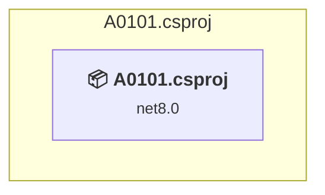

### API Compatibility

| Category | Count | Impact |
| :--- | :---: | :--- |
| 🔴 Binary Incompatible | 0 | High - Require code changes |
| 🟡 Source Incompatible | 0 | Medium - Needs re-compilation and potential conflicting API error fixing |
| 🔵 Behavioral change | 0 | Low - Behavioral changes that may require testing at runtime |
| ✅ Compatible | 32 |  |
| ***Total APIs Analyzed*** | ***32*** |  |

<a id="appendixaa0102a0102csproj"></a>
### AppendixA\A0102\A0102.csproj

#### Project Info

- **Current Target Framework:** net8.0
- **Proposed Target Framework:** net10.0
- **SDK-style**: True
- **Project Kind:** DotNetCoreApp
- **Dependencies**: 0
- **Dependants**: 0
- **Number of Files**: 1
- **Number of Files with Incidents**: 1
- **Lines of Code**: 20
- **Estimated LOC to modify**: 0+ (at least 0.0% of the project)

#### Dependency Graph

Legend:
📦 SDK-style project
⚙️ Classic project


### API Compatibility

| Category | Count | Impact |
| :--- | :---: | :--- |
| 🔴 Binary Incompatible | 0 | High - Require code changes |
| 🟡 Source Incompatible | 0 | Medium - Needs re-compilation and potential conflicting API error fixing |
| 🔵 Behavioral change | 0 | Low - Behavioral changes that may require testing at runtime |
| ✅ Compatible | 46 |  |
| ***Total APIs Analyzed*** | ***46*** |  |

<a id="appendixaa0103a0103csproj"></a>
### AppendixA\A0103\A0103.csproj

#### Project Info

- **Current Target Framework:** net8.0
- **Proposed Target Framework:** net10.0
- **SDK-style**: True
- **Project Kind:** DotNetCoreApp
- **Dependencies**: 0
- **Dependants**: 0
- **Number of Files**: 1
- **Number of Files with Incidents**: 1
- **Lines of Code**: 34
- **Estimated LOC to modify**: 0+ (at least 0.0% of the project)

#### Dependency Graph

Legend:
📦 SDK-style project
⚙️ Classic project


### API Compatibility

| Category | Count | Impact |
| :--- | :---: | :--- |
| 🔴 Binary Incompatible | 0 | High - Require code changes |
| 🟡 Source Incompatible | 0 | Medium - Needs re-compilation and potential conflicting API error fixing |
| 🔵 Behavioral change | 0 | Low - Behavioral changes that may require testing at runtime |
| ✅ Compatible | 41 |  |
| ***Total APIs Analyzed*** | ***41*** |  |

<a id="appendixaa0104a0104csproj"></a>
### AppendixA\A0104\A0104.csproj

#### Project Info

- **Current Target Framework:** net8.0
- **Proposed Target Framework:** net10.0
- **SDK-style**: True
- **Project Kind:** DotNetCoreApp
- **Dependencies**: 0
- **Dependants**: 0
- **Number of Files**: 1
- **Number of Files with Incidents**: 2
- **Lines of Code**: 19
- **Estimated LOC to modify**: 1+ (at least 5.3% of the project)

#### Dependency Graph

Legend:
📦 SDK-style project
⚙️ Classic project


### API Compatibility

| Category | Count | Impact |
| :--- | :---: | :--- |
| 🔴 Binary Incompatible | 0 | High - Require code changes |
| 🟡 Source Incompatible | 0 | Medium - Needs re-compilation and potential conflicting API error fixing |
| 🔵 Behavioral change | 1 | Low - Behavioral changes that may require testing at runtime |
| ✅ Compatible | 13 |  |
| ***Total APIs Analyzed*** | ***14*** |  |

<a id="appendixaa0105a0105csproj"></a>
### AppendixA\A0105\A0105.csproj

#### Project Info

- **Current Target Framework:** net8.0
- **Proposed Target Framework:** net10.0
- **SDK-style**: True
- **Project Kind:** DotNetCoreApp
- **Dependencies**: 0
- **Dependants**: 0
- **Number of Files**: 1
- **Number of Files with Incidents**: 1
- **Lines of Code**: 22
- **Estimated LOC to modify**: 0+ (at least 0.0% of the project)

#### Dependency Graph

Legend:
📦 SDK-style project
⚙️ Classic project

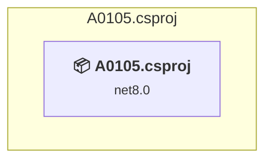

### API Compatibility

| Category | Count | Impact |
| :--- | :---: | :--- |
| 🔴 Binary Incompatible | 0 | High - Require code changes |
| 🟡 Source Incompatible | 0 | Medium - Needs re-compilation and potential conflicting API error fixing |
| 🔵 Behavioral change | 0 | Low - Behavioral changes that may require testing at runtime |
| ✅ Compatible | 19 |  |
| ***Total APIs Analyzed*** | ***19*** |  |

<a id="appendixaa0106a0106csproj"></a>
### AppendixA\A0106\A0106.csproj

#### Project Info

- **Current Target Framework:** net8.0
- **Proposed Target Framework:** net10.0
- **SDK-style**: True
- **Project Kind:** DotNetCoreApp
- **Dependencies**: 0
- **Dependants**: 0
- **Number of Files**: 1
- **Number of Files with Incidents**: 1
- **Lines of Code**: 23
- **Estimated LOC to modify**: 0+ (at least 0.0% of the project)

#### Dependency Graph

Legend:
📦 SDK-style project
⚙️ Classic project

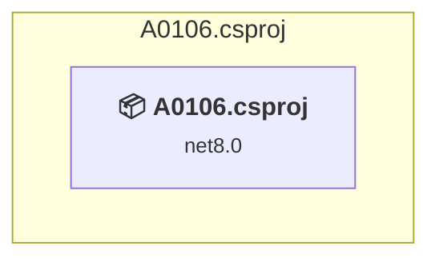

### API Compatibility

| Category | Count | Impact |
| :--- | :---: | :--- |
| 🔴 Binary Incompatible | 0 | High - Require code changes |
| 🟡 Source Incompatible | 0 | Medium - Needs re-compilation and potential conflicting API error fixing |
| 🔵 Behavioral change | 0 | Low - Behavioral changes that may require testing at runtime |
| ✅ Compatible | 25 |  |
| ***Total APIs Analyzed*** | ***25*** |  |

<a id="appendixbb0101b0101csproj"></a>
### AppendixB\B0101\B0101.csproj

#### Project Info

- **Current Target Framework:** net8.0
- **Proposed Target Framework:** net10.0
- **SDK-style**: True
- **Project Kind:** DotNetCoreApp
- **Dependencies**: 0
- **Dependants**: 0
- **Number of Files**: 1
- **Number of Files with Incidents**: 1
- **Lines of Code**: 27
- **Estimated LOC to modify**: 0+ (at least 0.0% of the project)

#### Dependency Graph

Legend:
📦 SDK-style project
⚙️ Classic project

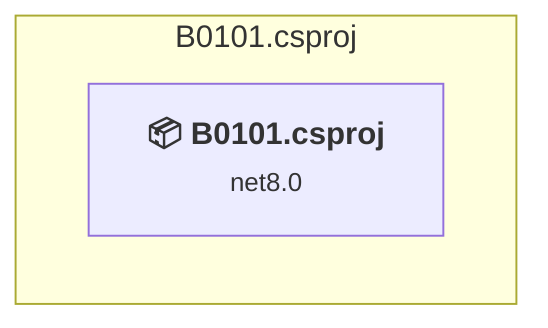

### API Compatibility

| Category | Count | Impact |
| :--- | :---: | :--- |
| 🔴 Binary Incompatible | 0 | High - Require code changes |
| 🟡 Source Incompatible | 0 | Medium - Needs re-compilation and potential conflicting API error fixing |
| 🔵 Behavioral change | 0 | Low - Behavioral changes that may require testing at runtime |
| ✅ Compatible | 20 |  |
| ***Total APIs Analyzed*** | ***20*** |  |

<a id="appendixbb0201b0201csproj"></a>
### AppendixB\B0201\B0201.csproj

#### Project Info

- **Current Target Framework:** net8.0
- **Proposed Target Framework:** net10.0
- **SDK-style**: True
- **Project Kind:** DotNetCoreApp
- **Dependencies**: 0
- **Dependants**: 0
- **Number of Files**: 1
- **Number of Files with Incidents**: 1
- **Lines of Code**: 22
- **Estimated LOC to modify**: 0+ (at least 0.0% of the project)

#### Dependency Graph

Legend:
📦 SDK-style project
⚙️ Classic project

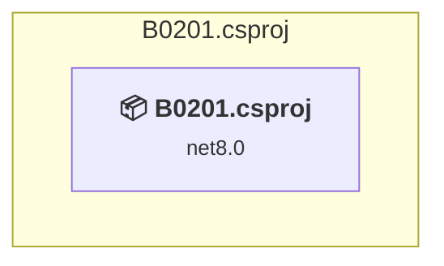

### API Compatibility

| Category | Count | Impact |
| :--- | :---: | :--- |
| 🔴 Binary Incompatible | 0 | High - Require code changes |
| 🟡 Source Incompatible | 0 | Medium - Needs re-compilation and potential conflicting API error fixing |
| 🔵 Behavioral change | 0 | Low - Behavioral changes that may require testing at runtime |
| ✅ Compatible | 15 |  |
| ***Total APIs Analyzed*** | ***15*** |  |

<a id="appendixcrxlibrarymstestsrxlibrarymstestscsproj"></a>
### AppendixC\RxLibrary.MSTests\RxLibrary.MSTests.csproj

#### Project Info

- **Current Target Framework:** net8.0
- **Proposed Target Framework:** net10.0
- **SDK-style**: True
- **Project Kind:** DotNetCoreApp
- **Dependencies**: 1
- **Dependants**: 0
- **Number of Files**: 5
- **Number of Files with Incidents**: 1
- **Lines of Code**: 229
- **Estimated LOC to modify**: 0+ (at least 0.0% of the project)

#### Dependency Graph

Legend:
📦 SDK-style project
⚙️ Classic project

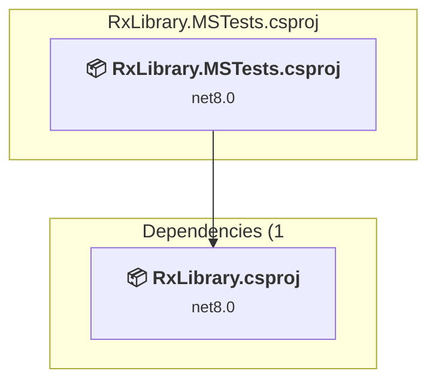

### API Compatibility

| Category | Count | Impact |
| :--- | :---: | :--- |
| 🔴 Binary Incompatible | 0 | High - Require code changes |
| 🟡 Source Incompatible | 0 | Medium - Needs re-compilation and potential conflicting API error fixing |
| 🔵 Behavioral change | 0 | Low - Behavioral changes that may require testing at runtime |
| ✅ Compatible | 431 |  |
| ***Total APIs Analyzed*** | ***431*** |  |

<a id="appendixcrxlibraryrxlibrarycsproj"></a>
### AppendixC\RxLibrary\RxLibrary.csproj

#### Project Info

- **Current Target Framework:** net8.0
- **Proposed Target Framework:** net10.0
- **SDK-style**: True
- **Project Kind:** ClassLibrary
- **Dependencies**: 0
- **Dependants**: 1
- **Number of Files**: 7
- **Number of Files with Incidents**: 1
- **Lines of Code**: 182
- **Estimated LOC to modify**: 0+ (at least 0.0% of the project)

#### Dependency Graph

Legend:
📦 SDK-style project
⚙️ Classic project

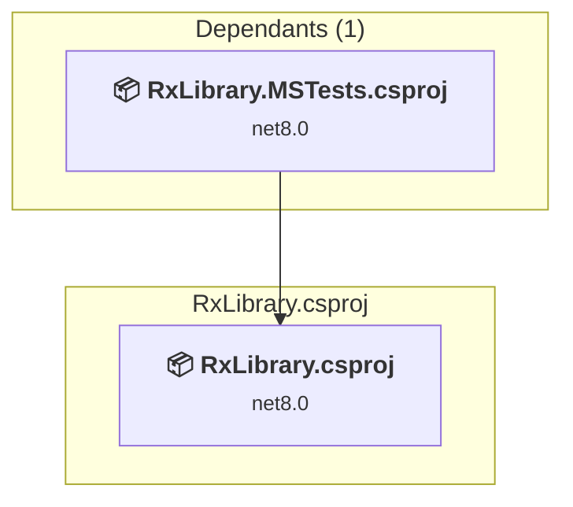

### API Compatibility

| Category | Count | Impact |
| :--- | :---: | :--- |
| 🔴 Binary Incompatible | 0 | High - Require code changes |
| 🟡 Source Incompatible | 0 | Medium - Needs re-compilation and potential conflicting API error fixing |
| 🔵 Behavioral change | 0 | Low - Behavioral changes that may require testing at runtime |
| ✅ Compatible | 213 |  |
| ***Total APIs Analyzed*** | ***213*** |  |

<a id="c01c0101introductionc0101introductioncsproj"></a>
### C01\C0101.Introduction\C0101.Introduction.csproj

#### Project Info

- **Current Target Framework:** net10.0✅
- **SDK-style**: True
- **Project Kind:** DotNetCoreApp
- **Dependencies**: 0
- **Dependants**: 0
- **Number of Files**: 1
- **Lines of Code**: 35
- **Estimated LOC to modify**: 0+ (at least 0.0% of the project)

#### Dependency Graph

Legend:
📦 SDK-style project
⚙️ Classic project


### API Compatibility

| Category | Count | Impact |
| :--- | :---: | :--- |
| 🔴 Binary Incompatible | 0 | High - Require code changes |
| 🟡 Source Incompatible | 0 | Medium - Needs re-compilation and potential conflicting API error fixing |
| 🔵 Behavioral change | 0 | Low - Behavioral changes that may require testing at runtime |
| ✅ Compatible | 0 |  |
| ***Total APIs Analyzed*** | ***0*** |  |

<a id="c01c0102shoppyexamplec0102shoppyexamplecsproj"></a>
### C01\C0102.ShoppyExample\C0102.ShoppyExample.csproj

#### Project Info

- **Current Target Framework:** net8.0
- **Proposed Target Framework:** net10.0
- **SDK-style**: True
- **Project Kind:** DotNetCoreApp
- **Dependencies**: 0
- **Dependants**: 0
- **Number of Files**: 6
- **Number of Files with Incidents**: 1
- **Lines of Code**: 142
- **Estimated LOC to modify**: 0+ (at least 0.0% of the project)

#### Dependency Graph

Legend:
📦 SDK-style project
⚙️ Classic project

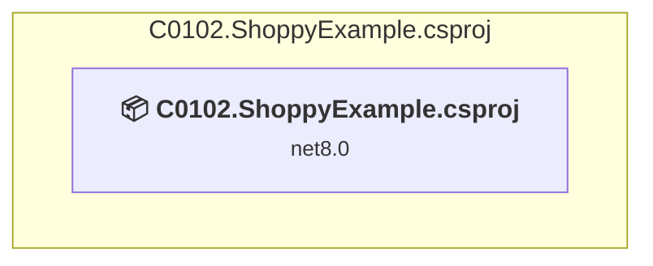

### API Compatibility

| Category | Count | Impact |
| :--- | :---: | :--- |
| 🔴 Binary Incompatible | 0 | High - Require code changes |
| 🟡 Source Incompatible | 0 | Medium - Needs re-compilation and potential conflicting API error fixing |
| 🔵 Behavioral change | 0 | Low - Behavioral changes that may require testing at runtime |
| ✅ Compatible | 172 |  |
| ***Total APIs Analyzed*** | ***172*** |  |

<a id="c01c0103asyncdemoc0103asyncdemocsproj"></a>
### C01\C0103.AsyncDemo\C0103.AsyncDemo.csproj

#### Project Info

- **Current Target Framework:** net9.0
- **Proposed Target Framework:** net10.0
- **SDK-style**: True
- **Project Kind:** DotNetCoreApp
- **Dependencies**: 0
- **Dependants**: 0
- **Number of Files**: 1
- **Number of Files with Incidents**: 2
- **Lines of Code**: 31
- **Estimated LOC to modify**: 1+ (at least 3.2% of the project)

#### Dependency Graph

Legend:
📦 SDK-style project
⚙️ Classic project

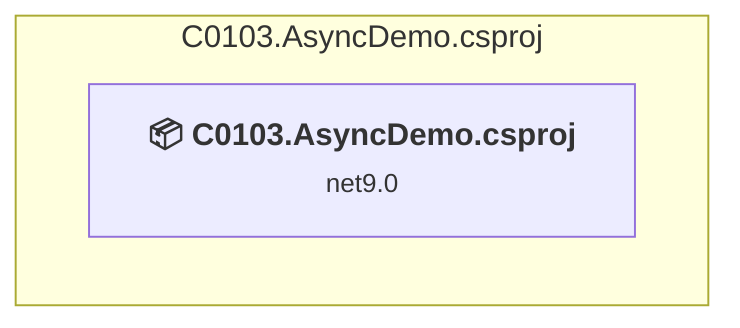

### API Compatibility

| Category | Count | Impact |
| :--- | :---: | :--- |
| 🔴 Binary Incompatible | 0 | High - Require code changes |
| 🟡 Source Incompatible | 1 | Medium - Needs re-compilation and potential conflicting API error fixing |
| 🔵 Behavioral change | 0 | Low - Behavioral changes that may require testing at runtime |
| ✅ Compatible | 51 |  |
| ***Total APIs Analyzed*** | ***52*** |  |

<a id="c02c0201eventhandlingc0201eventhandlingcsproj"></a>
### C02\C0201.EventHandling\C0201.EventHandling.csproj

#### Project Info

- **Current Target Framework:** net10.0✅
- **SDK-style**: True
- **Project Kind:** DotNetCoreApp
- **Dependencies**: 1
- **Dependants**: 0
- **Number of Files**: 2
- **Lines of Code**: 124
- **Estimated LOC to modify**: 0+ (at least 0.0% of the project)

#### Dependency Graph

Legend:
📦 SDK-style project
⚙️ Classic project

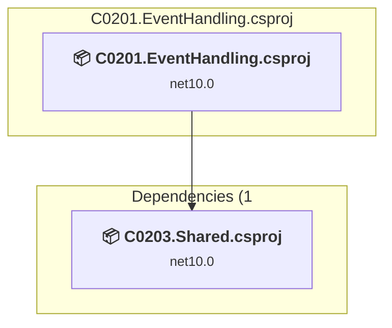

### API Compatibility

| Category | Count | Impact |
| :--- | :---: | :--- |
| 🔴 Binary Incompatible | 0 | High - Require code changes |
| 🟡 Source Incompatible | 0 | Medium - Needs re-compilation and potential conflicting API error fixing |
| 🔵 Behavioral change | 0 | Low - Behavioral changes that may require testing at runtime |
| ✅ Compatible | 0 |  |
| ***Total APIs Analyzed*** | ***0*** |  |

<a id="c02c0202firstrxc0202firstrxcsproj"></a>
### C02\C0202.FirstRx\C0202.FirstRx.csproj

#### Project Info

- **Current Target Framework:** net10.0✅
- **SDK-style**: True
- **Project Kind:** DotNetCoreApp
- **Dependencies**: 1
- **Dependants**: 0
- **Number of Files**: 3
- **Lines of Code**: 143
- **Estimated LOC to modify**: 0+ (at least 0.0% of the project)

#### Dependency Graph

Legend:
📦 SDK-style project
⚙️ Classic project

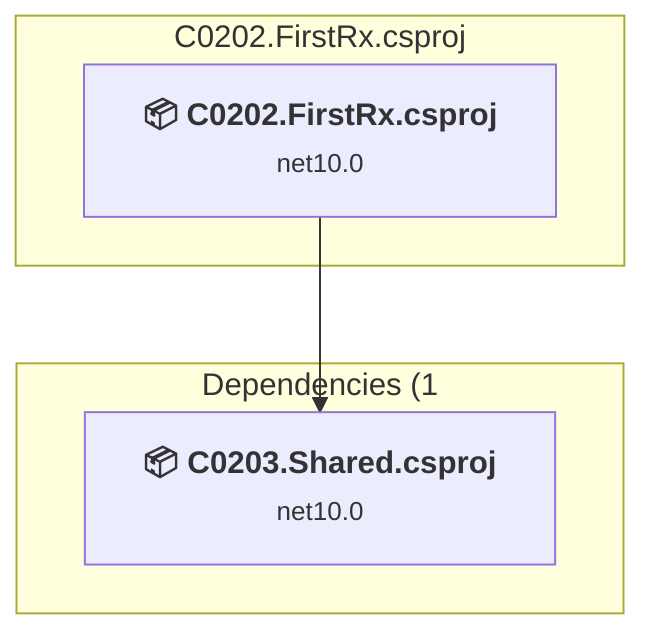

### API Compatibility

| Category | Count | Impact |
| :--- | :---: | :--- |
| 🔴 Binary Incompatible | 0 | High - Require code changes |
| 🟡 Source Incompatible | 0 | Medium - Needs re-compilation and potential conflicting API error fixing |
| 🔵 Behavioral change | 0 | Low - Behavioral changes that may require testing at runtime |
| ✅ Compatible | 0 |  |
| ***Total APIs Analyzed*** | ***0*** |  |

<a id="c02c0203sharedc0203sharedcsproj"></a>
### C02\C0203.Shared\C0203.Shared.csproj

#### Project Info

- **Current Target Framework:** net10.0✅
- **SDK-style**: True
- **Project Kind:** ClassLibrary
- **Dependencies**: 0
- **Dependants**: 2
- **Number of Files**: 4
- **Lines of Code**: 83
- **Estimated LOC to modify**: 0+ (at least 0.0% of the project)

#### Dependency Graph

Legend:
📦 SDK-style project
⚙️ Classic project

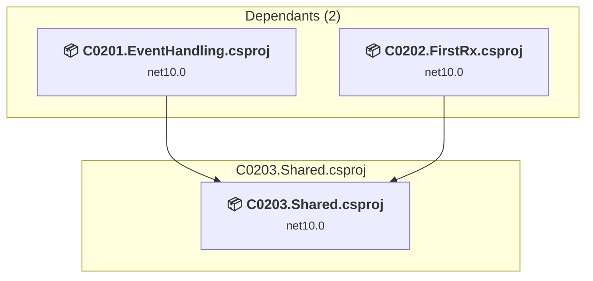

### API Compatibility

| Category | Count | Impact |
| :--- | :---: | :--- |
| 🔴 Binary Incompatible | 0 | High - Require code changes |
| 🟡 Source Incompatible | 0 | Medium - Needs re-compilation and potential conflicting API error fixing |
| 🔵 Behavioral change | 0 | Low - Behavioral changes that may require testing at runtime |
| ✅ Compatible | 0 |  |
| ***Total APIs Analyzed*** | ***0*** |  |

<a id="c02c0204streamprocessc0204streamprocesscsproj"></a>
### C02\C0204.StreamProcess\C0204.StreamProcess.csproj

#### Project Info

- **Current Target Framework:** net10.0✅
- **SDK-style**: True
- **Project Kind:** DotNetCoreApp
- **Dependencies**: 0
- **Dependants**: 0
- **Number of Files**: 5
- **Lines of Code**: 163
- **Estimated LOC to modify**: 0+ (at least 0.0% of the project)

#### Dependency Graph

Legend:
📦 SDK-style project
⚙️ Classic project

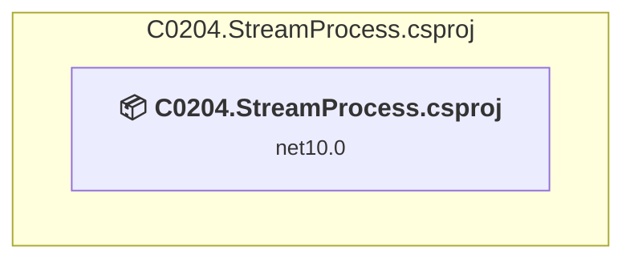

### API Compatibility

| Category | Count | Impact |
| :--- | :---: | :--- |
| 🔴 Binary Incompatible | 0 | High - Require code changes |
| 🟡 Source Incompatible | 0 | Medium - Needs re-compilation and potential conflicting API error fixing |
| 🔵 Behavioral change | 0 | Low - Behavioral changes that may require testing at runtime |
| ✅ Compatible | 0 |  |
| ***Total APIs Analyzed*** | ***0*** |  |

<a id="c03c0300sideeffectsc0300sideeffectscsproj"></a>
### C03\C0300.SideEffects\C0300.SideEffects.csproj

#### Project Info

- **Current Target Framework:** net8.0
- **Proposed Target Framework:** net10.0
- **SDK-style**: True
- **Project Kind:** DotNetCoreApp
- **Dependencies**: 0
- **Dependants**: 0
- **Number of Files**: 1
- **Number of Files with Incidents**: 1
- **Lines of Code**: 12
- **Estimated LOC to modify**: 0+ (at least 0.0% of the project)

#### Dependency Graph

Legend:
📦 SDK-style project
⚙️ Classic project

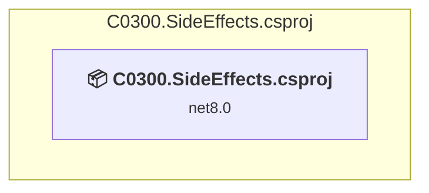

### API Compatibility

| Category | Count | Impact |
| :--- | :---: | :--- |
| 🔴 Binary Incompatible | 0 | High - Require code changes |
| 🟡 Source Incompatible | 0 | Medium - Needs re-compilation and potential conflicting API error fixing |
| 🔵 Behavioral change | 0 | Low - Behavioral changes that may require testing at runtime |
| ✅ Compatible | 13 |  |
| ***Total APIs Analyzed*** | ***13*** |  |

<a id="c03c0301delegatesc0301delegatescsproj"></a>
### C03\C0301.Delegates\C0301.Delegates.csproj

#### Project Info

- **Current Target Framework:** net8.0
- **Proposed Target Framework:** net10.0
- **SDK-style**: True
- **Project Kind:** DotNetCoreApp
- **Dependencies**: 0
- **Dependants**: 0
- **Number of Files**: 1
- **Number of Files with Incidents**: 1
- **Lines of Code**: 44
- **Estimated LOC to modify**: 0+ (at least 0.0% of the project)

#### Dependency Graph

Legend:
📦 SDK-style project
⚙️ Classic project

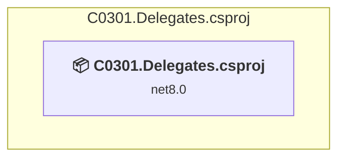

### API Compatibility

| Category | Count | Impact |
| :--- | :---: | :--- |
| 🔴 Binary Incompatible | 0 | High - Require code changes |
| 🟡 Source Incompatible | 0 | Medium - Needs re-compilation and potential conflicting API error fixing |
| 🔵 Behavioral change | 0 | Low - Behavioral changes that may require testing at runtime |
| ✅ Compatible | 51 |  |
| ***Total APIs Analyzed*** | ***51*** |  |

<a id="c03c0302anonymousmethodsc0302anonymousmethodscsproj"></a>
### C03\C0302.AnonymousMethods\C0302.AnonymousMethods.csproj

#### Project Info

- **Current Target Framework:** net8.0
- **Proposed Target Framework:** net10.0
- **SDK-style**: True
- **Project Kind:** DotNetCoreApp
- **Dependencies**: 0
- **Dependants**: 0
- **Number of Files**: 1
- **Number of Files with Incidents**: 1
- **Lines of Code**: 59
- **Estimated LOC to modify**: 0+ (at least 0.0% of the project)

#### Dependency Graph

Legend:
📦 SDK-style project
⚙️ Classic project

```mermaid
flowchart TB
    subgraph current["C0302.AnonymousMethods.csproj"]
        MAIN["<b>📦&nbsp;C0302.AnonymousMethods.csproj</b><br/><small>net8.0</small>"]
        click MAIN "#c03c0302anonymousmethodsc0302anonymousmethodscsproj"
    end

```

### API Compatibility

| Category | Count | Impact |
| :--- | :---: | :--- |
| 🔴 Binary Incompatible | 0 | High - Require code changes |
| 🟡 Source Incompatible | 0 | Medium - Needs re-compilation and potential conflicting API error fixing |
| 🔵 Behavioral change | 0 | Low - Behavioral changes that may require testing at runtime |
| ✅ Compatible | 58 |  |
| ***Total APIs Analyzed*** | ***58*** |  |

<a id="c03c0303lambdaexpressionsc0303lambdaexpressionscsproj"></a>
### C03\C0303.LambdaExpressions\C0303.LambdaExpressions.csproj

#### Project Info

- **Current Target Framework:** net8.0
- **Proposed Target Framework:** net10.0
- **SDK-style**: True
- **Project Kind:** DotNetCoreApp
- **Dependencies**: 0
- **Dependants**: 0
- **Number of Files**: 1
- **Number of Files with Incidents**: 1
- **Lines of Code**: 19
- **Estimated LOC to modify**: 0+ (at least 0.0% of the project)

#### Dependency Graph

Legend:
📦 SDK-style project
⚙️ Classic project

```mermaid
flowchart TB
    subgraph current["C0303.LambdaExpressions.csproj"]
        MAIN["<b>📦&nbsp;C0303.LambdaExpressions.csproj</b><br/><small>net8.0</small>"]
        click MAIN "#c03c0303lambdaexpressionsc0303lambdaexpressionscsproj"
    end

```

### API Compatibility

| Category | Count | Impact |
| :--- | :---: | :--- |
| 🔴 Binary Incompatible | 0 | High - Require code changes |
| 🟡 Source Incompatible | 0 | Medium - Needs re-compilation and potential conflicting API error fixing |
| 🔵 Behavioral change | 0 | Low - Behavioral changes that may require testing at runtime |
| ✅ Compatible | 29 |  |
| ***Total APIs Analyzed*** | ***29*** |  |

<a id="c03c0304actionfuncc0304actionfunccsproj"></a>
### C03\C0304.ActionFunc\C0304.ActionFunc.csproj

#### Project Info

- **Current Target Framework:** net8.0
- **Proposed Target Framework:** net10.0
- **SDK-style**: True
- **Project Kind:** DotNetCoreApp
- **Dependencies**: 0
- **Dependants**: 0
- **Number of Files**: 1
- **Number of Files with Incidents**: 1
- **Lines of Code**: 41
- **Estimated LOC to modify**: 0+ (at least 0.0% of the project)

#### Dependency Graph

Legend:
📦 SDK-style project
⚙️ Classic project

```mermaid
flowchart TB
    subgraph current["C0304.ActionFunc.csproj"]
        MAIN["<b>📦&nbsp;C0304.ActionFunc.csproj</b><br/><small>net8.0</small>"]
        click MAIN "#c03c0304actionfuncc0304actionfunccsproj"
    end

```

### API Compatibility

| Category | Count | Impact |
| :--- | :---: | :--- |
| 🔴 Binary Incompatible | 0 | High - Require code changes |
| 🟡 Source Incompatible | 0 | Medium - Needs re-compilation and potential conflicting API error fixing |
| 🔵 Behavioral change | 0 | Low - Behavioral changes that may require testing at runtime |
| ✅ Compatible | 24 |  |
| ***Total APIs Analyzed*** | ***24*** |  |

<a id="c03c0305strategypatternc0305strategypatterncsproj"></a>
### C03\C0305.StrategyPattern\C0305.StrategyPattern.csproj

#### Project Info

- **Current Target Framework:** net8.0
- **Proposed Target Framework:** net10.0
- **SDK-style**: True
- **Project Kind:** DotNetCoreApp
- **Dependencies**: 0
- **Dependants**: 0
- **Number of Files**: 1
- **Number of Files with Incidents**: 1
- **Lines of Code**: 50
- **Estimated LOC to modify**: 0+ (at least 0.0% of the project)

#### Dependency Graph

Legend:
📦 SDK-style project
⚙️ Classic project

```mermaid
flowchart TB
    subgraph current["C0305.StrategyPattern.csproj"]
        MAIN["<b>📦&nbsp;C0305.StrategyPattern.csproj</b><br/><small>net8.0</small>"]
        click MAIN "#c03c0305strategypatternc0305strategypatterncsproj"
    end

```

### API Compatibility

| Category | Count | Impact |
| :--- | :---: | :--- |
| 🔴 Binary Incompatible | 0 | High - Require code changes |
| 🟡 Source Incompatible | 0 | Medium - Needs re-compilation and potential conflicting API error fixing |
| 🔵 Behavioral change | 0 | Low - Behavioral changes that may require testing at runtime |
| ✅ Compatible | 77 |  |
| ***Total APIs Analyzed*** | ***77*** |  |

<a id="c03c0306factorypatternc0306factorypatterncsproj"></a>
### C03\C0306.FactoryPattern\C0306.FactoryPattern.csproj

#### Project Info

- **Current Target Framework:** net8.0
- **Proposed Target Framework:** net10.0
- **SDK-style**: True
- **Project Kind:** DotNetCoreApp
- **Dependencies**: 0
- **Dependants**: 0
- **Number of Files**: 1
- **Number of Files with Incidents**: 1
- **Lines of Code**: 39
- **Estimated LOC to modify**: 0+ (at least 0.0% of the project)

#### Dependency Graph

Legend:
📦 SDK-style project
⚙️ Classic project

```mermaid
flowchart TB
    subgraph current["C0306.FactoryPattern.csproj"]
        MAIN["<b>📦&nbsp;C0306.FactoryPattern.csproj</b><br/><small>net8.0</small>"]
        click MAIN "#c03c0306factorypatternc0306factorypatterncsproj"
    end

```

### API Compatibility

| Category | Count | Impact |
| :--- | :---: | :--- |
| 🔴 Binary Incompatible | 0 | High - Require code changes |
| 🟡 Source Incompatible | 0 | Medium - Needs re-compilation and potential conflicting API error fixing |
| 🔵 Behavioral change | 0 | Low - Behavioral changes that may require testing at runtime |
| ✅ Compatible | 6 |  |
| ***Total APIs Analyzed*** | ***6*** |  |

<a id="c03c0307extensionmethodsc0307extensionmethodscsproj"></a>
### C03\C0307.ExtensionMethods\C0307.ExtensionMethods.csproj

#### Project Info

- **Current Target Framework:** net8.0
- **Proposed Target Framework:** net10.0
- **SDK-style**: True
- **Project Kind:** DotNetCoreApp
- **Dependencies**: 0
- **Dependants**: 0
- **Number of Files**: 1
- **Number of Files with Incidents**: 1
- **Lines of Code**: 30
- **Estimated LOC to modify**: 0+ (at least 0.0% of the project)

#### Dependency Graph

Legend:
📦 SDK-style project
⚙️ Classic project

```mermaid
flowchart TB
    subgraph current["C0307.ExtensionMethods.csproj"]
        MAIN["<b>📦&nbsp;C0307.ExtensionMethods.csproj</b><br/><small>net8.0</small>"]
        click MAIN "#c03c0307extensionmethodsc0307extensionmethodscsproj"
    end

```

### API Compatibility

| Category | Count | Impact |
| :--- | :---: | :--- |
| 🔴 Binary Incompatible | 0 | High - Require code changes |
| 🟡 Source Incompatible | 0 | Medium - Needs re-compilation and potential conflicting API error fixing |
| 🔵 Behavioral change | 0 | Low - Behavioral changes that may require testing at runtime |
| ✅ Compatible | 20 |  |
| ***Total APIs Analyzed*** | ***20*** |  |

<a id="c03c0308fluentc0308fluentcsproj"></a>
### C03\C0308.Fluent\C0308.Fluent.csproj

#### Project Info

- **Current Target Framework:** net8.0
- **Proposed Target Framework:** net10.0
- **SDK-style**: True
- **Project Kind:** DotNetCoreApp
- **Dependencies**: 0
- **Dependants**: 0
- **Number of Files**: 1
- **Number of Files with Incidents**: 1
- **Lines of Code**: 43
- **Estimated LOC to modify**: 0+ (at least 0.0% of the project)

#### Dependency Graph

Legend:
📦 SDK-style project
⚙️ Classic project

```mermaid
flowchart TB
    subgraph current["C0308.Fluent.csproj"]
        MAIN["<b>📦&nbsp;C0308.Fluent.csproj</b><br/><small>net8.0</small>"]
        click MAIN "#c03c0308fluentc0308fluentcsproj"
    end

```

### API Compatibility

| Category | Count | Impact |
| :--- | :---: | :--- |
| 🔴 Binary Incompatible | 0 | High - Require code changes |
| 🟡 Source Incompatible | 0 | Medium - Needs re-compilation and potential conflicting API error fixing |
| 🔵 Behavioral change | 0 | Low - Behavioral changes that may require testing at runtime |
| ✅ Compatible | 35 |  |
| ***Total APIs Analyzed*** | ***35*** |  |

<a id="c03c0309linqsc0309linqscsproj"></a>
### C03\C0309.LINQs\C0309.LINQs.csproj

#### Project Info

- **Current Target Framework:** net8.0
- **Proposed Target Framework:** net10.0
- **SDK-style**: True
- **Project Kind:** DotNetCoreApp
- **Dependencies**: 0
- **Dependants**: 0
- **Number of Files**: 1
- **Number of Files with Incidents**: 1
- **Lines of Code**: 74
- **Estimated LOC to modify**: 0+ (at least 0.0% of the project)

#### Dependency Graph

Legend:
📦 SDK-style project
⚙️ Classic project

```mermaid
flowchart TB
    subgraph current["C0309.LINQs.csproj"]
        MAIN["<b>📦&nbsp;C0309.LINQs.csproj</b><br/><small>net8.0</small>"]
        click MAIN "#c03c0309linqsc0309linqscsproj"
    end

```

### API Compatibility

| Category | Count | Impact |
| :--- | :---: | :--- |
| 🔴 Binary Incompatible | 0 | High - Require code changes |
| 🟡 Source Incompatible | 0 | Medium - Needs re-compilation and potential conflicting API error fixing |
| 🔵 Behavioral change | 0 | Low - Behavioral changes that may require testing at runtime |
| ✅ Compatible | 96 |  |
| ***Total APIs Analyzed*** | ***96*** |  |

<a id="c03c0310anonymoustypesc0310anonymoustypescsproj"></a>
### C03\C0310.AnonymousTypes\C0310.AnonymousTypes.csproj

#### Project Info

- **Current Target Framework:** net8.0
- **Proposed Target Framework:** net10.0
- **SDK-style**: True
- **Project Kind:** DotNetCoreApp
- **Dependencies**: 0
- **Dependants**: 0
- **Number of Files**: 1
- **Number of Files with Incidents**: 1
- **Lines of Code**: 67
- **Estimated LOC to modify**: 0+ (at least 0.0% of the project)

#### Dependency Graph

Legend:
📦 SDK-style project
⚙️ Classic project

```mermaid
flowchart TB
    subgraph current["C0310.AnonymousTypes.csproj"]
        MAIN["<b>📦&nbsp;C0310.AnonymousTypes.csproj</b><br/><small>net8.0</small>"]
        click MAIN "#c03c0310anonymoustypesc0310anonymoustypescsproj"
    end

```

### API Compatibility

| Category | Count | Impact |
| :--- | :---: | :--- |
| 🔴 Binary Incompatible | 0 | High - Require code changes |
| 🟡 Source Incompatible | 0 | Medium - Needs re-compilation and potential conflicting API error fixing |
| 🔵 Behavioral change | 0 | Low - Behavioral changes that may require testing at runtime |
| ✅ Compatible | 65 |  |
| ***Total APIs Analyzed*** | ***65*** |  |

<a id="c03c0311yieldreturnc0311yieldreturncsproj"></a>
### C03\C0311.YieldReturn\C0311.YieldReturn.csproj

#### Project Info

- **Current Target Framework:** net8.0
- **Proposed Target Framework:** net10.0
- **SDK-style**: True
- **Project Kind:** DotNetCoreApp
- **Dependencies**: 0
- **Dependants**: 0
- **Number of Files**: 1
- **Number of Files with Incidents**: 1
- **Lines of Code**: 48
- **Estimated LOC to modify**: 0+ (at least 0.0% of the project)

#### Dependency Graph

Legend:
📦 SDK-style project
⚙️ Classic project

```mermaid
flowchart TB
    subgraph current["C0311.YieldReturn.csproj"]
        MAIN["<b>📦&nbsp;C0311.YieldReturn.csproj</b><br/><small>net8.0</small>"]
        click MAIN "#c03c0311yieldreturnc0311yieldreturncsproj"
    end

```

### API Compatibility

| Category | Count | Impact |
| :--- | :---: | :--- |
| 🔴 Binary Incompatible | 0 | High - Require code changes |
| 🟡 Source Incompatible | 0 | Medium - Needs re-compilation and potential conflicting API error fixing |
| 🔵 Behavioral change | 0 | Low - Behavioral changes that may require testing at runtime |
| ✅ Compatible | 17 |  |
| ***Total APIs Analyzed*** | ***17*** |  |

<a id="c03c0312deferredextensionsc0312deferredextensionscsproj"></a>
### C03\C0312.DeferredExtensions\C0312.DeferredExtensions.csproj

#### Project Info

- **Current Target Framework:** net8.0
- **Proposed Target Framework:** net10.0
- **SDK-style**: True
- **Project Kind:** DotNetCoreApp
- **Dependencies**: 0
- **Dependants**: 0
- **Number of Files**: 1
- **Number of Files with Incidents**: 1
- **Lines of Code**: 32
- **Estimated LOC to modify**: 0+ (at least 0.0% of the project)

#### Dependency Graph

Legend:
📦 SDK-style project
⚙️ Classic project

```mermaid
flowchart TB
    subgraph current["C0312.DeferredExtensions.csproj"]
        MAIN["<b>📦&nbsp;C0312.DeferredExtensions.csproj</b><br/><small>net8.0</small>"]
        click MAIN "#c03c0312deferredextensionsc0312deferredextensionscsproj"
    end

```

### API Compatibility

| Category | Count | Impact |
| :--- | :---: | :--- |
| 🔴 Binary Incompatible | 0 | High - Require code changes |
| 🟡 Source Incompatible | 0 | Medium - Needs re-compilation and potential conflicting API error fixing |
| 🔵 Behavioral change | 0 | Low - Behavioral changes that may require testing at runtime |
| ✅ Compatible | 16 |  |
| ***Total APIs Analyzed*** | ***16*** |  |

<a id="c04c00derivefrombasec00derivefrombasecsproj"></a>
### C04\C00DeriveFromBase\C00DeriveFromBase.csproj

#### Project Info

- **Current Target Framework:** net9.0
- **Proposed Target Framework:** net10.0
- **SDK-style**: True
- **Project Kind:** DotNetCoreApp
- **Dependencies**: 0
- **Dependants**: 0
- **Number of Files**: 1
- **Number of Files with Incidents**: 1
- **Lines of Code**: 43
- **Estimated LOC to modify**: 0+ (at least 0.0% of the project)

#### Dependency Graph

Legend:
📦 SDK-style project
⚙️ Classic project

```mermaid
flowchart TB
    subgraph current["C00DeriveFromBase.csproj"]
        MAIN["<b>📦&nbsp;C00DeriveFromBase.csproj</b><br/><small>net9.0</small>"]
        click MAIN "#c04c00derivefrombasec00derivefrombasecsproj"
    end

```

### API Compatibility

| Category | Count | Impact |
| :--- | :---: | :--- |
| 🔴 Binary Incompatible | 0 | High - Require code changes |
| 🟡 Source Incompatible | 0 | Medium - Needs re-compilation and potential conflicting API error fixing |
| 🔵 Behavioral change | 0 | Low - Behavioral changes that may require testing at runtime |
| ✅ Compatible | 39 |  |
| ***Total APIs Analyzed*** | ***39*** |  |

<a id="c04p090p090csproj"></a>
### C04\P090\P090.csproj

#### Project Info

- **Current Target Framework:** net8.0
- **Proposed Target Framework:** net10.0
- **SDK-style**: True
- **Project Kind:** DotNetCoreApp
- **Dependencies**: 1
- **Dependants**: 0
- **Number of Files**: 3
- **Number of Files with Incidents**: 1
- **Lines of Code**: 68
- **Estimated LOC to modify**: 0+ (at least 0.0% of the project)

#### Dependency Graph

Legend:
📦 SDK-style project
⚙️ Classic project

```mermaid
flowchart TB
    subgraph current["P090.csproj"]
        MAIN["<b>📦&nbsp;P090.csproj</b><br/><small>net8.0</small>"]
        click MAIN "#c04p090p090csproj"
    end
    subgraph downstream["Dependencies (1"]
        P1["<b>📦&nbsp;Helpers.csproj</b><br/><small>net8.0</small>"]
        click P1 "#commonhelpershelperscsproj"
    end
    MAIN --> P1

```

### API Compatibility

| Category | Count | Impact |
| :--- | :---: | :--- |
| 🔴 Binary Incompatible | 0 | High - Require code changes |
| 🟡 Source Incompatible | 0 | Medium - Needs re-compilation and potential conflicting API error fixing |
| 🔵 Behavioral change | 0 | Low - Behavioral changes that may require testing at runtime |
| ✅ Compatible | 71 |  |
| ***Total APIs Analyzed*** | ***71*** |  |

<a id="c04p093p093csproj"></a>
### C04\P093\P093.csproj

#### Project Info

- **Current Target Framework:** net9.0
- **Proposed Target Framework:** net10.0
- **SDK-style**: True
- **Project Kind:** DotNetCoreApp
- **Dependencies**: 1
- **Dependants**: 0
- **Number of Files**: 6
- **Number of Files with Incidents**: 1
- **Lines of Code**: 82
- **Estimated LOC to modify**: 0+ (at least 0.0% of the project)

#### Dependency Graph

Legend:
📦 SDK-style project
⚙️ Classic project

```mermaid
flowchart TB
    subgraph current["P093.csproj"]
        MAIN["<b>📦&nbsp;P093.csproj</b><br/><small>net9.0</small>"]
        click MAIN "#c04p093p093csproj"
    end
    subgraph downstream["Dependencies (1"]
        P1["<b>📦&nbsp;Helpers.csproj</b><br/><small>net8.0</small>"]
        click P1 "#commonhelpershelperscsproj"
    end
    MAIN --> P1

```

### API Compatibility

| Category | Count | Impact |
| :--- | :---: | :--- |
| 🔴 Binary Incompatible | 0 | High - Require code changes |
| 🟡 Source Incompatible | 0 | Medium - Needs re-compilation and potential conflicting API error fixing |
| 🔵 Behavioral change | 0 | Low - Behavioral changes that may require testing at runtime |
| ✅ Compatible | 51 |  |
| ***Total APIs Analyzed*** | ***51*** |  |

<a id="c04p093simplestobservablebasep093simplestobservablebasecsproj"></a>
### C04\P093SimplestObservableBase\P093SimplestObservableBase.csproj

#### Project Info

- **Current Target Framework:** net9.0
- **Proposed Target Framework:** net10.0
- **SDK-style**: True
- **Project Kind:** DotNetCoreApp
- **Dependencies**: 1
- **Dependants**: 0
- **Number of Files**: 1
- **Number of Files with Incidents**: 1
- **Lines of Code**: 26
- **Estimated LOC to modify**: 0+ (at least 0.0% of the project)

#### Dependency Graph

Legend:
📦 SDK-style project
⚙️ Classic project

```mermaid
flowchart TB
    subgraph current["P093SimplestObservableBase.csproj"]
        MAIN["<b>📦&nbsp;P093SimplestObservableBase.csproj</b><br/><small>net9.0</small>"]
        click MAIN "#c04p093simplestobservablebasep093simplestobservablebasecsproj"
    end
    subgraph downstream["Dependencies (1"]
        P1["<b>📦&nbsp;Helpers.csproj</b><br/><small>net8.0</small>"]
        click P1 "#commonhelpershelperscsproj"
    end
    MAIN --> P1

```

### API Compatibility

| Category | Count | Impact |
| :--- | :---: | :--- |
| 🔴 Binary Incompatible | 0 | High - Require code changes |
| 🟡 Source Incompatible | 0 | Medium - Needs re-compilation and potential conflicting API error fixing |
| 🔵 Behavioral change | 0 | Low - Behavioral changes that may require testing at runtime |
| ✅ Compatible | 21 |  |
| ***Total APIs Analyzed*** | ***21*** |  |

<a id="c04p094p094csproj"></a>
### C04\P094\P094.csproj

#### Project Info

- **Current Target Framework:** net8.0
- **Proposed Target Framework:** net10.0
- **SDK-style**: True
- **Project Kind:** DotNetCoreApp
- **Dependencies**: 1
- **Dependants**: 0
- **Number of Files**: 9
- **Number of Files with Incidents**: 1
- **Lines of Code**: 338
- **Estimated LOC to modify**: 0+ (at least 0.0% of the project)

#### Dependency Graph

Legend:
📦 SDK-style project
⚙️ Classic project

```mermaid
flowchart TB
    subgraph current["P094.csproj"]
        MAIN["<b>📦&nbsp;P094.csproj</b><br/><small>net8.0</small>"]
        click MAIN "#c04p094p094csproj"
    end
    subgraph downstream["Dependencies (1"]
        P1["<b>📦&nbsp;Helpers.csproj</b><br/><small>net8.0</small>"]
        click P1 "#commonhelpershelperscsproj"
    end
    MAIN --> P1

```

### API Compatibility

| Category | Count | Impact |
| :--- | :---: | :--- |
| 🔴 Binary Incompatible | 0 | High - Require code changes |
| 🟡 Source Incompatible | 0 | Medium - Needs re-compilation and potential conflicting API error fixing |
| 🔵 Behavioral change | 0 | Low - Behavioral changes that may require testing at runtime |
| ✅ Compatible | 199 |  |
| ***Total APIs Analyzed*** | ***199*** |  |

<a id="c04p094observablebasep094observablebasecsproj"></a>
### C04\P094ObservableBase\P094ObservableBase.csproj

#### Project Info

- **Current Target Framework:** net9.0
- **Proposed Target Framework:** net10.0
- **SDK-style**: True
- **Project Kind:** DotNetCoreApp
- **Dependencies**: 1
- **Dependants**: 0
- **Number of Files**: 1
- **Number of Files with Incidents**: 1
- **Lines of Code**: 37
- **Estimated LOC to modify**: 0+ (at least 0.0% of the project)

#### Dependency Graph

Legend:
📦 SDK-style project
⚙️ Classic project

```mermaid
flowchart TB
    subgraph current["P094ObservableBase.csproj"]
        MAIN["<b>📦&nbsp;P094ObservableBase.csproj</b><br/><small>net9.0</small>"]
        click MAIN "#c04p094observablebasep094observablebasecsproj"
    end
    subgraph downstream["Dependencies (1"]
        P1["<b>📦&nbsp;Helpers.csproj</b><br/><small>net8.0</small>"]
        click P1 "#commonhelpershelperscsproj"
    end
    MAIN --> P1

```

### API Compatibility

| Category | Count | Impact |
| :--- | :---: | :--- |
| 🔴 Binary Incompatible | 0 | High - Require code changes |
| 🟡 Source Incompatible | 0 | Medium - Needs re-compilation and potential conflicting API error fixing |
| 🔵 Behavioral change | 0 | Low - Behavioral changes that may require testing at runtime |
| ✅ Compatible | 30 |  |
| ***Total APIs Analyzed*** | ***30*** |  |

<a id="c04p094simpleclientp094simpleclientcsproj"></a>
### C04\P094SimpleClient\P094SimpleClient.csproj

#### Project Info

- **Current Target Framework:** net9.0
- **Proposed Target Framework:** net10.0
- **SDK-style**: True
- **Project Kind:** DotNetCoreApp
- **Dependencies**: 1
- **Dependants**: 0
- **Number of Files**: 1
- **Number of Files with Incidents**: 1
- **Lines of Code**: 132
- **Estimated LOC to modify**: 0+ (at least 0.0% of the project)

#### Dependency Graph

Legend:
📦 SDK-style project
⚙️ Classic project

```mermaid
flowchart TB
    subgraph current["P094SimpleClient.csproj"]
        MAIN["<b>📦&nbsp;P094SimpleClient.csproj</b><br/><small>net9.0</small>"]
        click MAIN "#c04p094simpleclientp094simpleclientcsproj"
    end
    subgraph downstream["Dependencies (1"]
        P1["<b>📦&nbsp;Helpers.csproj</b><br/><small>net8.0</small>"]
        click P1 "#commonhelpershelperscsproj"
    end
    MAIN --> P1

```

### API Compatibility

| Category | Count | Impact |
| :--- | :---: | :--- |
| 🔴 Binary Incompatible | 0 | High - Require code changes |
| 🟡 Source Incompatible | 0 | Medium - Needs re-compilation and potential conflicting API error fixing |
| 🔵 Behavioral change | 0 | Low - Behavioral changes that may require testing at runtime |
| ✅ Compatible | 84 |  |
| ***Total APIs Analyzed*** | ***84*** |  |

<a id="c04p097p097csproj"></a>
### C04\P097\P097.csproj

#### Project Info

- **Current Target Framework:** net8.0
- **Proposed Target Framework:** net10.0
- **SDK-style**: True
- **Project Kind:** DotNetCoreApp
- **Dependencies**: 1
- **Dependants**: 0
- **Number of Files**: 3
- **Number of Files with Incidents**: 1
- **Lines of Code**: 123
- **Estimated LOC to modify**: 0+ (at least 0.0% of the project)

#### Dependency Graph

Legend:
📦 SDK-style project
⚙️ Classic project

```mermaid
flowchart TB
    subgraph current["P097.csproj"]
        MAIN["<b>📦&nbsp;P097.csproj</b><br/><small>net8.0</small>"]
        click MAIN "#c04p097p097csproj"
    end
    subgraph downstream["Dependencies (1"]
        P1["<b>📦&nbsp;Helpers.csproj</b><br/><small>net8.0</small>"]
        click P1 "#commonhelpershelperscsproj"
    end
    MAIN --> P1

```

### API Compatibility

| Category | Count | Impact |
| :--- | :---: | :--- |
| 🔴 Binary Incompatible | 0 | High - Require code changes |
| 🟡 Source Incompatible | 0 | Medium - Needs re-compilation and potential conflicting API error fixing |
| 🔵 Behavioral change | 0 | Low - Behavioral changes that may require testing at runtime |
| ✅ Compatible | 73 |  |
| ***Total APIs Analyzed*** | ***73*** |  |

<a id="c04p100p100csproj"></a>
### C04\P100\P100.csproj

#### Project Info

- **Current Target Framework:** net8.0-windows7.0
- **Proposed Target Framework:** net10.0-windows
- **SDK-style**: True
- **Project Kind:** Wpf
- **Dependencies**: 0
- **Dependants**: 0
- **Number of Files**: 3
- **Number of Files with Incidents**: 4
- **Lines of Code**: 52
- **Estimated LOC to modify**: 33+ (at least 63.5% of the project)

#### Dependency Graph

Legend:
📦 SDK-style project
⚙️ Classic project

```mermaid
flowchart TB
    subgraph current["P100.csproj"]
        MAIN["<b>📦&nbsp;P100.csproj</b><br/><small>net8.0-windows7.0</small>"]
        click MAIN "#c04p100p100csproj"
    end

```

### API Compatibility

| Category | Count | Impact |
| :--- | :---: | :--- |
| 🔴 Binary Incompatible | 28 | High - Require code changes |
| 🟡 Source Incompatible | 0 | Medium - Needs re-compilation and potential conflicting API error fixing |
| 🔵 Behavioral change | 5 | Low - Behavioral changes that may require testing at runtime |
| ✅ Compatible | 39 |  |
| ***Total APIs Analyzed*** | ***72*** |  |

#### Project Technologies and Features

| Technology | Issues | Percentage | Migration Path |
| :--- | :---: | :---: | :--- |
| WPF (Windows Presentation Foundation) | 11 | 33.3% | WPF APIs for building Windows desktop applications with XAML-based UI that are available in .NET on Windows. WPF provides rich desktop UI capabilities with data binding and styling. Enable Windows Desktop support: Option 1 (Recommended): Target net9.0-windows; Option 2: Add <UseWindowsDesktop>true</UseWindowsDesktop>. |

<a id="c04p102p102csproj"></a>
### C04\P102\P102.csproj

#### Project Info

- **Current Target Framework:** net8.0
- **Proposed Target Framework:** net10.0
- **SDK-style**: True
- **Project Kind:** DotNetCoreApp
- **Dependencies**: 1
- **Dependants**: 0
- **Number of Files**: 2
- **Number of Files with Incidents**: 1
- **Lines of Code**: 66
- **Estimated LOC to modify**: 0+ (at least 0.0% of the project)

#### Dependency Graph

Legend:
📦 SDK-style project
⚙️ Classic project

```mermaid
flowchart TB
    subgraph current["P102.csproj"]
        MAIN["<b>📦&nbsp;P102.csproj</b><br/><small>net8.0</small>"]
        click MAIN "#c04p102p102csproj"
    end
    subgraph downstream["Dependencies (1"]
        P1["<b>📦&nbsp;Helpers.csproj</b><br/><small>net8.0</small>"]
        click P1 "#commonhelpershelperscsproj"
    end
    MAIN --> P1

```

### API Compatibility

| Category | Count | Impact |
| :--- | :---: | :--- |
| 🔴 Binary Incompatible | 0 | High - Require code changes |
| 🟡 Source Incompatible | 0 | Medium - Needs re-compilation and potential conflicting API error fixing |
| 🔵 Behavioral change | 0 | Low - Behavioral changes that may require testing at runtime |
| ✅ Compatible | 85 |  |
| ***Total APIs Analyzed*** | ***85*** |  |

<a id="c04p102oneparamp102oneparamcsproj"></a>
### C04\P102OneParam\P102OneParam.csproj

#### Project Info

- **Current Target Framework:** net9.0
- **Proposed Target Framework:** net10.0
- **SDK-style**: True
- **Project Kind:** DotNetCoreApp
- **Dependencies**: 0
- **Dependants**: 0
- **Number of Files**: 2
- **Number of Files with Incidents**: 1
- **Lines of Code**: 40
- **Estimated LOC to modify**: 0+ (at least 0.0% of the project)

#### Dependency Graph

Legend:
📦 SDK-style project
⚙️ Classic project

```mermaid
flowchart TB
    subgraph current["P102OneParam.csproj"]
        MAIN["<b>📦&nbsp;P102OneParam.csproj</b><br/><small>net9.0</small>"]
        click MAIN "#c04p102oneparamp102oneparamcsproj"
    end

```

### API Compatibility

| Category | Count | Impact |
| :--- | :---: | :--- |
| 🔴 Binary Incompatible | 0 | High - Require code changes |
| 🟡 Source Incompatible | 0 | Medium - Needs re-compilation and potential conflicting API error fixing |
| 🔵 Behavioral change | 0 | Low - Behavioral changes that may require testing at runtime |
| ✅ Compatible | 36 |  |
| ***Total APIs Analyzed*** | ***36*** |  |

<a id="c04p105p105csproj"></a>
### C04\P105\P105.csproj

#### Project Info

- **Current Target Framework:** net8.0
- **Proposed Target Framework:** net10.0
- **SDK-style**: True
- **Project Kind:** DotNetCoreApp
- **Dependencies**: 0
- **Dependants**: 0
- **Number of Files**: 1
- **Number of Files with Incidents**: 1
- **Lines of Code**: 34
- **Estimated LOC to modify**: 0+ (at least 0.0% of the project)

#### Dependency Graph

Legend:
📦 SDK-style project
⚙️ Classic project

```mermaid
flowchart TB
    subgraph current["P105.csproj"]
        MAIN["<b>📦&nbsp;P105.csproj</b><br/><small>net8.0</small>"]
        click MAIN "#c04p105p105csproj"
    end

```

### API Compatibility

| Category | Count | Impact |
| :--- | :---: | :--- |
| 🔴 Binary Incompatible | 0 | High - Require code changes |
| 🟡 Source Incompatible | 0 | Medium - Needs re-compilation and potential conflicting API error fixing |
| 🔵 Behavioral change | 0 | Low - Behavioral changes that may require testing at runtime |
| ✅ Compatible | 23 |  |
| ***Total APIs Analyzed*** | ***23*** |  |

<a id="c04p107p107csproj"></a>
### C04\P107\P107.csproj

#### Project Info

- **Current Target Framework:** net8.0
- **Proposed Target Framework:** net10.0
- **SDK-style**: True
- **Project Kind:** DotNetCoreApp
- **Dependencies**: 0
- **Dependants**: 0
- **Number of Files**: 1
- **Number of Files with Incidents**: 1
- **Lines of Code**: 46
- **Estimated LOC to modify**: 0+ (at least 0.0% of the project)

#### Dependency Graph

Legend:
📦 SDK-style project
⚙️ Classic project

```mermaid
flowchart TB
    subgraph current["P107.csproj"]
        MAIN["<b>📦&nbsp;P107.csproj</b><br/><small>net8.0</small>"]
        click MAIN "#c04p107p107csproj"
    end

```

### API Compatibility

| Category | Count | Impact |
| :--- | :---: | :--- |
| 🔴 Binary Incompatible | 0 | High - Require code changes |
| 🟡 Source Incompatible | 0 | Medium - Needs re-compilation and potential conflicting API error fixing |
| 🔵 Behavioral change | 0 | Low - Behavioral changes that may require testing at runtime |
| ✅ Compatible | 51 |  |
| ***Total APIs Analyzed*** | ***51*** |  |

<a id="c04p109p109csproj"></a>
### C04\P109\P109.csproj

#### Project Info

- **Current Target Framework:** net8.0
- **Proposed Target Framework:** net10.0
- **SDK-style**: True
- **Project Kind:** DotNetCoreApp
- **Dependencies**: 0
- **Dependants**: 0
- **Number of Files**: 1
- **Number of Files with Incidents**: 1
- **Lines of Code**: 45
- **Estimated LOC to modify**: 0+ (at least 0.0% of the project)

#### Dependency Graph

Legend:
📦 SDK-style project
⚙️ Classic project

```mermaid
flowchart TB
    subgraph current["P109.csproj"]
        MAIN["<b>📦&nbsp;P109.csproj</b><br/><small>net8.0</small>"]
        click MAIN "#c04p109p109csproj"
    end

```

### API Compatibility

| Category | Count | Impact |
| :--- | :---: | :--- |
| 🔴 Binary Incompatible | 0 | High - Require code changes |
| 🟡 Source Incompatible | 0 | Medium - Needs re-compilation and potential conflicting API error fixing |
| 🔵 Behavioral change | 0 | Low - Behavioral changes that may require testing at runtime |
| ✅ Compatible | 48 |  |
| ***Total APIs Analyzed*** | ***48*** |  |

<a id="c04p110p110csproj"></a>
### C04\P110\P110.csproj

#### Project Info

- **Current Target Framework:** net8.0
- **Proposed Target Framework:** net10.0
- **SDK-style**: True
- **Project Kind:** DotNetCoreApp
- **Dependencies**: 1
- **Dependants**: 0
- **Number of Files**: 2
- **Number of Files with Incidents**: 1
- **Lines of Code**: 88
- **Estimated LOC to modify**: 0+ (at least 0.0% of the project)

#### Dependency Graph

Legend:
📦 SDK-style project
⚙️ Classic project

```mermaid
flowchart TB
    subgraph current["P110.csproj"]
        MAIN["<b>📦&nbsp;P110.csproj</b><br/><small>net8.0</small>"]
        click MAIN "#c04p110p110csproj"
    end
    subgraph downstream["Dependencies (1"]
        P1["<b>📦&nbsp;Helpers.csproj</b><br/><small>net8.0</small>"]
        click P1 "#commonhelpershelperscsproj"
    end
    MAIN --> P1

```

### API Compatibility

| Category | Count | Impact |
| :--- | :---: | :--- |
| 🔴 Binary Incompatible | 0 | High - Require code changes |
| 🟡 Source Incompatible | 0 | Medium - Needs re-compilation and potential conflicting API error fixing |
| 🔵 Behavioral change | 0 | Low - Behavioral changes that may require testing at runtime |
| ✅ Compatible | 93 |  |
| ***Total APIs Analyzed*** | ***93*** |  |

<a id="c05c0500threadsc0500threadscsproj"></a>
### C05\C0500.Threads\C0500.Threads.csproj

#### Project Info

- **Current Target Framework:** net8.0
- **Proposed Target Framework:** net10.0
- **SDK-style**: True
- **Project Kind:** DotNetCoreApp
- **Dependencies**: 0
- **Dependants**: 0
- **Number of Files**: 1
- **Number of Files with Incidents**: 2
- **Lines of Code**: 37
- **Estimated LOC to modify**: 2+ (at least 5.4% of the project)

#### Dependency Graph

Legend:
📦 SDK-style project
⚙️ Classic project

```mermaid
flowchart TB
    subgraph current["C0500.Threads.csproj"]
        MAIN["<b>📦&nbsp;C0500.Threads.csproj</b><br/><small>net8.0</small>"]
        click MAIN "#c05c0500threadsc0500threadscsproj"
    end

```

### API Compatibility

| Category | Count | Impact |
| :--- | :---: | :--- |
| 🔴 Binary Incompatible | 0 | High - Require code changes |
| 🟡 Source Incompatible | 2 | Medium - Needs re-compilation and potential conflicting API error fixing |
| 🔵 Behavioral change | 0 | Low - Behavioral changes that may require testing at runtime |
| ✅ Compatible | 45 |  |
| ***Total APIs Analyzed*** | ***47*** |  |

<a id="c05c0501threadasyncc0501threadasynccsproj"></a>
### C05\C0501.ThreadAsync\C0501.ThreadAsync.csproj

#### Project Info

- **Current Target Framework:** net8.0
- **Proposed Target Framework:** net10.0
- **SDK-style**: True
- **Project Kind:** DotNetCoreApp
- **Dependencies**: 0
- **Dependants**: 0
- **Number of Files**: 1
- **Number of Files with Incidents**: 2
- **Lines of Code**: 114
- **Estimated LOC to modify**: 4+ (at least 3.5% of the project)

#### Dependency Graph

Legend:
📦 SDK-style project
⚙️ Classic project

```mermaid
flowchart TB
    subgraph current["C0501.ThreadAsync.csproj"]
        MAIN["<b>📦&nbsp;C0501.ThreadAsync.csproj</b><br/><small>net8.0</small>"]
        click MAIN "#c05c0501threadasyncc0501threadasynccsproj"
    end

```

### API Compatibility

| Category | Count | Impact |
| :--- | :---: | :--- |
| 🔴 Binary Incompatible | 0 | High - Require code changes |
| 🟡 Source Incompatible | 2 | Medium - Needs re-compilation and potential conflicting API error fixing |
| 🔵 Behavioral change | 2 | Low - Behavioral changes that may require testing at runtime |
| ✅ Compatible | 160 |  |
| ***Total APIs Analyzed*** | ***164*** |  |

<a id="c05c0502synchronouslygenerationc0502synchronouslygenerationcsproj"></a>
### C05\C0502.SynchronouslyGeneration\C0502.SynchronouslyGeneration.csproj

#### Project Info

- **Current Target Framework:** net8.0
- **Proposed Target Framework:** net10.0
- **SDK-style**: True
- **Project Kind:** DotNetCoreApp
- **Dependencies**: 0
- **Dependants**: 0
- **Number of Files**: 2
- **Number of Files with Incidents**: 1
- **Lines of Code**: 31
- **Estimated LOC to modify**: 0+ (at least 0.0% of the project)

#### Dependency Graph

Legend:
📦 SDK-style project
⚙️ Classic project

```mermaid
flowchart TB
    subgraph current["C0502.SynchronouslyGeneration.csproj"]
        MAIN["<b>📦&nbsp;C0502.SynchronouslyGeneration.csproj</b><br/><small>net8.0</small>"]
        click MAIN "#c05c0502synchronouslygenerationc0502synchronouslygenerationcsproj"
    end

```

### API Compatibility

| Category | Count | Impact |
| :--- | :---: | :--- |
| 🔴 Binary Incompatible | 0 | High - Require code changes |
| 🟡 Source Incompatible | 0 | Medium - Needs re-compilation and potential conflicting API error fixing |
| 🔵 Behavioral change | 0 | Low - Behavioral changes that may require testing at runtime |
| ✅ Compatible | 18 |  |
| ***Total APIs Analyzed*** | ***18*** |  |

<a id="c05c0503generateobservablesc0503generateobservablescsproj"></a>
### C05\C0503.GenerateObservables\C0503.GenerateObservables.csproj

#### Project Info

- **Current Target Framework:** net8.0
- **Proposed Target Framework:** net10.0
- **SDK-style**: True
- **Project Kind:** DotNetCoreApp
- **Dependencies**: 1
- **Dependants**: 0
- **Number of Files**: 1
- **Number of Files with Incidents**: 1
- **Lines of Code**: 60
- **Estimated LOC to modify**: 0+ (at least 0.0% of the project)

#### Dependency Graph

Legend:
📦 SDK-style project
⚙️ Classic project

```mermaid
flowchart TB
    subgraph current["C0503.GenerateObservables.csproj"]
        MAIN["<b>📦&nbsp;C0503.GenerateObservables.csproj</b><br/><small>net8.0</small>"]
        click MAIN "#c05c0503generateobservablesc0503generateobservablescsproj"
    end
    subgraph downstream["Dependencies (1"]
        P1["<b>📦&nbsp;Helpers.csproj</b><br/><small>net8.0</small>"]
        click P1 "#commonhelpershelperscsproj"
    end
    MAIN --> P1

```

### API Compatibility

| Category | Count | Impact |
| :--- | :---: | :--- |
| 🔴 Binary Incompatible | 0 | High - Require code changes |
| 🟡 Source Incompatible | 0 | Medium - Needs re-compilation and potential conflicting API error fixing |
| 🔵 Behavioral change | 0 | Low - Behavioral changes that may require testing at runtime |
| ✅ Compatible | 38 |  |
| ***Total APIs Analyzed*** | ***38*** |  |

<a id="c05magicalprimemagicalprimecsproj"></a>
### C05\MagicalPrime\MagicalPrime.csproj

#### Project Info

- **Current Target Framework:** net8.0
- **Proposed Target Framework:** net10.0
- **SDK-style**: True
- **Project Kind:** ClassLibrary
- **Dependencies**: 0
- **Dependants**: 0
- **Number of Files**: 1
- **Number of Files with Incidents**: 1
- **Lines of Code**: 28
- **Estimated LOC to modify**: 0+ (at least 0.0% of the project)

#### Dependency Graph

Legend:
📦 SDK-style project
⚙️ Classic project

```mermaid
flowchart TB
    subgraph current["MagicalPrime.csproj"]
        MAIN["<b>📦&nbsp;MagicalPrime.csproj</b><br/><small>net8.0</small>"]
        click MAIN "#c05magicalprimemagicalprimecsproj"
    end

```

### API Compatibility

| Category | Count | Impact |
| :--- | :---: | :--- |
| 🔴 Binary Incompatible | 0 | High - Require code changes |
| 🟡 Source Incompatible | 0 | Medium - Needs re-compilation and potential conflicting API error fixing |
| 🔵 Behavioral change | 0 | Low - Behavioral changes that may require testing at runtime |
| ✅ Compatible | 13 |  |
| ***Total APIs Analyzed*** | ***13*** |  |

<a id="c05p117p117csproj"></a>
### C05\P117\P117.csproj

#### Project Info

- **Current Target Framework:** net8.0
- **Proposed Target Framework:** net10.0
- **SDK-style**: True
- **Project Kind:** DotNetCoreApp
- **Dependencies**: 0
- **Dependants**: 0
- **Number of Files**: 1
- **Number of Files with Incidents**: 1
- **Lines of Code**: 59
- **Estimated LOC to modify**: 0+ (at least 0.0% of the project)

#### Dependency Graph

Legend:
📦 SDK-style project
⚙️ Classic project

```mermaid
flowchart TB
    subgraph current["P117.csproj"]
        MAIN["<b>📦&nbsp;P117.csproj</b><br/><small>net8.0</small>"]
        click MAIN "#c05p117p117csproj"
    end

```

### API Compatibility

| Category | Count | Impact |
| :--- | :---: | :--- |
| 🔴 Binary Incompatible | 0 | High - Require code changes |
| 🟡 Source Incompatible | 0 | Medium - Needs re-compilation and potential conflicting API error fixing |
| 🔵 Behavioral change | 0 | Low - Behavioral changes that may require testing at runtime |
| ✅ Compatible | 40 |  |
| ***Total APIs Analyzed*** | ***40*** |  |

<a id="c05p118p118csproj"></a>
### C05\P118\P118.csproj

#### Project Info

- **Current Target Framework:** net8.0
- **Proposed Target Framework:** net10.0
- **SDK-style**: True
- **Project Kind:** DotNetCoreApp
- **Dependencies**: 0
- **Dependants**: 0
- **Number of Files**: 1
- **Number of Files with Incidents**: 1
- **Lines of Code**: 58
- **Estimated LOC to modify**: 0+ (at least 0.0% of the project)

#### Dependency Graph

Legend:
📦 SDK-style project
⚙️ Classic project

```mermaid
flowchart TB
    subgraph current["P118.csproj"]
        MAIN["<b>📦&nbsp;P118.csproj</b><br/><small>net8.0</small>"]
        click MAIN "#c05p118p118csproj"
    end

```

### API Compatibility

| Category | Count | Impact |
| :--- | :---: | :--- |
| 🔴 Binary Incompatible | 0 | High - Require code changes |
| 🟡 Source Incompatible | 0 | Medium - Needs re-compilation and potential conflicting API error fixing |
| 🔵 Behavioral change | 0 | Low - Behavioral changes that may require testing at runtime |
| ✅ Compatible | 41 |  |
| ***Total APIs Analyzed*** | ***41*** |  |

<a id="c05p119p119csproj"></a>
### C05\P119\P119.csproj

#### Project Info

- **Current Target Framework:** net8.0
- **Proposed Target Framework:** net10.0
- **SDK-style**: True
- **Project Kind:** DotNetCoreApp
- **Dependencies**: 1
- **Dependants**: 0
- **Number of Files**: 1
- **Number of Files with Incidents**: 1
- **Lines of Code**: 62
- **Estimated LOC to modify**: 0+ (at least 0.0% of the project)

#### Dependency Graph

Legend:
📦 SDK-style project
⚙️ Classic project

```mermaid
flowchart TB
    subgraph current["P119.csproj"]
        MAIN["<b>📦&nbsp;P119.csproj</b><br/><small>net8.0</small>"]
        click MAIN "#c05p119p119csproj"
    end
    subgraph downstream["Dependencies (1"]
        P1["<b>📦&nbsp;Helpers.csproj</b><br/><small>net8.0</small>"]
        click P1 "#commonhelpershelperscsproj"
    end
    MAIN --> P1

```

### API Compatibility

| Category | Count | Impact |
| :--- | :---: | :--- |
| 🔴 Binary Incompatible | 0 | High - Require code changes |
| 🟡 Source Incompatible | 0 | Medium - Needs re-compilation and potential conflicting API error fixing |
| 🔵 Behavioral change | 0 | Low - Behavioral changes that may require testing at runtime |
| ✅ Compatible | 45 |  |
| ***Total APIs Analyzed*** | ***45*** |  |

<a id="c05p120p120csproj"></a>
### C05\P120\P120.csproj

#### Project Info

- **Current Target Framework:** net8.0
- **Proposed Target Framework:** net10.0
- **SDK-style**: True
- **Project Kind:** DotNetCoreApp
- **Dependencies**: 0
- **Dependants**: 0
- **Number of Files**: 1
- **Number of Files with Incidents**: 1
- **Lines of Code**: 52
- **Estimated LOC to modify**: 0+ (at least 0.0% of the project)

#### Dependency Graph

Legend:
📦 SDK-style project
⚙️ Classic project

```mermaid
flowchart TB
    subgraph current["P120.csproj"]
        MAIN["<b>📦&nbsp;P120.csproj</b><br/><small>net8.0</small>"]
        click MAIN "#c05p120p120csproj"
    end

```

### API Compatibility

| Category | Count | Impact |
| :--- | :---: | :--- |
| 🔴 Binary Incompatible | 0 | High - Require code changes |
| 🟡 Source Incompatible | 0 | Medium - Needs re-compilation and potential conflicting API error fixing |
| 🔵 Behavioral change | 0 | Low - Behavioral changes that may require testing at runtime |
| ✅ Compatible | 33 |  |
| ***Total APIs Analyzed*** | ***33*** |  |

<a id="c05p121p121csproj"></a>
### C05\P121\P121.csproj

#### Project Info

- **Current Target Framework:** net8.0
- **Proposed Target Framework:** net10.0
- **SDK-style**: True
- **Project Kind:** DotNetCoreApp
- **Dependencies**: 1
- **Dependants**: 0
- **Number of Files**: 8
- **Number of Files with Incidents**: 2
- **Lines of Code**: 191
- **Estimated LOC to modify**: 2+ (at least 1.0% of the project)

#### Dependency Graph

Legend:
📦 SDK-style project
⚙️ Classic project

```mermaid
flowchart TB
    subgraph current["P121.csproj"]
        MAIN["<b>📦&nbsp;P121.csproj</b><br/><small>net8.0</small>"]
        click MAIN "#c05p121p121csproj"
    end
    subgraph downstream["Dependencies (1"]
        P1["<b>📦&nbsp;Helpers.csproj</b><br/><small>net8.0</small>"]
        click P1 "#commonhelpershelperscsproj"
    end
    MAIN --> P1

```

### API Compatibility

| Category | Count | Impact |
| :--- | :---: | :--- |
| 🔴 Binary Incompatible | 0 | High - Require code changes |
| 🟡 Source Incompatible | 2 | Medium - Needs re-compilation and potential conflicting API error fixing |
| 🔵 Behavioral change | 0 | Low - Behavioral changes that may require testing at runtime |
| ✅ Compatible | 167 |  |
| ***Total APIs Analyzed*** | ***169*** |  |

<a id="c055c0501magicprimegeneratorexamplec0501magicprimegeneratorexamplecsproj"></a>
### C055\C0501MagicPrimeGeneratorExample\C0501MagicPrimeGeneratorExample.csproj

#### Project Info

- **Current Target Framework:** net9.0
- **Proposed Target Framework:** net10.0
- **SDK-style**: True
- **Project Kind:** DotNetCoreApp
- **Dependencies**: 1
- **Dependants**: 0
- **Number of Files**: 2
- **Number of Files with Incidents**: 1
- **Lines of Code**: 89
- **Estimated LOC to modify**: 0+ (at least 0.0% of the project)

#### Dependency Graph

Legend:
📦 SDK-style project
⚙️ Classic project

```mermaid
flowchart TB
    subgraph current["C0501MagicPrimeGeneratorExample.csproj"]
        MAIN["<b>📦&nbsp;C0501MagicPrimeGeneratorExample.csproj</b><br/><small>net9.0</small>"]
        click MAIN "#c055c0501magicprimegeneratorexamplec0501magicprimegeneratorexamplecsproj"
    end
    subgraph downstream["Dependencies (1"]
        P1["<b>📦&nbsp;Helpers.csproj</b><br/><small>net8.0</small>"]
        click P1 "#commonhelpershelperscsproj"
    end
    MAIN --> P1

```

### API Compatibility

| Category | Count | Impact |
| :--- | :---: | :--- |
| 🔴 Binary Incompatible | 0 | High - Require code changes |
| 🟡 Source Incompatible | 0 | Medium - Needs re-compilation and potential conflicting API error fixing |
| 🔵 Behavioral change | 0 | Low - Behavioral changes that may require testing at runtime |
| ✅ Compatible | 53 |  |
| ***Total APIs Analyzed*** | ***53*** |  |

<a id="c055c0502generateobservablec0502generateobservablecsproj"></a>
### C055\C0502GenerateObservable\C0502GenerateObservable.csproj

#### Project Info

- **Current Target Framework:** net9.0
- **Proposed Target Framework:** net10.0
- **SDK-style**: True
- **Project Kind:** DotNetCoreApp
- **Dependencies**: 1
- **Dependants**: 0
- **Number of Files**: 2
- **Number of Files with Incidents**: 1
- **Lines of Code**: 91
- **Estimated LOC to modify**: 0+ (at least 0.0% of the project)

#### Dependency Graph

Legend:
📦 SDK-style project
⚙️ Classic project

```mermaid
flowchart TB
    subgraph current["C0502GenerateObservable.csproj"]
        MAIN["<b>📦&nbsp;C0502GenerateObservable.csproj</b><br/><small>net9.0</small>"]
        click MAIN "#c055c0502generateobservablec0502generateobservablecsproj"
    end
    subgraph downstream["Dependencies (1"]
        P1["<b>📦&nbsp;Helpers.csproj</b><br/><small>net8.0</small>"]
        click P1 "#commonhelpershelperscsproj"
    end
    MAIN --> P1

```

### API Compatibility

| Category | Count | Impact |
| :--- | :---: | :--- |
| 🔴 Binary Incompatible | 0 | High - Require code changes |
| 🟡 Source Incompatible | 0 | Medium - Needs re-compilation and potential conflicting API error fixing |
| 🔵 Behavioral change | 0 | Low - Behavioral changes that may require testing at runtime |
| ✅ Compatible | 63 |  |
| ***Total APIs Analyzed*** | ***63*** |  |

<a id="c055c0503generateasynccreatec0503generateasynccreatecsproj"></a>
### C055\C0503GenerateAsyncCreate\C0503GenerateAsyncCreate.csproj

#### Project Info

- **Current Target Framework:** net9.0
- **Proposed Target Framework:** net10.0
- **SDK-style**: True
- **Project Kind:** DotNetCoreApp
- **Dependencies**: 0
- **Dependants**: 0
- **Number of Files**: 2
- **Number of Files with Incidents**: 1
- **Lines of Code**: 57
- **Estimated LOC to modify**: 0+ (at least 0.0% of the project)

#### Dependency Graph

Legend:
📦 SDK-style project
⚙️ Classic project

```mermaid
flowchart TB
    subgraph current["C0503GenerateAsyncCreate.csproj"]
        MAIN["<b>📦&nbsp;C0503GenerateAsyncCreate.csproj</b><br/><small>net9.0</small>"]
        click MAIN "#c055c0503generateasynccreatec0503generateasynccreatecsproj"
    end

```

### API Compatibility

| Category | Count | Impact |
| :--- | :---: | :--- |
| 🔴 Binary Incompatible | 0 | High - Require code changes |
| 🟡 Source Incompatible | 0 | Medium - Needs re-compilation and potential conflicting API error fixing |
| 🔵 Behavioral change | 0 | Low - Behavioral changes that may require testing at runtime |
| ✅ Compatible | 32 |  |
| ***Total APIs Analyzed*** | ***32*** |  |

<a id="c06p138p138csproj"></a>
### C06\P138\P138.csproj

#### Project Info

- **Current Target Framework:** net8.0
- **Proposed Target Framework:** net10.0
- **SDK-style**: True
- **Project Kind:** DotNetCoreApp
- **Dependencies**: 0
- **Dependants**: 0
- **Number of Files**: 1
- **Number of Files with Incidents**: 1
- **Lines of Code**: 66
- **Estimated LOC to modify**: 0+ (at least 0.0% of the project)

#### Dependency Graph

Legend:
📦 SDK-style project
⚙️ Classic project

```mermaid
flowchart TB
    subgraph current["P138.csproj"]
        MAIN["<b>📦&nbsp;P138.csproj</b><br/><small>net8.0</small>"]
        click MAIN "#c06p138p138csproj"
    end

```

### API Compatibility

| Category | Count | Impact |
| :--- | :---: | :--- |
| 🔴 Binary Incompatible | 0 | High - Require code changes |
| 🟡 Source Incompatible | 0 | Medium - Needs re-compilation and potential conflicting API error fixing |
| 🔵 Behavioral change | 0 | Low - Behavioral changes that may require testing at runtime |
| ✅ Compatible | 84 |  |
| ***Total APIs Analyzed*** | ***84*** |  |

<a id="c06p141p141csproj"></a>
### C06\P141\P141.csproj

#### Project Info

- **Current Target Framework:** net8.0
- **Proposed Target Framework:** net10.0
- **SDK-style**: True
- **Project Kind:** DotNetCoreApp
- **Dependencies**: 0
- **Dependants**: 0
- **Number of Files**: 1
- **Number of Files with Incidents**: 2
- **Lines of Code**: 24
- **Estimated LOC to modify**: 2+ (at least 8.3% of the project)

#### Dependency Graph

Legend:
📦 SDK-style project
⚙️ Classic project

```mermaid
flowchart TB
    subgraph current["P141.csproj"]
        MAIN["<b>📦&nbsp;P141.csproj</b><br/><small>net8.0</small>"]
        click MAIN "#c06p141p141csproj"
    end

```

### API Compatibility

| Category | Count | Impact |
| :--- | :---: | :--- |
| 🔴 Binary Incompatible | 0 | High - Require code changes |
| 🟡 Source Incompatible | 2 | Medium - Needs re-compilation and potential conflicting API error fixing |
| 🔵 Behavioral change | 0 | Low - Behavioral changes that may require testing at runtime |
| ✅ Compatible | 30 |  |
| ***Total APIs Analyzed*** | ***32*** |  |

<a id="c06p142p142csproj"></a>
### C06\P142\P142.csproj

#### Project Info

- **Current Target Framework:** net8.0
- **Proposed Target Framework:** net10.0
- **SDK-style**: True
- **Project Kind:** DotNetCoreApp
- **Dependencies**: 0
- **Dependants**: 0
- **Number of Files**: 1
- **Number of Files with Incidents**: 2
- **Lines of Code**: 26
- **Estimated LOC to modify**: 2+ (at least 7.7% of the project)

#### Dependency Graph

Legend:
📦 SDK-style project
⚙️ Classic project

```mermaid
flowchart TB
    subgraph current["P142.csproj"]
        MAIN["<b>📦&nbsp;P142.csproj</b><br/><small>net8.0</small>"]
        click MAIN "#c06p142p142csproj"
    end

```

### API Compatibility

| Category | Count | Impact |
| :--- | :---: | :--- |
| 🔴 Binary Incompatible | 0 | High - Require code changes |
| 🟡 Source Incompatible | 2 | Medium - Needs re-compilation and potential conflicting API error fixing |
| 🔵 Behavioral change | 0 | Low - Behavioral changes that may require testing at runtime |
| ✅ Compatible | 30 |  |
| ***Total APIs Analyzed*** | ***32*** |  |

<a id="c06p143p143csproj"></a>
### C06\P143\P143.csproj

#### Project Info

- **Current Target Framework:** net8.0
- **Proposed Target Framework:** net10.0
- **SDK-style**: True
- **Project Kind:** DotNetCoreApp
- **Dependencies**: 1
- **Dependants**: 0
- **Number of Files**: 1
- **Number of Files with Incidents**: 2
- **Lines of Code**: 75
- **Estimated LOC to modify**: 6+ (at least 8.0% of the project)

#### Dependency Graph

Legend:
📦 SDK-style project
⚙️ Classic project

```mermaid
flowchart TB
    subgraph current["P143.csproj"]
        MAIN["<b>📦&nbsp;P143.csproj</b><br/><small>net8.0</small>"]
        click MAIN "#c06p143p143csproj"
    end
    subgraph downstream["Dependencies (1"]
        P1["<b>📦&nbsp;Helpers.csproj</b><br/><small>net8.0</small>"]
        click P1 "#commonhelpershelperscsproj"
    end
    MAIN --> P1

```

### API Compatibility

| Category | Count | Impact |
| :--- | :---: | :--- |
| 🔴 Binary Incompatible | 0 | High - Require code changes |
| 🟡 Source Incompatible | 6 | Medium - Needs re-compilation and potential conflicting API error fixing |
| 🔵 Behavioral change | 0 | Low - Behavioral changes that may require testing at runtime |
| ✅ Compatible | 142 |  |
| ***Total APIs Analyzed*** | ***148*** |  |

<a id="c06p147p147csproj"></a>
### C06\P147\P147.csproj

#### Project Info

- **Current Target Framework:** net9.0
- **Proposed Target Framework:** net10.0
- **SDK-style**: True
- **Project Kind:** DotNetCoreApp
- **Dependencies**: 1
- **Dependants**: 0
- **Number of Files**: 1
- **Number of Files with Incidents**: 1
- **Lines of Code**: 56
- **Estimated LOC to modify**: 0+ (at least 0.0% of the project)

#### Dependency Graph

Legend:
📦 SDK-style project
⚙️ Classic project

```mermaid
flowchart TB
    subgraph current["P147.csproj"]
        MAIN["<b>📦&nbsp;P147.csproj</b><br/><small>net9.0</small>"]
        click MAIN "#c06p147p147csproj"
    end
    subgraph downstream["Dependencies (1"]
        P1["<b>📦&nbsp;Helpers.csproj</b><br/><small>net8.0</small>"]
        click P1 "#commonhelpershelperscsproj"
    end
    MAIN --> P1

```

### API Compatibility

| Category | Count | Impact |
| :--- | :---: | :--- |
| 🔴 Binary Incompatible | 0 | High - Require code changes |
| 🟡 Source Incompatible | 0 | Medium - Needs re-compilation and potential conflicting API error fixing |
| 🔵 Behavioral change | 0 | Low - Behavioral changes that may require testing at runtime |
| ✅ Compatible | 64 |  |
| ***Total APIs Analyzed*** | ***64*** |  |

<a id="c06p154p154csproj"></a>
### C06\P154\P154.csproj

#### Project Info

- **Current Target Framework:** net9.0-windows
- **Proposed Target Framework:** net10.0-windows
- **SDK-style**: True
- **Project Kind:** Wpf
- **Dependencies**: 0
- **Dependants**: 0
- **Number of Files**: 3
- **Number of Files with Incidents**: 5
- **Lines of Code**: 58
- **Estimated LOC to modify**: 38+ (at least 65.5% of the project)

#### Dependency Graph

Legend:
📦 SDK-style project
⚙️ Classic project

```mermaid
flowchart TB
    subgraph current["P154.csproj"]
        MAIN["<b>📦&nbsp;P154.csproj</b><br/><small>net9.0-windows</small>"]
        click MAIN "#c06p154p154csproj"
    end

```

### API Compatibility

| Category | Count | Impact |
| :--- | :---: | :--- |
| 🔴 Binary Incompatible | 33 | High - Require code changes |
| 🟡 Source Incompatible | 0 | Medium - Needs re-compilation and potential conflicting API error fixing |
| 🔵 Behavioral change | 5 | Low - Behavioral changes that may require testing at runtime |
| ✅ Compatible | 59 |  |
| ***Total APIs Analyzed*** | ***97*** |  |

#### Project Technologies and Features

| Technology | Issues | Percentage | Migration Path |
| :--- | :---: | :---: | :--- |
| WPF (Windows Presentation Foundation) | 23 | 60.5% | WPF APIs for building Windows desktop applications with XAML-based UI that are available in .NET on Windows. WPF provides rich desktop UI capabilities with data binding and styling. Enable Windows Desktop support: Option 1 (Recommended): Target net9.0-windows; Option 2: Add <UseWindowsDesktop>true</UseWindowsDesktop>. |

<a id="c07p160p160csproj"></a>
### C07\P160\P160.csproj

#### Project Info

- **Current Target Framework:** net8.0
- **Proposed Target Framework:** net10.0
- **SDK-style**: True
- **Project Kind:** DotNetCoreApp
- **Dependencies**: 1
- **Dependants**: 0
- **Number of Files**: 1
- **Number of Files with Incidents**: 1
- **Lines of Code**: 11
- **Estimated LOC to modify**: 0+ (at least 0.0% of the project)

#### Dependency Graph

Legend:
📦 SDK-style project
⚙️ Classic project

```mermaid
flowchart TB
    subgraph current["P160.csproj"]
        MAIN["<b>📦&nbsp;P160.csproj</b><br/><small>net8.0</small>"]
        click MAIN "#c07p160p160csproj"
    end
    subgraph downstream["Dependencies (1"]
        P1["<b>📦&nbsp;Helpers.csproj</b><br/><small>net8.0</small>"]
        click P1 "#commonhelpershelperscsproj"
    end
    MAIN --> P1

```

### API Compatibility

| Category | Count | Impact |
| :--- | :---: | :--- |
| 🔴 Binary Incompatible | 0 | High - Require code changes |
| 🟡 Source Incompatible | 0 | Medium - Needs re-compilation and potential conflicting API error fixing |
| 🔵 Behavioral change | 0 | Low - Behavioral changes that may require testing at runtime |
| ✅ Compatible | 11 |  |
| ***Total APIs Analyzed*** | ***11*** |  |

<a id="c07p161p161csproj"></a>
### C07\P161\P161.csproj

#### Project Info

- **Current Target Framework:** net8.0
- **Proposed Target Framework:** net10.0
- **SDK-style**: True
- **Project Kind:** DotNetCoreApp
- **Dependencies**: 1
- **Dependants**: 0
- **Number of Files**: 1
- **Number of Files with Incidents**: 2
- **Lines of Code**: 18
- **Estimated LOC to modify**: 2+ (at least 11.1% of the project)

#### Dependency Graph

Legend:
📦 SDK-style project
⚙️ Classic project

```mermaid
flowchart TB
    subgraph current["P161.csproj"]
        MAIN["<b>📦&nbsp;P161.csproj</b><br/><small>net8.0</small>"]
        click MAIN "#c07p161p161csproj"
    end
    subgraph downstream["Dependencies (1"]
        P1["<b>📦&nbsp;Helpers.csproj</b><br/><small>net8.0</small>"]
        click P1 "#commonhelpershelperscsproj"
    end
    MAIN --> P1

```

### API Compatibility

| Category | Count | Impact |
| :--- | :---: | :--- |
| 🔴 Binary Incompatible | 0 | High - Require code changes |
| 🟡 Source Incompatible | 2 | Medium - Needs re-compilation and potential conflicting API error fixing |
| 🔵 Behavioral change | 0 | Low - Behavioral changes that may require testing at runtime |
| ✅ Compatible | 33 |  |
| ***Total APIs Analyzed*** | ***35*** |  |

<a id="c07p164p164csproj"></a>
### C07\P164\P164.csproj

#### Project Info

- **Current Target Framework:** net8.0
- **Proposed Target Framework:** net10.0
- **SDK-style**: True
- **Project Kind:** DotNetCoreApp
- **Dependencies**: 1
- **Dependants**: 0
- **Number of Files**: 1
- **Number of Files with Incidents**: 1
- **Lines of Code**: 26
- **Estimated LOC to modify**: 0+ (at least 0.0% of the project)

#### Dependency Graph

Legend:
📦 SDK-style project
⚙️ Classic project

```mermaid
flowchart TB
    subgraph current["P164.csproj"]
        MAIN["<b>📦&nbsp;P164.csproj</b><br/><small>net8.0</small>"]
        click MAIN "#c07p164p164csproj"
    end
    subgraph downstream["Dependencies (1"]
        P1["<b>📦&nbsp;Helpers.csproj</b><br/><small>net8.0</small>"]
        click P1 "#commonhelpershelperscsproj"
    end
    MAIN --> P1

```

### API Compatibility

| Category | Count | Impact |
| :--- | :---: | :--- |
| 🔴 Binary Incompatible | 0 | High - Require code changes |
| 🟡 Source Incompatible | 0 | Medium - Needs re-compilation and potential conflicting API error fixing |
| 🔵 Behavioral change | 0 | Low - Behavioral changes that may require testing at runtime |
| ✅ Compatible | 42 |  |
| ***Total APIs Analyzed*** | ***42*** |  |

<a id="c07p165p165csproj"></a>
### C07\P165\P165.csproj

#### Project Info

- **Current Target Framework:** net9.0
- **Proposed Target Framework:** net10.0
- **SDK-style**: True
- **Project Kind:** DotNetCoreApp
- **Dependencies**: 1
- **Dependants**: 0
- **Number of Files**: 1
- **Number of Files with Incidents**: 1
- **Lines of Code**: 27
- **Estimated LOC to modify**: 0+ (at least 0.0% of the project)

#### Dependency Graph

Legend:
📦 SDK-style project
⚙️ Classic project

```mermaid
flowchart TB
    subgraph current["P165.csproj"]
        MAIN["<b>📦&nbsp;P165.csproj</b><br/><small>net9.0</small>"]
        click MAIN "#c07p165p165csproj"
    end
    subgraph downstream["Dependencies (1"]
        P1["<b>📦&nbsp;Helpers.csproj</b><br/><small>net8.0</small>"]
        click P1 "#commonhelpershelperscsproj"
    end
    MAIN --> P1

```

### API Compatibility

| Category | Count | Impact |
| :--- | :---: | :--- |
| 🔴 Binary Incompatible | 0 | High - Require code changes |
| 🟡 Source Incompatible | 0 | Medium - Needs re-compilation and potential conflicting API error fixing |
| 🔵 Behavioral change | 0 | Low - Behavioral changes that may require testing at runtime |
| ✅ Compatible | 13 |  |
| ***Total APIs Analyzed*** | ***13*** |  |

<a id="c07p167p167csproj"></a>
### C07\P167\P167.csproj

#### Project Info

- **Current Target Framework:** net8.0
- **Proposed Target Framework:** net10.0
- **SDK-style**: True
- **Project Kind:** DotNetCoreApp
- **Dependencies**: 1
- **Dependants**: 0
- **Number of Files**: 1
- **Number of Files with Incidents**: 2
- **Lines of Code**: 12
- **Estimated LOC to modify**: 1+ (at least 8.3% of the project)

#### Dependency Graph

Legend:
📦 SDK-style project
⚙️ Classic project

```mermaid
flowchart TB
    subgraph current["P167.csproj"]
        MAIN["<b>📦&nbsp;P167.csproj</b><br/><small>net8.0</small>"]
        click MAIN "#c07p167p167csproj"
    end
    subgraph downstream["Dependencies (1"]
        P1["<b>📦&nbsp;Helpers.csproj</b><br/><small>net8.0</small>"]
        click P1 "#commonhelpershelperscsproj"
    end
    MAIN --> P1

```

### API Compatibility

| Category | Count | Impact |
| :--- | :---: | :--- |
| 🔴 Binary Incompatible | 0 | High - Require code changes |
| 🟡 Source Incompatible | 1 | Medium - Needs re-compilation and potential conflicting API error fixing |
| 🔵 Behavioral change | 0 | Low - Behavioral changes that may require testing at runtime |
| ✅ Compatible | 16 |  |
| ***Total APIs Analyzed*** | ***17*** |  |

<a id="c07p168p168csproj"></a>
### C07\P168\P168.csproj

#### Project Info

- **Current Target Framework:** net8.0
- **Proposed Target Framework:** net10.0
- **SDK-style**: True
- **Project Kind:** DotNetCoreApp
- **Dependencies**: 1
- **Dependants**: 0
- **Number of Files**: 1
- **Number of Files with Incidents**: 1
- **Lines of Code**: 40
- **Estimated LOC to modify**: 0+ (at least 0.0% of the project)

#### Dependency Graph

Legend:
📦 SDK-style project
⚙️ Classic project

```mermaid
flowchart TB
    subgraph current["P168.csproj"]
        MAIN["<b>📦&nbsp;P168.csproj</b><br/><small>net8.0</small>"]
        click MAIN "#c07p168p168csproj"
    end
    subgraph downstream["Dependencies (1"]
        P1["<b>📦&nbsp;Helpers.csproj</b><br/><small>net8.0</small>"]
        click P1 "#commonhelpershelperscsproj"
    end
    MAIN --> P1

```

### API Compatibility

| Category | Count | Impact |
| :--- | :---: | :--- |
| 🔴 Binary Incompatible | 0 | High - Require code changes |
| 🟡 Source Incompatible | 0 | Medium - Needs re-compilation and potential conflicting API error fixing |
| 🔵 Behavioral change | 0 | Low - Behavioral changes that may require testing at runtime |
| ✅ Compatible | 25 |  |
| ***Total APIs Analyzed*** | ***25*** |  |

<a id="c07p170p170csproj"></a>
### C07\P170\P170.csproj

#### Project Info

- **Current Target Framework:** net8.0
- **Proposed Target Framework:** net10.0
- **SDK-style**: True
- **Project Kind:** DotNetCoreApp
- **Dependencies**: 1
- **Dependants**: 0
- **Number of Files**: 1
- **Number of Files with Incidents**: 2
- **Lines of Code**: 29
- **Estimated LOC to modify**: 2+ (at least 6.9% of the project)

#### Dependency Graph

Legend:
📦 SDK-style project
⚙️ Classic project

```mermaid
flowchart TB
    subgraph current["P170.csproj"]
        MAIN["<b>📦&nbsp;P170.csproj</b><br/><small>net8.0</small>"]
        click MAIN "#c07p170p170csproj"
    end
    subgraph downstream["Dependencies (1"]
        P1["<b>📦&nbsp;Helpers.csproj</b><br/><small>net8.0</small>"]
        click P1 "#commonhelpershelperscsproj"
    end
    MAIN --> P1

```

### API Compatibility

| Category | Count | Impact |
| :--- | :---: | :--- |
| 🔴 Binary Incompatible | 0 | High - Require code changes |
| 🟡 Source Incompatible | 2 | Medium - Needs re-compilation and potential conflicting API error fixing |
| 🔵 Behavioral change | 0 | Low - Behavioral changes that may require testing at runtime |
| ✅ Compatible | 25 |  |
| ***Total APIs Analyzed*** | ***27*** |  |

<a id="c07p173p173csproj"></a>
### C07\P173\P173.csproj

#### Project Info

- **Current Target Framework:** net9.0
- **Proposed Target Framework:** net10.0
- **SDK-style**: True
- **Project Kind:** DotNetCoreApp
- **Dependencies**: 1
- **Dependants**: 0
- **Number of Files**: 1
- **Number of Files with Incidents**: 2
- **Lines of Code**: 97
- **Estimated LOC to modify**: 5+ (at least 5.2% of the project)

#### Dependency Graph

Legend:
📦 SDK-style project
⚙️ Classic project

```mermaid
flowchart TB
    subgraph current["P173.csproj"]
        MAIN["<b>📦&nbsp;P173.csproj</b><br/><small>net9.0</small>"]
        click MAIN "#c07p173p173csproj"
    end
    subgraph downstream["Dependencies (1"]
        P1["<b>📦&nbsp;Helpers.csproj</b><br/><small>net8.0</small>"]
        click P1 "#commonhelpershelperscsproj"
    end
    MAIN --> P1

```

### API Compatibility

| Category | Count | Impact |
| :--- | :---: | :--- |
| 🔴 Binary Incompatible | 0 | High - Require code changes |
| 🟡 Source Incompatible | 5 | Medium - Needs re-compilation and potential conflicting API error fixing |
| 🔵 Behavioral change | 0 | Low - Behavioral changes that may require testing at runtime |
| ✅ Compatible | 139 |  |
| ***Total APIs Analyzed*** | ***144*** |  |

<a id="c08p185basicqueryoperatorsp185basicqueryoperatorscsproj"></a>
### C08\P185BasicQueryOperators\P185BasicQueryOperators.csproj

#### Project Info

- **Current Target Framework:** net9.0
- **Proposed Target Framework:** net10.0
- **SDK-style**: True
- **Project Kind:** DotNetCoreApp
- **Dependencies**: 1
- **Dependants**: 0
- **Number of Files**: 8
- **Number of Files with Incidents**: 1
- **Lines of Code**: 274
- **Estimated LOC to modify**: 0+ (at least 0.0% of the project)

#### Dependency Graph

Legend:
📦 SDK-style project
⚙️ Classic project

```mermaid
flowchart TB
    subgraph current["P185BasicQueryOperators.csproj"]
        MAIN["<b>📦&nbsp;P185BasicQueryOperators.csproj</b><br/><small>net9.0</small>"]
        click MAIN "#c08p185basicqueryoperatorsp185basicqueryoperatorscsproj"
    end
    subgraph downstream["Dependencies (1"]
        P1["<b>📦&nbsp;Helpers.csproj</b><br/><small>net8.0</small>"]
        click P1 "#commonhelpershelperscsproj"
    end
    MAIN --> P1

```

### API Compatibility

| Category | Count | Impact |
| :--- | :---: | :--- |
| 🔴 Binary Incompatible | 0 | High - Require code changes |
| 🟡 Source Incompatible | 0 | Medium - Needs re-compilation and potential conflicting API error fixing |
| 🔵 Behavioral change | 0 | Low - Behavioral changes that may require testing at runtime |
| ✅ Compatible | 285 |  |
| ***Total APIs Analyzed*** | ***285*** |  |

<a id="c08p187p187csproj"></a>
### C08\P187\P187.csproj

#### Project Info

- **Current Target Framework:** net9.0
- **Proposed Target Framework:** net10.0
- **SDK-style**: True
- **Project Kind:** DotNetCoreApp
- **Dependencies**: 0
- **Dependants**: 0
- **Number of Files**: 1
- **Number of Files with Incidents**: 1
- **Lines of Code**: 53
- **Estimated LOC to modify**: 0+ (at least 0.0% of the project)

#### Dependency Graph

Legend:
📦 SDK-style project
⚙️ Classic project

```mermaid
flowchart TB
    subgraph current["P187.csproj"]
        MAIN["<b>📦&nbsp;P187.csproj</b><br/><small>net9.0</small>"]
        click MAIN "#c08p187p187csproj"
    end

```

### API Compatibility

| Category | Count | Impact |
| :--- | :---: | :--- |
| 🔴 Binary Incompatible | 0 | High - Require code changes |
| 🟡 Source Incompatible | 0 | Medium - Needs re-compilation and potential conflicting API error fixing |
| 🔵 Behavioral change | 0 | Low - Behavioral changes that may require testing at runtime |
| ✅ Compatible | 59 |  |
| ***Total APIs Analyzed*** | ***59*** |  |

<a id="c08p195distinctuntilchangedp195distinctuntilchangedcsproj"></a>
### C08\P195DistinctUntilChanged\P195DistinctUntilChanged.csproj

#### Project Info

- **Current Target Framework:** net9.0-windows
- **Proposed Target Framework:** net10.0-windows
- **SDK-style**: True
- **Project Kind:** Wpf
- **Dependencies**: 0
- **Dependants**: 0
- **Number of Files**: 3
- **Number of Files with Incidents**: 5
- **Lines of Code**: 55
- **Estimated LOC to modify**: 35+ (at least 63.6% of the project)

#### Dependency Graph

Legend:
📦 SDK-style project
⚙️ Classic project

```mermaid
flowchart TB
    subgraph current["P195DistinctUntilChanged.csproj"]
        MAIN["<b>📦&nbsp;P195DistinctUntilChanged.csproj</b><br/><small>net9.0-windows</small>"]
        click MAIN "#c08p195distinctuntilchangedp195distinctuntilchangedcsproj"
    end

```

### API Compatibility

| Category | Count | Impact |
| :--- | :---: | :--- |
| 🔴 Binary Incompatible | 28 | High - Require code changes |
| 🟡 Source Incompatible | 2 | Medium - Needs re-compilation and potential conflicting API error fixing |
| 🔵 Behavioral change | 5 | Low - Behavioral changes that may require testing at runtime |
| ✅ Compatible | 75 |  |
| ***Total APIs Analyzed*** | ***110*** |  |

#### Project Technologies and Features

| Technology | Issues | Percentage | Migration Path |
| :--- | :---: | :---: | :--- |
| WPF (Windows Presentation Foundation) | 19 | 54.3% | WPF APIs for building Windows desktop applications with XAML-based UI that are available in .NET on Windows. WPF provides rich desktop UI capabilities with data binding and styling. Enable Windows Desktop support: Option 1 (Recommended): Target net9.0-windows; Option 2: Add <UseWindowsDesktop>true</UseWindowsDesktop>. |

<a id="c08p197aggregatep197aggregatecsproj"></a>
### C08\P197Aggregate\P197Aggregate.csproj

#### Project Info

- **Current Target Framework:** net9.0
- **Proposed Target Framework:** net10.0
- **SDK-style**: True
- **Project Kind:** DotNetCoreApp
- **Dependencies**: 1
- **Dependants**: 0
- **Number of Files**: 1
- **Number of Files with Incidents**: 1
- **Lines of Code**: 173
- **Estimated LOC to modify**: 0+ (at least 0.0% of the project)

#### Dependency Graph

Legend:
📦 SDK-style project
⚙️ Classic project

```mermaid
flowchart TB
    subgraph current["P197Aggregate.csproj"]
        MAIN["<b>📦&nbsp;P197Aggregate.csproj</b><br/><small>net9.0</small>"]
        click MAIN "#c08p197aggregatep197aggregatecsproj"
    end
    subgraph downstream["Dependencies (1"]
        P1["<b>📦&nbsp;Helpers.csproj</b><br/><small>net8.0</small>"]
        click P1 "#commonhelpershelperscsproj"
    end
    MAIN --> P1

```

### API Compatibility

| Category | Count | Impact |
| :--- | :---: | :--- |
| 🔴 Binary Incompatible | 0 | High - Require code changes |
| 🟡 Source Incompatible | 0 | Medium - Needs re-compilation and potential conflicting API error fixing |
| 🔵 Behavioral change | 0 | Low - Behavioral changes that may require testing at runtime |
| ✅ Compatible | 220 |  |
| ***Total APIs Analyzed*** | ***220*** |  |

<a id="c08p200p200csproj"></a>
### C08\P200\P200.csproj

#### Project Info

- **Current Target Framework:** net9.0
- **Proposed Target Framework:** net10.0
- **SDK-style**: True
- **Project Kind:** DotNetCoreApp
- **Dependencies**: 1
- **Dependants**: 0
- **Number of Files**: 1
- **Number of Files with Incidents**: 1
- **Lines of Code**: 65
- **Estimated LOC to modify**: 0+ (at least 0.0% of the project)

#### Dependency Graph

Legend:
📦 SDK-style project
⚙️ Classic project

```mermaid
flowchart TB
    subgraph current["P200.csproj"]
        MAIN["<b>📦&nbsp;P200.csproj</b><br/><small>net9.0</small>"]
        click MAIN "#c08p200p200csproj"
    end
    subgraph downstream["Dependencies (1"]
        P1["<b>📦&nbsp;Helpers.csproj</b><br/><small>net8.0</small>"]
        click P1 "#commonhelpershelperscsproj"
    end
    MAIN --> P1

```

### API Compatibility

| Category | Count | Impact |
| :--- | :---: | :--- |
| 🔴 Binary Incompatible | 0 | High - Require code changes |
| 🟡 Source Incompatible | 0 | Medium - Needs re-compilation and potential conflicting API error fixing |
| 🔵 Behavioral change | 0 | Low - Behavioral changes that may require testing at runtime |
| ✅ Compatible | 79 |  |
| ***Total APIs Analyzed*** | ***79*** |  |

<a id="c09p206p206csproj"></a>
### C09\P206\P206.csproj

#### Project Info

- **Current Target Framework:** net9.0
- **Proposed Target Framework:** net10.0
- **SDK-style**: True
- **Project Kind:** DotNetCoreApp
- **Dependencies**: 1
- **Dependants**: 0
- **Number of Files**: 1
- **Number of Files with Incidents**: 1
- **Lines of Code**: 177
- **Estimated LOC to modify**: 0+ (at least 0.0% of the project)

#### Dependency Graph

Legend:
📦 SDK-style project
⚙️ Classic project

```mermaid
flowchart TB
    subgraph current["P206.csproj"]
        MAIN["<b>📦&nbsp;P206.csproj</b><br/><small>net9.0</small>"]
        click MAIN "#c09p206p206csproj"
    end
    subgraph downstream["Dependencies (1"]
        P1["<b>📦&nbsp;Helpers.csproj</b><br/><small>net8.0</small>"]
        click P1 "#commonhelpershelperscsproj"
    end
    MAIN --> P1

```

### API Compatibility

| Category | Count | Impact |
| :--- | :---: | :--- |
| 🔴 Binary Incompatible | 0 | High - Require code changes |
| 🟡 Source Incompatible | 0 | Medium - Needs re-compilation and potential conflicting API error fixing |
| 🔵 Behavioral change | 0 | Low - Behavioral changes that may require testing at runtime |
| ✅ Compatible | 265 |  |
| ***Total APIs Analyzed*** | ***265*** |  |

<a id="c09p214groupp214groupcsproj"></a>
### C09\P214Group\P214Group.csproj

#### Project Info

- **Current Target Framework:** net9.0
- **Proposed Target Framework:** net10.0
- **SDK-style**: True
- **Project Kind:** DotNetCoreApp
- **Dependencies**: 1
- **Dependants**: 0
- **Number of Files**: 1
- **Number of Files with Incidents**: 1
- **Lines of Code**: 50
- **Estimated LOC to modify**: 0+ (at least 0.0% of the project)

#### Dependency Graph

Legend:
📦 SDK-style project
⚙️ Classic project

```mermaid
flowchart TB
    subgraph current["P214Group.csproj"]
        MAIN["<b>📦&nbsp;P214Group.csproj</b><br/><small>net9.0</small>"]
        click MAIN "#c09p214groupp214groupcsproj"
    end
    subgraph downstream["Dependencies (1"]
        P1["<b>📦&nbsp;Helpers.csproj</b><br/><small>net8.0</small>"]
        click P1 "#commonhelpershelperscsproj"
    end
    MAIN --> P1

```

### API Compatibility

| Category | Count | Impact |
| :--- | :---: | :--- |
| 🔴 Binary Incompatible | 0 | High - Require code changes |
| 🟡 Source Incompatible | 0 | Medium - Needs re-compilation and potential conflicting API error fixing |
| 🔵 Behavioral change | 0 | Low - Behavioral changes that may require testing at runtime |
| ✅ Compatible | 47 |  |
| ***Total APIs Analyzed*** | ***47*** |  |

<a id="c10p234schedulersp234schedulerscsproj"></a>
### C10\P234Schedulers\P234Schedulers.csproj

#### Project Info

- **Current Target Framework:** net9.0
- **Proposed Target Framework:** net10.0
- **SDK-style**: True
- **Project Kind:** DotNetCoreApp
- **Dependencies**: 1
- **Dependants**: 0
- **Number of Files**: 1
- **Number of Files with Incidents**: 2
- **Lines of Code**: 99
- **Estimated LOC to modify**: 5+ (at least 5.1% of the project)

#### Dependency Graph

Legend:
📦 SDK-style project
⚙️ Classic project

```mermaid
flowchart TB
    subgraph current["P234Schedulers.csproj"]
        MAIN["<b>📦&nbsp;P234Schedulers.csproj</b><br/><small>net9.0</small>"]
        click MAIN "#c10p234schedulersp234schedulerscsproj"
    end
    subgraph downstream["Dependencies (1"]
        P1["<b>📦&nbsp;Helpers.csproj</b><br/><small>net8.0</small>"]
        click P1 "#commonhelpershelperscsproj"
    end
    MAIN --> P1

```

### API Compatibility

| Category | Count | Impact |
| :--- | :---: | :--- |
| 🔴 Binary Incompatible | 0 | High - Require code changes |
| 🟡 Source Incompatible | 5 | Medium - Needs re-compilation and potential conflicting API error fixing |
| 🔵 Behavioral change | 0 | Low - Behavioral changes that may require testing at runtime |
| ✅ Compatible | 174 |  |
| ***Total APIs Analyzed*** | ***179*** |  |

<a id="c10p242p242csproj"></a>
### C10\P242\P242.csproj

#### Project Info

- **Current Target Framework:** net9.0
- **Proposed Target Framework:** net10.0
- **SDK-style**: True
- **Project Kind:** DotNetCoreApp
- **Dependencies**: 1
- **Dependants**: 0
- **Number of Files**: 1
- **Number of Files with Incidents**: 2
- **Lines of Code**: 129
- **Estimated LOC to modify**: 27+ (at least 20.9% of the project)

#### Dependency Graph

Legend:
📦 SDK-style project
⚙️ Classic project

```mermaid
flowchart TB
    subgraph current["P242.csproj"]
        MAIN["<b>📦&nbsp;P242.csproj</b><br/><small>net9.0</small>"]
        click MAIN "#c10p242p242csproj"
    end
    subgraph downstream["Dependencies (1"]
        P1["<b>📦&nbsp;Helpers.csproj</b><br/><small>net8.0</small>"]
        click P1 "#commonhelpershelperscsproj"
    end
    MAIN --> P1

```

### API Compatibility

| Category | Count | Impact |
| :--- | :---: | :--- |
| 🔴 Binary Incompatible | 0 | High - Require code changes |
| 🟡 Source Incompatible | 27 | Medium - Needs re-compilation and potential conflicting API error fixing |
| 🔵 Behavioral change | 0 | Low - Behavioral changes that may require testing at runtime |
| ✅ Compatible | 304 |  |
| ***Total APIs Analyzed*** | ***331*** |  |

<a id="c10p251observeondispatcherp251observeondispatchercsproj"></a>
### C10\P251ObserveOnDispatcher\P251ObserveOnDispatcher.csproj

#### Project Info

- **Current Target Framework:** net9.0-windows
- **Proposed Target Framework:** net10.0-windows
- **SDK-style**: True
- **Project Kind:** Wpf
- **Dependencies**: 0
- **Dependants**: 0
- **Number of Files**: 3
- **Number of Files with Incidents**: 5
- **Lines of Code**: 41
- **Estimated LOC to modify**: 43+ (at least 104.9% of the project)

#### Dependency Graph

Legend:
📦 SDK-style project
⚙️ Classic project

```mermaid
flowchart TB
    subgraph current["P251ObserveOnDispatcher.csproj"]
        MAIN["<b>📦&nbsp;P251ObserveOnDispatcher.csproj</b><br/><small>net9.0-windows</small>"]
        click MAIN "#c10p251observeondispatcherp251observeondispatchercsproj"
    end

```

### API Compatibility

| Category | Count | Impact |
| :--- | :---: | :--- |
| 🔴 Binary Incompatible | 36 | High - Require code changes |
| 🟡 Source Incompatible | 2 | Medium - Needs re-compilation and potential conflicting API error fixing |
| 🔵 Behavioral change | 5 | Low - Behavioral changes that may require testing at runtime |
| ✅ Compatible | 69 |  |
| ***Total APIs Analyzed*** | ***112*** |  |

#### Project Technologies and Features

| Technology | Issues | Percentage | Migration Path |
| :--- | :---: | :---: | :--- |
| WPF (Windows Presentation Foundation) | 27 | 62.8% | WPF APIs for building Windows desktop applications with XAML-based UI that are available in .NET on Windows. WPF provides rich desktop UI capabilities with data binding and styling. Enable Windows Desktop support: Option 1 (Recommended): Target net9.0-windows; Option 2: Add <UseWindowsDesktop>true</UseWindowsDesktop>. |

<a id="c10p252p252csproj"></a>
### C10\P252\P252.csproj

#### Project Info

- **Current Target Framework:** net9.0
- **Proposed Target Framework:** net10.0
- **SDK-style**: True
- **Project Kind:** DotNetCoreApp
- **Dependencies**: 1
- **Dependants**: 0
- **Number of Files**: 1
- **Number of Files with Incidents**: 2
- **Lines of Code**: 36
- **Estimated LOC to modify**: 2+ (at least 5.6% of the project)

#### Dependency Graph

Legend:
📦 SDK-style project
⚙️ Classic project

```mermaid
flowchart TB
    subgraph current["P252.csproj"]
        MAIN["<b>📦&nbsp;P252.csproj</b><br/><small>net9.0</small>"]
        click MAIN "#c10p252p252csproj"
    end
    subgraph downstream["Dependencies (1"]
        P1["<b>📦&nbsp;Helpers.csproj</b><br/><small>net8.0</small>"]
        click P1 "#commonhelpershelperscsproj"
    end
    MAIN --> P1

```

### API Compatibility

| Category | Count | Impact |
| :--- | :---: | :--- |
| 🔴 Binary Incompatible | 0 | High - Require code changes |
| 🟡 Source Incompatible | 2 | Medium - Needs re-compilation and potential conflicting API error fixing |
| 🔵 Behavioral change | 0 | Low - Behavioral changes that may require testing at runtime |
| ✅ Compatible | 44 |  |
| ***Total APIs Analyzed*** | ***46*** |  |

<a id="c10p254p254csproj"></a>
### C10\P254\P254.csproj

#### Project Info

- **Current Target Framework:** net9.0
- **Proposed Target Framework:** net10.0
- **SDK-style**: True
- **Project Kind:** DotNetCoreApp
- **Dependencies**: 1
- **Dependants**: 0
- **Number of Files**: 1
- **Number of Files with Incidents**: 1
- **Lines of Code**: 25
- **Estimated LOC to modify**: 0+ (at least 0.0% of the project)

#### Dependency Graph

Legend:
📦 SDK-style project
⚙️ Classic project

```mermaid
flowchart TB
    subgraph current["P254.csproj"]
        MAIN["<b>📦&nbsp;P254.csproj</b><br/><small>net9.0</small>"]
        click MAIN "#c10p254p254csproj"
    end
    subgraph downstream["Dependencies (1"]
        P1["<b>📦&nbsp;Helpers.csproj</b><br/><small>net8.0</small>"]
        click P1 "#commonhelpershelperscsproj"
    end
    MAIN --> P1

```

### API Compatibility

| Category | Count | Impact |
| :--- | :---: | :--- |
| 🔴 Binary Incompatible | 0 | High - Require code changes |
| 🟡 Source Incompatible | 0 | Medium - Needs re-compilation and potential conflicting API error fixing |
| 🔵 Behavioral change | 0 | Low - Behavioral changes that may require testing at runtime |
| ✅ Compatible | 36 |  |
| ***Total APIs Analyzed*** | ***36*** |  |

<a id="c11p261reacttoerrorsp261reacttoerrorscsproj"></a>
### C11\P261ReactToErrors\P261ReactToErrors.csproj

#### Project Info

- **Current Target Framework:** net9.0
- **Proposed Target Framework:** net10.0
- **SDK-style**: True
- **Project Kind:** DotNetCoreApp
- **Dependencies**: 1
- **Dependants**: 0
- **Number of Files**: 2
- **Number of Files with Incidents**: 1
- **Lines of Code**: 84
- **Estimated LOC to modify**: 0+ (at least 0.0% of the project)

#### Dependency Graph

Legend:
📦 SDK-style project
⚙️ Classic project

```mermaid
flowchart TB
    subgraph current["P261ReactToErrors.csproj"]
        MAIN["<b>📦&nbsp;P261ReactToErrors.csproj</b><br/><small>net9.0</small>"]
        click MAIN "#c11p261reacttoerrorsp261reacttoerrorscsproj"
    end
    subgraph downstream["Dependencies (1"]
        P1["<b>📦&nbsp;Helpers.csproj</b><br/><small>net8.0</small>"]
        click P1 "#commonhelpershelperscsproj"
    end
    MAIN --> P1

```

### API Compatibility

| Category | Count | Impact |
| :--- | :---: | :--- |
| 🔴 Binary Incompatible | 0 | High - Require code changes |
| 🟡 Source Incompatible | 0 | Medium - Needs re-compilation and potential conflicting API error fixing |
| 🔵 Behavioral change | 0 | Low - Behavioral changes that may require testing at runtime |
| ✅ Compatible | 75 |  |
| ***Total APIs Analyzed*** | ***75*** |  |

<a id="c11p278p278csproj"></a>
### C11\P278\P278.csproj

#### Project Info

- **Current Target Framework:** net9.0
- **Proposed Target Framework:** net10.0
- **SDK-style**: True
- **Project Kind:** DotNetCoreApp
- **Dependencies**: 1
- **Dependants**: 0
- **Number of Files**: 1
- **Number of Files with Incidents**: 2
- **Lines of Code**: 22
- **Estimated LOC to modify**: 2+ (at least 9.1% of the project)

#### Dependency Graph

Legend:
📦 SDK-style project
⚙️ Classic project

```mermaid
flowchart TB
    subgraph current["P278.csproj"]
        MAIN["<b>📦&nbsp;P278.csproj</b><br/><small>net9.0</small>"]
        click MAIN "#c11p278p278csproj"
    end
    subgraph downstream["Dependencies (1"]
        P1["<b>📦&nbsp;Helpers.csproj</b><br/><small>net8.0</small>"]
        click P1 "#commonhelpershelperscsproj"
    end
    MAIN --> P1

```

### API Compatibility

| Category | Count | Impact |
| :--- | :---: | :--- |
| 🔴 Binary Incompatible | 0 | High - Require code changes |
| 🟡 Source Incompatible | 2 | Medium - Needs re-compilation and potential conflicting API error fixing |
| 🔵 Behavioral change | 0 | Low - Behavioral changes that may require testing at runtime |
| ✅ Compatible | 25 |  |
| ***Total APIs Analyzed*** | ***27*** |  |

<a id="commonhelpershelperscsproj"></a>
### Common\Helpers\Helpers.csproj

#### Project Info

- **Current Target Framework:** net8.0
- **Proposed Target Framework:** net10.0
- **SDK-style**: True
- **Project Kind:** ClassLibrary
- **Dependencies**: 0
- **Dependants**: 35
- **Number of Files**: 3
- **Number of Files with Incidents**: 2
- **Lines of Code**: 113
- **Estimated LOC to modify**: 1+ (at least 0.9% of the project)

#### Dependency Graph

Legend:
📦 SDK-style project
⚙️ Classic project

```mermaid
flowchart TB
    subgraph upstream["Dependants (35)"]
        P30["<b>📦&nbsp;C0503.GenerateObservables.csproj</b><br/><small>net8.0</small>"]
        P34["<b>📦&nbsp;P090.csproj</b><br/><small>net8.0</small>"]
        P35["<b>📦&nbsp;P094.csproj</b><br/><small>net8.0</small>"]
        P36["<b>📦&nbsp;P097.csproj</b><br/><small>net8.0</small>"]
        P38["<b>📦&nbsp;P102.csproj</b><br/><small>net8.0</small>"]
        P42["<b>📦&nbsp;P110.csproj</b><br/><small>net8.0</small>"]
        P43["<b>📦&nbsp;P121.csproj</b><br/><small>net8.0</small>"]
        P47["<b>📦&nbsp;P143.csproj</b><br/><small>net8.0</small>"]
        P48["<b>📦&nbsp;P160.csproj</b><br/><small>net8.0</small>"]
        P49["<b>📦&nbsp;P161.csproj</b><br/><small>net8.0</small>"]
        P50["<b>📦&nbsp;P164.csproj</b><br/><small>net8.0</small>"]
        P51["<b>📦&nbsp;P167.csproj</b><br/><small>net8.0</small>"]
        P52["<b>📦&nbsp;P168.csproj</b><br/><small>net8.0</small>"]
        P53["<b>📦&nbsp;P170.csproj</b><br/><small>net8.0</small>"]
        P54["<b>📦&nbsp;P119.csproj</b><br/><small>net8.0</small>"]
        P59["<b>📦&nbsp;P093.csproj</b><br/><small>net9.0</small>"]
        P61["<b>📦&nbsp;P094ObservableBase.csproj</b><br/><small>net9.0</small>"]
        P62["<b>📦&nbsp;P147.csproj</b><br/><small>net9.0</small>"]
        P64["<b>📦&nbsp;P165.csproj</b><br/><small>net9.0</small>"]
        P65["<b>📦&nbsp;P173.csproj</b><br/><small>net9.0</small>"]
        P67["<b>📦&nbsp;P200.csproj</b><br/><small>net9.0</small>"]
        P68["<b>📦&nbsp;P206.csproj</b><br/><small>net9.0</small>"]
        P69["<b>📦&nbsp;P185BasicQueryOperators.csproj</b><br/><small>net9.0</small>"]
        P71["<b>📦&nbsp;P197Aggregate.csproj</b><br/><small>net9.0</small>"]
        P72["<b>📦&nbsp;P214Group.csproj</b><br/><small>net9.0</small>"]
        P73["<b>📦&nbsp;P234Schedulers.csproj</b><br/><small>net9.0</small>"]
        P74["<b>📦&nbsp;P242.csproj</b><br/><small>net9.0</small>"]
        P76["<b>📦&nbsp;P252.csproj</b><br/><small>net9.0</small>"]
        P77["<b>📦&nbsp;P254.csproj</b><br/><small>net9.0</small>"]
        P78["<b>📦&nbsp;P261ReactToErrors.csproj</b><br/><small>net9.0</small>"]
        P79["<b>📦&nbsp;P278.csproj</b><br/><small>net9.0</small>"]
        P82["<b>📦&nbsp;P093SimplestObservableBase.csproj</b><br/><small>net9.0</small>"]
        P83["<b>📦&nbsp;P094SimpleClient.csproj</b><br/><small>net9.0</small>"]
        P85["<b>📦&nbsp;C0501MagicPrimeGeneratorExample.csproj</b><br/><small>net9.0</small>"]
        P86["<b>📦&nbsp;C0502GenerateObservable.csproj</b><br/><small>net9.0</small>"]
        click P30 "#c05c0503generateobservablesc0503generateobservablescsproj"
        click P34 "#c04p090p090csproj"
        click P35 "#c04p094p094csproj"
        click P36 "#c04p097p097csproj"
        click P38 "#c04p102p102csproj"
        click P42 "#c04p110p110csproj"
        click P43 "#c05p121p121csproj"
        click P47 "#c06p143p143csproj"
        click P48 "#c07p160p160csproj"
        click P49 "#c07p161p161csproj"
        click P50 "#c07p164p164csproj"
        click P51 "#c07p167p167csproj"
        click P52 "#c07p168p168csproj"
        click P53 "#c07p170p170csproj"
        click P54 "#c05p119p119csproj"
        click P59 "#c04p093p093csproj"
        click P61 "#c04p094observablebasep094observablebasecsproj"
        click P62 "#c06p147p147csproj"
        click P64 "#c07p165p165csproj"
        click P65 "#c07p173p173csproj"
        click P67 "#c08p200p200csproj"
        click P68 "#c09p206p206csproj"
        click P69 "#c08p185basicqueryoperatorsp185basicqueryoperatorscsproj"
        click P71 "#c08p197aggregatep197aggregatecsproj"
        click P72 "#c09p214groupp214groupcsproj"
        click P73 "#c10p234schedulersp234schedulerscsproj"
        click P74 "#c10p242p242csproj"
        click P76 "#c10p252p252csproj"
        click P77 "#c10p254p254csproj"
        click P78 "#c11p261reacttoerrorsp261reacttoerrorscsproj"
        click P79 "#c11p278p278csproj"
        click P82 "#c04p093simplestobservablebasep093simplestobservablebasecsproj"
        click P83 "#c04p094simpleclientp094simpleclientcsproj"
        click P85 "#c055c0501magicprimegeneratorexamplec0501magicprimegeneratorexamplecsproj"
        click P86 "#c055c0502generateobservablec0502generateobservablecsproj"
    end
    subgraph current["Helpers.csproj"]
        MAIN["<b>📦&nbsp;Helpers.csproj</b><br/><small>net8.0</small>"]
        click MAIN "#commonhelpershelperscsproj"
    end
    P30 --> MAIN
    P34 --> MAIN
    P35 --> MAIN
    P36 --> MAIN
    P38 --> MAIN
    P42 --> MAIN
    P43 --> MAIN
    P47 --> MAIN
    P48 --> MAIN
    P49 --> MAIN
    P50 --> MAIN
    P51 --> MAIN
    P52 --> MAIN
    P53 --> MAIN
    P54 --> MAIN
    P59 --> MAIN
    P61 --> MAIN
    P62 --> MAIN
    P64 --> MAIN
    P65 --> MAIN
    P67 --> MAIN
    P68 --> MAIN
    P69 --> MAIN
    P71 --> MAIN
    P72 --> MAIN
    P73 --> MAIN
    P74 --> MAIN
    P76 --> MAIN
    P77 --> MAIN
    P78 --> MAIN
    P79 --> MAIN
    P82 --> MAIN
    P83 --> MAIN
    P85 --> MAIN
    P86 --> MAIN

```

### API Compatibility

| Category | Count | Impact |
| :--- | :---: | :--- |
| 🔴 Binary Incompatible | 0 | High - Require code changes |
| 🟡 Source Incompatible | 1 | Medium - Needs re-compilation and potential conflicting API error fixing |
| 🔵 Behavioral change | 0 | Low - Behavioral changes that may require testing at runtime |
| ✅ Compatible | 153 |  |
| ***Total APIs Analyzed*** | ***154*** |  |

<a id="eventse00e00csproj"></a>
### Events\E00\E00.csproj

#### Project Info

- **Current Target Framework:** net9.0
- **Proposed Target Framework:** net10.0
- **SDK-style**: True
- **Project Kind:** DotNetCoreApp
- **Dependencies**: 0
- **Dependants**: 0
- **Number of Files**: 1
- **Number of Files with Incidents**: 1
- **Lines of Code**: 101
- **Estimated LOC to modify**: 0+ (at least 0.0% of the project)

#### Dependency Graph

Legend:
📦 SDK-style project
⚙️ Classic project

```mermaid
flowchart TB
    subgraph current["E00.csproj"]
        MAIN["<b>📦&nbsp;E00.csproj</b><br/><small>net9.0</small>"]
        click MAIN "#eventse00e00csproj"
    end

```

### API Compatibility

| Category | Count | Impact |
| :--- | :---: | :--- |
| 🔴 Binary Incompatible | 0 | High - Require code changes |
| 🟡 Source Incompatible | 0 | Medium - Needs re-compilation and potential conflicting API error fixing |
| 🔵 Behavioral change | 0 | Low - Behavioral changes that may require testing at runtime |
| ✅ Compatible | 63 |  |
| ***Total APIs Analyzed*** | ***63*** |  |

<a id="eventse01e01csproj"></a>
### Events\E01\E01.csproj

#### Project Info

- **Current Target Framework:** net9.0
- **Proposed Target Framework:** net10.0
- **SDK-style**: True
- **Project Kind:** DotNetCoreApp
- **Dependencies**: 0
- **Dependants**: 0
- **Number of Files**: 1
- **Number of Files with Incidents**: 1
- **Lines of Code**: 37
- **Estimated LOC to modify**: 0+ (at least 0.0% of the project)

#### Dependency Graph

Legend:
📦 SDK-style project
⚙️ Classic project

```mermaid
flowchart TB
    subgraph current["E01.csproj"]
        MAIN["<b>📦&nbsp;E01.csproj</b><br/><small>net9.0</small>"]
        click MAIN "#eventse01e01csproj"
    end

```

### API Compatibility

| Category | Count | Impact |
| :--- | :---: | :--- |
| 🔴 Binary Incompatible | 0 | High - Require code changes |
| 🟡 Source Incompatible | 0 | Medium - Needs re-compilation and potential conflicting API error fixing |
| 🔵 Behavioral change | 0 | Low - Behavioral changes that may require testing at runtime |
| ✅ Compatible | 40 |  |
| ***Total APIs Analyzed*** | ***40*** |  |

<a id="eventse02e02csproj"></a>
### Events\E02\E02.csproj

#### Project Info

- **Current Target Framework:** net9.0
- **Proposed Target Framework:** net10.0
- **SDK-style**: True
- **Project Kind:** DotNetCoreApp
- **Dependencies**: 0
- **Dependants**: 0
- **Number of Files**: 1
- **Number of Files with Incidents**: 1
- **Lines of Code**: 42
- **Estimated LOC to modify**: 0+ (at least 0.0% of the project)

#### Dependency Graph

Legend:
📦 SDK-style project
⚙️ Classic project

```mermaid
flowchart TB
    subgraph current["E02.csproj"]
        MAIN["<b>📦&nbsp;E02.csproj</b><br/><small>net9.0</small>"]
        click MAIN "#eventse02e02csproj"
    end

```

### API Compatibility

| Category | Count | Impact |
| :--- | :---: | :--- |
| 🔴 Binary Incompatible | 0 | High - Require code changes |
| 🟡 Source Incompatible | 0 | Medium - Needs re-compilation and potential conflicting API error fixing |
| 🔵 Behavioral change | 0 | Low - Behavioral changes that may require testing at runtime |
| ✅ Compatible | 38 |  |
| ***Total APIs Analyzed*** | ***38*** |  |

<a id="eventse03e03csproj"></a>
### Events\E03\E03.csproj

#### Project Info

- **Current Target Framework:** net9.0
- **Proposed Target Framework:** net10.0
- **SDK-style**: True
- **Project Kind:** DotNetCoreApp
- **Dependencies**: 0
- **Dependants**: 0
- **Number of Files**: 4
- **Number of Files with Incidents**: 1
- **Lines of Code**: 179
- **Estimated LOC to modify**: 0+ (at least 0.0% of the project)

#### Dependency Graph

Legend:
📦 SDK-style project
⚙️ Classic project

```mermaid
flowchart TB
    subgraph current["E03.csproj"]
        MAIN["<b>📦&nbsp;E03.csproj</b><br/><small>net9.0</small>"]
        click MAIN "#eventse03e03csproj"
    end

```

### API Compatibility

| Category | Count | Impact |
| :--- | :---: | :--- |
| 🔴 Binary Incompatible | 0 | High - Require code changes |
| 🟡 Source Incompatible | 0 | Medium - Needs re-compilation and potential conflicting API error fixing |
| 🔵 Behavioral change | 0 | Low - Behavioral changes that may require testing at runtime |
| ✅ Compatible | 105 |  |
| ***Total APIs Analyzed*** | ***105*** |  |

<a id="eventse04e04csproj"></a>
### Events\E04\E04.csproj

#### Project Info

- **Current Target Framework:** net9.0
- **Proposed Target Framework:** net10.0
- **SDK-style**: True
- **Project Kind:** DotNetCoreApp
- **Dependencies**: 0
- **Dependants**: 0
- **Number of Files**: 3
- **Number of Files with Incidents**: 1
- **Lines of Code**: 31
- **Estimated LOC to modify**: 0+ (at least 0.0% of the project)

#### Dependency Graph

Legend:
📦 SDK-style project
⚙️ Classic project

```mermaid
flowchart TB
    subgraph current["E04.csproj"]
        MAIN["<b>📦&nbsp;E04.csproj</b><br/><small>net9.0</small>"]
        click MAIN "#eventse04e04csproj"
    end

```

### API Compatibility

| Category | Count | Impact |
| :--- | :---: | :--- |
| 🔴 Binary Incompatible | 0 | High - Require code changes |
| 🟡 Source Incompatible | 0 | Medium - Needs re-compilation and potential conflicting API error fixing |
| 🔵 Behavioral change | 0 | Low - Behavioral changes that may require testing at runtime |
| ✅ Compatible | 13 |  |
| ***Total APIs Analyzed*** | ***13*** |  |

